

作者：Patrick

过去 18 个月，开源数据基础设施里最热的公司除了 [Supabase](https://mp.weixin.qq.com/s?__biz=Mzg2OTY0MDk0NQ==&mid=2247523861&idx=1&sn=3b173d0c7b5c067ccde0cb439502426d&scene=21#wechat_redirect) 可能就是 ClickHouse 了。ClickHouse Cloud ARR 在 2025 年保持 250% 的同比增速，第三方估计从 2024 年中的约 1500 万美元增长到 2025 年末的约 1.6 亿美元，付费云客户从 1000 个突破超 3000，估值在 2026 年 1 月的 D 轮达到了 150 亿美元，单轮融资 4 亿美元。

但 ClickHouse 并不是一家新公司。它最早是 2009 年俄罗斯搜索引擎 Yandex 内部的项目，2016 年开源，2021 年才从 Yandex 拆分出来开始商业化。一个十几年前给搜索引擎实时用户分析写的列式数据库，为什么会在 AI 浪潮里迎来一波爆发？

这本质上是个架构层面的契合。ClickHouse 适合的 workload 是 append-only 事件流上的高基数列扫描、过滤、聚合查询，而 LLM 推理日志（每次 API 调用产生的 token 消耗、延迟、模型版本、GPU 编号、安全过滤等几十个字段）恰好就是这种数据。Anthropic 在 Claude 3/3.5 发布期间,每天 PB 级日志规模导致其 APM 系统不堪重负,最终迁移到 ClickHouse，并跟 ClickHouse 团队共建了一套 air-gapped（物理隔离）的私有化部署方案；OpenAI 也在自己数十个分片的 ClickHouse 集群上建了内部的可观测性方案。这些 AI Labs 以及许多头部 AI 应用公司都发现 ClickHouse 是少数能在 PB 级数据量下还保持毫秒级查询的引擎。

对于 ClickHouse 公司本身，过去一年最大的变化在于其产品布局。它做了三笔关键收购，从一个单一的 OLAP 引擎扩成了一个数据平台：2025 年上半年收购 HyperDX，推出 ClickStack，正式进入 Datadog/Splunk/Elastic 等玩家所处的 observability 市场；2026 年 1 月收购 Langfuse，把开源 LLM observability 这块占住；同一天还发布了 Postgres Service，把 OLTP 也接了进来。这三笔收购逻辑是一致的，底层都是 ClickHouse 自己的列式存储引擎，上面不断买应用层产品做整合。从一个开源引擎厂商，开始进入跟 Snowflake、Databricks 等公司同一段位的平台竞争。

本文是我们对 ClickHouse 的初步研究，主要想回答几个问题：为什么它在 2025 年获得了前所未有的关注？它的增长驱动力怎么拆？它到底是不是 AI 受益公司？以及在当前估值下是否具有投资吸引力？欢迎对 agent-native 数据库或 Backend-as-a-Service 方向感兴趣的朋友联系我们交流。

**01.**

**2025 年发生了什么**

ClickHouse 最初是俄罗斯搜索引擎公司 Yandex 为其网站用户行为实时分析设计的数据引擎，已经开源十年时间，在 20-22 年在消费互联网客户中获得了广泛采用。它于 2021 年从 Yandex 拆分，创始团队开始围绕这个开源项目进行商业化。

从 2025 年中到现在，ClickHouse 迅速完成了新的三轮融资：

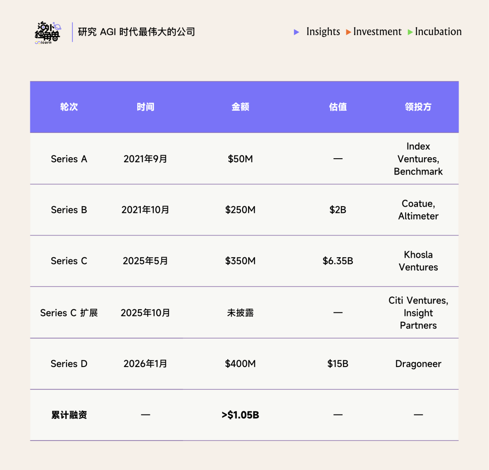

这一波投资人的热情可能源自 ClickHouse 在 2025 年完成的几个里程碑式的变化：

**1.** 显著的平台化 & TAM expansion，从实时 OLAP 杀进可观测性。

ClickHouse 的架构决策决定了它适合的 workload 是对 append-only event streams（高速写入的、几乎不删改的、时间序列的事件流）的聚合统计查询。围绕 LLM 的日志类数据正是这类数据。目前 ClickHouse 在 3 个市场拥有领导地位的开源产品：

1）实时 OLAP（TAM 40-50 亿美元，核心阵地）：数据产生后几秒内可查询、毫秒级返回结果的分析数据库。这是 ClickHouse 已经验证的基本盘和过去的主要用例。

2）可观测性（TAM ~ 200 亿美元，第二增长曲线）：log、trace、metric 等的统一追踪。ClickHouse 收购 HyperDX 后正式推出了 ClickStack，直接对标 Datadog/Splunk/Grafana 等产品。

3）AI 可观测性（TAM ~ 20 亿美元，新兴赛道）：追踪 LLM 应用的每一次 API 调用的 token 消耗、延迟。目前这个市场非常早期且碎片化，ClickHouse 在 26 年 1 月完成了对 Langfuse 的收购获得了作为开源玩家的领导者地位。

这三个市场的产品都使用 ClickHouse 作为底层的列式存储引擎。同时 ClickHouse 的这种平台化拓展使用了收购的策略，有 “底层引擎之上不断堆叠上层应用” 来垂直整合的平台化前景。

**2.** 领先的 AI Labs 转向 ClickHouse。

AI 推理日志的数据特征非常契合 ClickHouse。随着领先的 AI Labs 业务增长，每天的日志数据达到 PB 级，它们逐渐意识到原有的解决方案要么无法 scale，要么过于昂贵，开始将 ClickHouse 引入其 infra stack。Anthropic 在 Claude 3.5 发布后原有的 APM 系统崩溃，随后迁移到 ClickHouse，仅 3 人团队就管理了整个可观测性 Infra。OpenAI 在 25 年曾部分迁离了过于昂贵的 Datadog，ClickHouse 是它内部自建的可观测性方案的底层支撑。

**3.** 商业化明显加速，提价和获客都有明显加速信号。

ClickHouse ARR 从 24 年中的 1500 万美元增长至 2025 年底的 1.6 亿美元，18 个月完成了 10x 增长，其中付费客户数 3x，从 1000 提升至 3000+，ACV 扩张 3-4x。公司在 25 年 1 月对 ClickHouse cloud 完成了 30% 的提价。前 Atlassian CSO Kevin Egan 出任其 CRO，终结了 ClickHouse 无 SDR 完全靠 PLG 转化的时代，开始更系统化进行企业级销售。

**02.**

**ClickHouse 的产品**

目前 ClickHouse 有 3 条核心产品线：

**ClickHouse Cloud**

ClickHouse Cloud 是核心产品：把开源 ClickHouse 以云托管服务提供给客户，解决“海量数据的实时聚合分析”问题。三个层级满足从开发测试到大型企业的全场景需求：

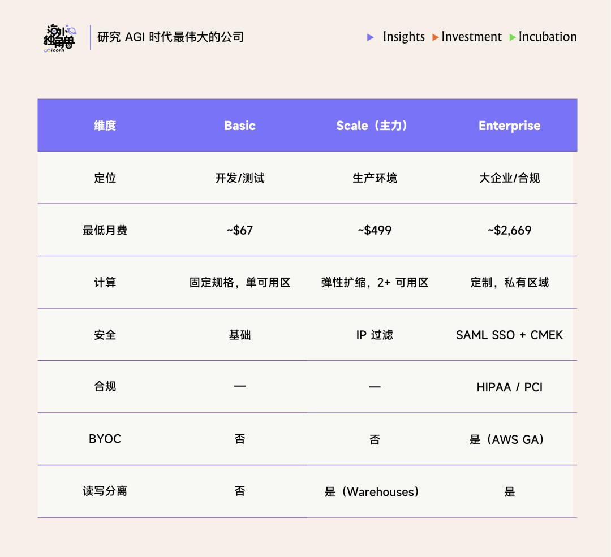

一个典型使用场景是：某 AI 公司每秒产生数十万条推理日志（包含 token 消耗、延迟、GPU 编号、模型版本等字段），这些数据通过 ClickPipes 实时写入 ClickHouse Cloud，工程师随即可以在仪表盘上看到 “过去 5 分钟 us-east-1 区域 Claude 3.5 模型的 P99 延迟”。从数据产生到可查询只有几秒延迟，查询本身在毫秒级返回。这种 “写入即可查、毫秒出结果” 的体验是 Snowflake/Databricks 在架构层面做不到的。

这个核心服务有两个配套产品：

**•** ETL/ELT 引擎 ClickPipes：一个全托管的连续数据摄入引擎，源自2024年收购的 PeerDB。支持以下数据流的 ingestion:

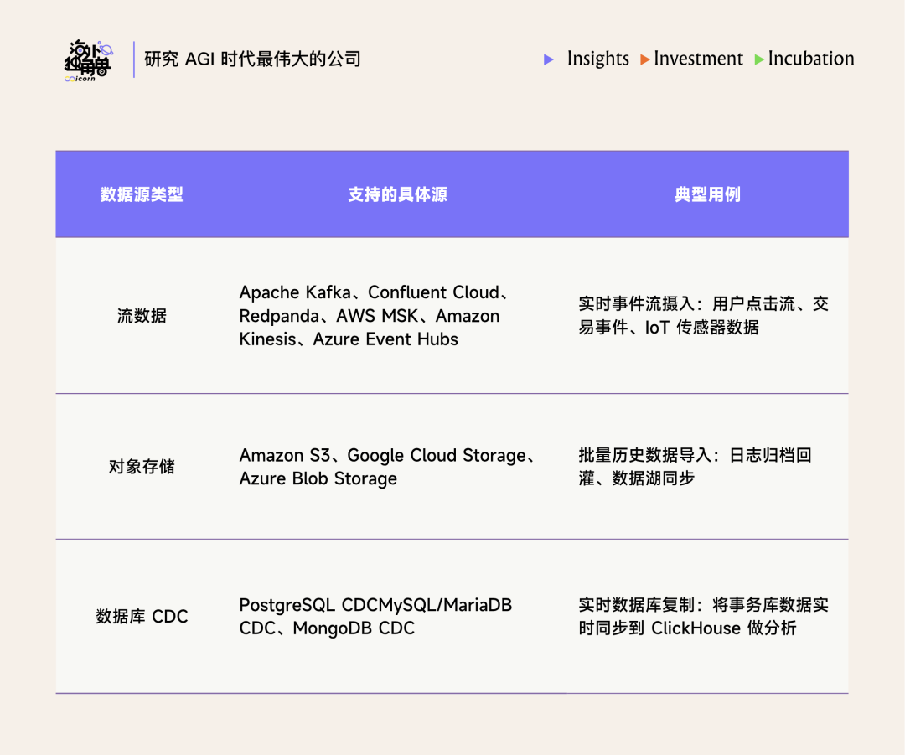

**•** OLTP 拓展 Postgres Service：2026 年 1 月与 D 轮融资同步官宣，与 Ubicloud 合作构建的企业级 Postgres 托管服务。当前处于 Private Preview（免费使用），正式定价未公布。

这让客户能在同一个 ClickHouse Cloud 账单和控制台下，同时拥有一个 OLTP 数据库（Postgres）和一个 OLAP 数据库（ClickHouse）。典型场景：一个 AI SaaS 公司用 Postgres 存储用户账户、订阅计划、API Key 等事务数据，用 ClickHouse 存储和分析 API 调用日志、token 消耗、延迟指标。以前这是两个完全独立的系统、两套运维、两张账单。现在在一个平台上搞定。拥有两个核心集成能力：

1）pg\_clickHouse 扩展，从 Postgres 直接查 ClickHouse。每个 Postgres 实例自带这个扩展，开发者可以在 Postgres 中直接用 SQL 查询 ClickHouse 的数据，无需修改应用代码。pg\_clickHouse 会自动将查询推送到 ClickHouse 执行（query pushdown）——TPC-H 基准测试中 22 个查询有 14 个被完全推送到 ClickHouse，性能提升超过 60 倍。这意味着开发者可以用 Postgres 作为统一查询入口，应用层代码只连 Postgres，但分析查询实际在 ClickHouse 上执行。

2）内置 CDC 实时复制，Postgres 数据自动同步到 ClickHouse。基于 ClickPipes/PeerDB 引擎，将 Postgres 的事务数据实时复制到 ClickHouse，复制延迟低至秒级。不需要用户自己搭 Debezium 或 Kafka Connect 之类的管道。

在开源的实时 OLAP 数据库解决方案中，ClickHouse 处于绝对领先位置：

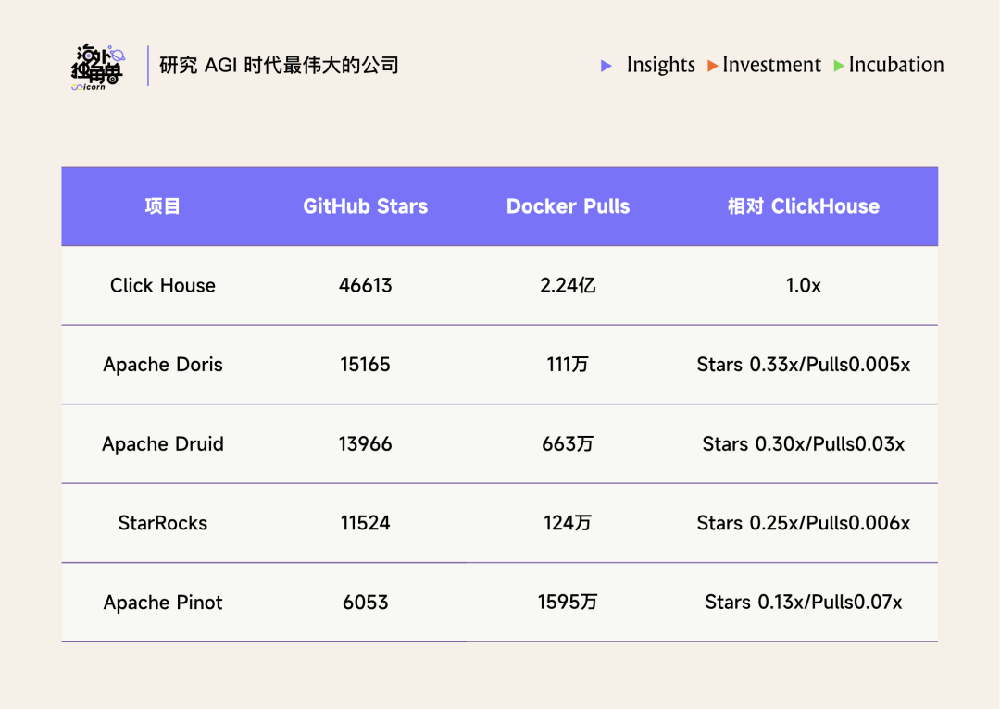

ClickHouse Cloud 的云端独占功能包括 SharedMergeTree、SharedCatalog、Lightweight UPDATEs、Serverless 架构等，都仅在 ClickHouse Cloud 可用，开源版本不包含。

**ClickStack**

ClickStack 是一个开源的、统一的可观测性平台，由三个组件组成：OpenTelemetry Collector（数据采集器）+ ClickHouse（存储引擎）+ HyperDX UI（前端界面）。2025 年收购 HyperDX 后推出，目前有自托管版（开源免费）和 Managed ClickStack（ClickHouse Cloud 上的托管服务，Beta 阶段）。

它有 4 大核心能力/use case：

**•**日志管理（Logs）：实时采集、存储、搜索所有应用和基础设施日志。工程师可以用 Lucene 风格的搜索语法快速过滤，如(level:error AND service:payment-api AND latency:>500ms)，也可以直接写 SQL 做复杂聚合分析（如 “过去1小时各微服务的错误率排名” ）。列式压缩让日志存储成本比 Elasticsearch/Splunk 低一个数量级，OpenTelemetry 格式的日志数据压缩率可达 90%，消除了因成本原因不得不采样或缩短保留期的问题，即使 PB 级数据也能全量保留。

**•** 分布式追踪（Traces）：跟踪一个用户请求从前端到后端微服务再到数据库的完整链路。比如一个电商下单请求经过 API Gateway → 订单服务 → 库存服务 → 支付服务 → 通知服务，ClickStack 记录每一跳的耗时、状态和元数据。工程师可以看到 “这个慢请求卡在了哪个服务的哪个方法上” ，而不是在几十个服务的日志里大海捞针。

**•** 指标监控（Metrics）：采集 CPU、内存、磁盘、网络等基础设施指标，以及自定义业务指标（如 QPS、订单转化率、token 消耗速率）。支持构建仪表盘、设置告警阈值。用简单的下拉菜单就能构建图表，无需学习 PromQL 之类的查询语言。

**•**会话回放（Session Replay）：录制用户在浏览器中的实际操作（点击、滚动、输入），当用户报告 bug 时，工程师可以回看用户当时的完整操作过程，并且这个会话回放自动关联到该用户操作期间产生的后端日志和追踪。

相对同样开源的 Grafana LGTM Stack，ClickStack 的最大优势是 cross-signal correlation 能力。在传统可观测性工具中，日志、追踪、指标通常存储在不同的后端（Grafana 的 Loki/Tempo/Mimir 各自独立），当工程师发现一个指标异常时，需要手动在三个系统之间切换、拼接时间戳来定位问题。ClickStack 因为所有数据共享同一个 ClickHouse 存储引擎，所以可以做到：点击一条错误日志 → 一键跳转到产生这条日志的完整分布式追踪链路 → 一键查看该时段相关服务的指标面板。工程师不需要在多个 Tab 之间来回切换，从 “发现异常” 到 “定位根因” 的路径缩短了一个数量级。

相比 Datadog，Clickstack 可以便宜 50% 以上。Datadog 定价围绕 host 数量和自定义 metrics 的数量，在 k8s 环境里月费膨胀非常快。ClickStack 定价围绕实际数据消耗（存储+计算），同时 ClickHouse 的列式压缩率能做到 90%，同等数据量下存储成本远低于 Elasticsearch/Splunk 的倒排索引存储。综合效果：同等监控负载下，ClickStack 成本约为 Datadog 的 30-50%、Splunk 的 15-20%。

目前 ClickStack 的核心短板主要是生态成熟度，特别是集成数量远落后于 Datadog，同时缺少 APM 等产品。ClickStack 还在 Beta 阶段，并且还需要补足 RBAC 和审计日志以提高合规性。

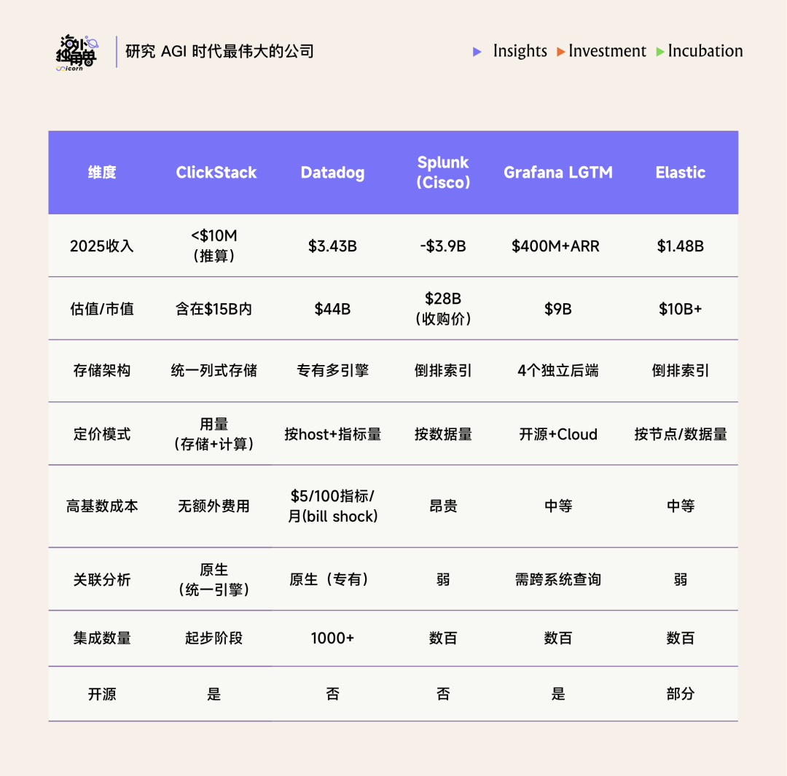

ClickHouse 被用在可观测性上的历史很久，比如专家访谈中 Nike 及 Cisco 在 ClickStack 之前都使用 ClickHouse 替代 Splunk 做 Infra 或网络安全的近实时监测。ClickStack 是对他们围绕 ClickHouse 构建的这些方案的更完整产品化的交付。

**Langfuse**

Langfuse 是 2026 年 1 月与 Series D 同步收购的开源 LLM 工程平台，MIT 许可证，覆盖从开发到生产的完整 LLM 应用生命周期。收购前已有 2000+ 付费客户、19 家 Fortune 50 客户、2 万+ GitHub Stars、2600 万+ SDK 月安装量。Langfuse 原本就建立在 ClickHouse 存储之上。

它拥有 6 大核心功能和用例：

**•** LLM tracing：追踪一个用户请求在你的系统中的完整链路：用户提问 → 检索相关文档（RAG）→ 构造 prompt → 调用 LLM → 后处理 → 返回结果。每一步的输入、输出、耗时、token 消耗都被记录。对于 Agent，Langfuse 用 Session 的概念追踪整个多步骤工作流。

**•** Cost tracking：自动计算每一次 LLM 调用的 token 消耗和费用，按模型、按用户、按功能模块、按时间段分维度统计。

**•** Prompt management：集中管理、版本控制、协作编辑所有 prompt 模板。每个 prompt 版本与生产中的 Trace 自动关联，可以直接看到这个 prompt 版本的线上表现（延迟、成本、质量评分）如何。

**•** LLM Playground：在 Langfuse 界面中直接测试 prompt 和模型配置，即时查看输出效果。

**•** Datasets：创建和管理测试集与基准集，用于评估 LLM 应用的持续改进、预部署测试和结构化实验。

**•** Eval：这是 Langfuse 最深的功能模块，也是它相对于竞品的核心差异化之一。支持四种评估方式的自由组合：

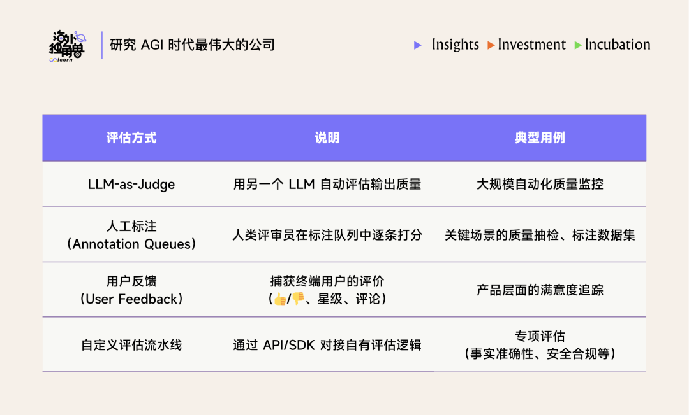

Langfuse 的差异化主要在于其 Eval 能力以及开源的路线。同时其产品体验在社区内口碑非常好。

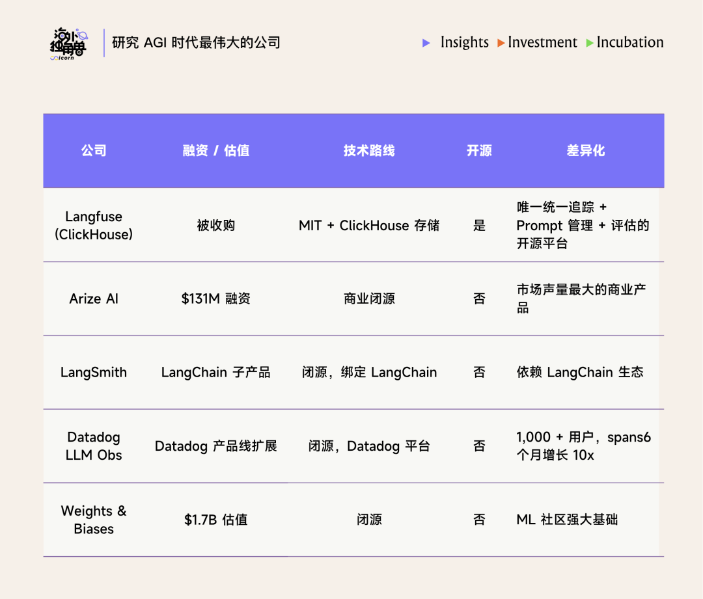

**03.**

**AI Tailwind？**

ClickHouse 本身不是所谓的 AI-native 公司，目前 AI 对它来说首先是一个业务上的顺风推动力：如上文，AI 推理日志是高度契合 ClickHouse 的数据类型，同时顶级 AI Labs 在生产环境大规模依赖 ClickHouse。同时，AI 数据量的增长是结构性的，主要体现在遥测数据的维度和难度的增大。

此外，从 2025 年下半年开始，ClickHouse 提出了 Agent-Facing Analytics 概念，基于 HyperDX、LibreChat、Langfuse 3 笔收购构建了完整的开源 Agentic Data Stack：

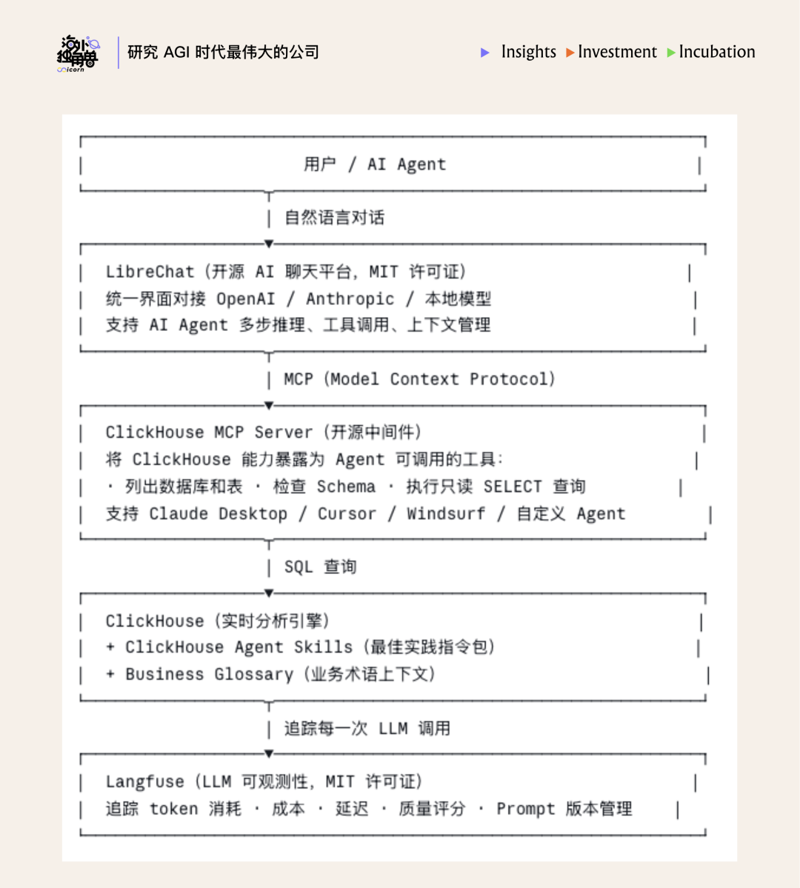

Agentic Data Stack 让 Agent 能代替人类完成 SQL 查询流程，即 Agent 通过 MCP 检查 Schema，借助 Business Glossary 理解业务语义，生成并执行 SQL，并最终将结果用自然语言返回给用户。

ClickHouse 自己用这套架构构建了 DWAINE（Data Warehouse AI Natural Expert），部署到内部数据仓库后：服务 250+ 内部用户，日均处理 200+ 条数据查询消息，接管了约 70% 的数据仓库查询请求，将分析师工作量减少 50-70%，截至 2025 年 10 月处理 3300万 LLM token。

在另一面，如果我们把 ClickHouse 放在二级市场软件的篮子里审视，有一系列可以 pushback 它作为 AI 受益者叙事的角度：

**•** ClickHouse 本身不做 AI，只是存储和查询 AI 产生的数据。ClickHouse 本身没有任何 AI/ML 能力，有还不错的向量搜索能力，但不做模型训练和推理。和 Datadog 的受益逻辑类似。它没法让客户“用 AI 做更多事”，只是帮客户更好地实时看到 AI 在做什么。

**•** Agentic Data Stack 的构建理念是 AI Agent 将代替人类用户进行 BI 操作，但目前和 Snowflake 等公司尝试转型没有哲学上的核心区别。

**•** Anthropic 和 OpenAI 等头部客户使用 ClickHouse 构建它们的内部解决方案时，ClickHouse 并没有销售其标准版的云端托管产品，需要跟客户共创解决方案，而且 OpenAI 大概率不付费。

ClickHouse 跟 Anthropic 的合作类似 BYOC 模式。二者合作部署的时间点是 2024 年，当时 ClickHouse Cloud 的 BYOC 还未 GA。

Anthropic 评估过三种方案：开源自部署（运维成本高，要自己管 re-sharding、replica 等）、ClickHouse Cloud 托管（有动态扩缩容和 blob storage 优势，但必须跑在 ClickHouse 的云上）。两者都不完全满足需求，因为 Anthropic 要求所有数据必须运行在自己的安全计算环境内。最终他们采取了混合方案：和 ClickHouse 团队合作，在 Anthropic 自己的基础设施内部署了一套定制的、air-gapped 的 ClickHouse Cloud 架构。这个方案是对 ClickHouse Cloud 的 air gapped 私有化定制部署。

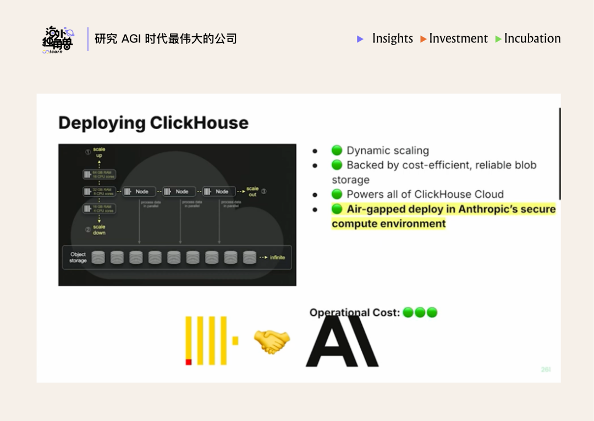

OpenAI 在其 blog 中提到选择 ClickHouse 的理由包括 “开源、无 vendor lock-in、可以自己进行代码调试” 。OpenAI 的数十个分片集群完全自己运维，大概率不是 ClickHouse Cloud 的客户。

**04.**

**ClickHouse 的 Go-To-Market**

**Traction**

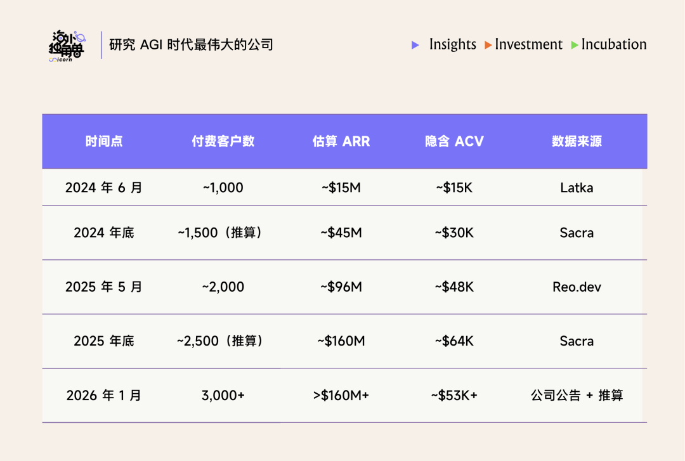

**Channel**

ClickHouse 在从纯 PLG 向 PLG + SLG 混合模式的转型中。在 2025 年之前，ClickHouse 没有 SDR，完全靠开源用户和 inbound 转化，获客成本极低。

目前它有 3 个核心的销售模式：

**•** Self-serve：自助注册 + 信用卡月付，开发者可以直接在网站上注册、创建数据库、开始使用，不需要和任何销售打交道。

**•** 大客户直销：大客户通常通过预购“ClickHouse Credits”（类似 Snowflake 的 capacity contract）来获得 15-40% 的折扣。这个渠道按客户数只占 20-30%，但贡献了 50%+ 的收入。2025 年 7 月 ClickHouse 招聘了 CRO Kevin Egan（曾任职于 Atlassian/Slack/Salesforce/Dropbox），正在搭建 enterprise sales 团队，这是从 1 亿美元 ARR 迈向 10 亿美元 ARR 的必经之路。

**•** 云 Marketplace（AWS/GCP/Azure）：客户可以直接通过 AWS、GCP 或 Azure 的 Marketplace 购买 ClickHouse Cloud，费用合并到云账单中。ClickHouse 目前在 AWS Marketplace 被归入 AI Agents and Tools 新品类。

从历史上看，在建立比较好的 SLG 的 practice 后，Infra 公司会迎来收入增长的爆发。MongoDB 在 1 亿美元 ARR 时引入 CRO，此后 6-7 年收入增长 19 倍。Datadog 在 3 亿美元 ARR 时建立企业销售团队，此后 5 年增长 8 倍。

**Usage-based 定价**

ClickHouse Cloud 只按照实际消耗的资源量收费。账单由以下几个维度组成：

**•** 计算（Compute）：这是最大的收入来源，估计占总收入的 65-75%。按 “计算单元 × 使用时长” 计费，计费粒度精确到分钟。Scale 层的计算单价约 0.69 美元/单元·小时（一个单元 = 24 GiB RAM + 6 vCPU）。对比 Snowflake 同等算力的 6.00 美元/小时，ClickHouse 便宜约 88%。服务在空闲时可以自动休眠，不收取计算费用。

**•** 存储（Storage）：估计占收入的 15-20%。按压缩后的数据量 × 月计费，Scale 层约 $47/TB·月。虽然表面单价是 Snowflake 的 2 倍（$47 vs $23），但 ClickHouse 的列式压缩率通常在 90-98%（Snowflake 约 50-75%），所以按原始数据量折算，ClickHouse 存储实际更便宜。1TB 原始数据在 ClickHouse 中可能只计费 20-100 GB。

**•** 数据传输（Egress）：估计占收入的 5-8%。2025 年 1 月之前免费，此后按 $115/TiB 收费。这是一个明确的锁定机制，一旦客户数据量达到 TB 级，迁出数据的传输费用变得不可忽视。

Snowflake 毛利在 70%+，ClickHouse 的综合毛利率可能略低（它的计算单价比 Snowflake 便宜很多），但 ClickHouse 用 C++ 原生开发、极致优化每一个计算周期，同样的查询任务消耗的底层云资源（VM、存储、网络）更少。目前 ClickHouse Cloud 处于第一波提价周期，25 年 1 月进行了约 30% 的综合提价并新增了 Egress 收费，25 年 7 月完成了老客户的过渡期，新定价已经全面生效。

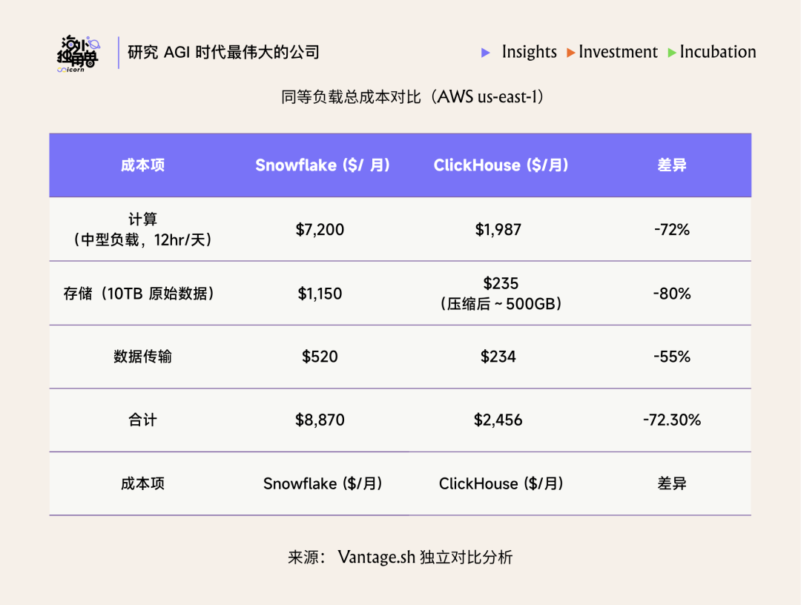

**05.**

**Enterprise Sentiment**

每一个数据库的架构决策都有自己的 trade off，从 15 个专家访谈的分析来看，ClickHouse 的优势主要集中在：

**•**实时OLAP性能碾压级领先 — 客户实测 5-20x 速度优势，单毫秒级扫描数十亿行。15位专家中共识度最高的维度(均值 +1.7)，Snowflake 等竞品方专家试图淡化但被客户定量数据压倒。

**•**成本优势构成采购决策第一驱动力 — Deutsche Bank 从 kdb 迁移后年费从 300 万美元降至 20 万美元；Nike 确认比 Splunk 便宜 5x+；Goldsky 存储成本 $47/TB/月远低于 Snowflake/BigQuery。对有工程能力的中大型组织吸引力极强。

**•**架构与现代数据范式结构性契合 — 追加写入、不可变事件流的设计与可观测性、金融时序、产品分析三大高增长场景天然匹配。这是结构性优势而非功能性优势(Vanco CEO 判断)。

**•**PB级可扩展性已被生产验证 — Goldsky 2PB、Walmart 40TB+、Deutsche Bank 20+年时序数据，共识度第二高(σ=0.67)。

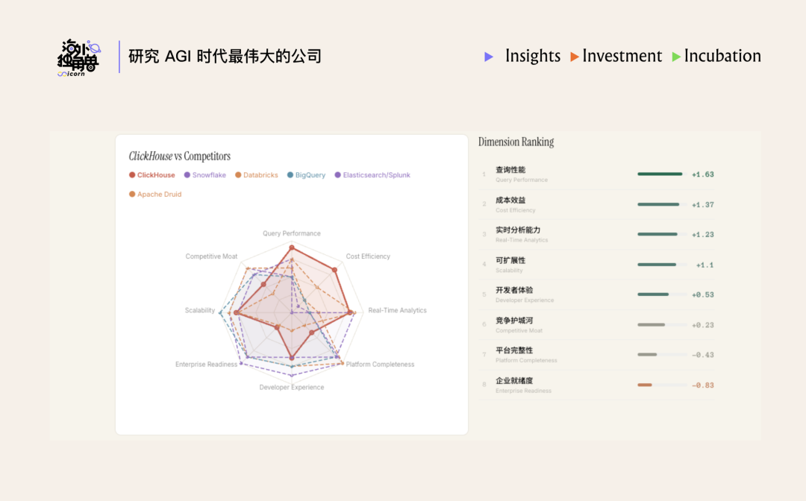

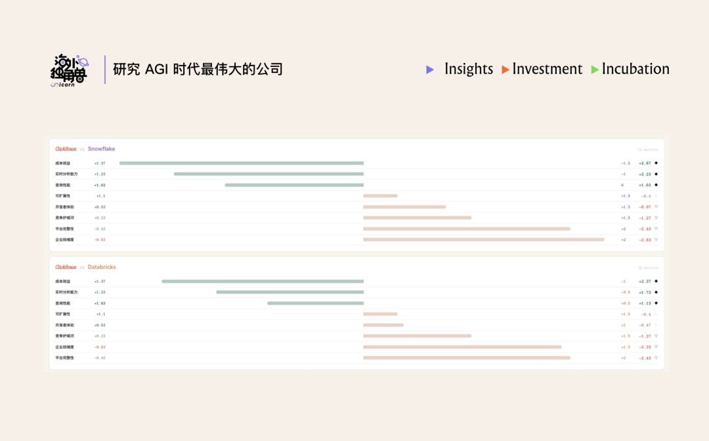

左右滑动查看完整图文

专家反馈的 ClickHouse 局限/劣势包括：

**•** 平台完整性缺失是估值天花板的决定性因素 — 无AI/ML、无ETL、无市场生态。如果保持专用工具定位，TAM上限可能仅为数据分析支出的 3-5%(Cisco VP估算)。ClickPipes 和 ClickStack 的 GTM 是关键观察点。

**•**企业就绪度是Cloud ARR增长的最大瓶颈 — Walmart明确表示Cloud版无法通过敏感数据安全审批(SSP)；客户支持人员流失严重、响应缓慢(Prefect)；RBAC/IAM/审计需客户自建(Nike)。大企业被迫停留在开源自托管。BYOC 已经推出，需要等待广泛 GA。

**•** 护城河正在被侵蚀 — Goldsky CTO警告核心优势正被 SingleStore、StarTree等快速复制，产品日趋可互换。最值得警惕的信号：即便最满意的客户也在密切关注竞品定价变化。

**•** 开发者体验两极化限制GTM天花板 — 深度工程师视为 “乐园” ，但企业/非技术用户认为门槛过高。bottoms-up模式天然排斥CIO级自上而下采购。

此外，从中小型企业 IT 决策者的反馈看，ClickHouse 还面临着一个结构性的挑战：

**•** ClickHouse 的性能非常强，但缺少自动扩缩容、存算分离最优实现、容灾等功能，因此自行管理和维护 ClickHouse 集群的难度实际上非常大。

**•** ClickHouse Cloud 或者 Managed ClickStack 很好地解决了以上问题，但类似 TiDB 面临的挑战，部分决策者因为 ClickHouse 和 Yandex 以及俄罗斯的关系而在 national security 层面对使用官方托管产品有疑虑。

Walmart 高级工程经理表示：“ClickHouse Cloud 永远无法通过我们的敏感数据安全审批（SSP），因为需要将数据转移到外部云”。 BYOC（Bring Your Own Cloud）模式理论上可以解决这个问题（数据留在客户自己的 AWS 账户），但 BYOC 目前仅在 Enterprise 层 AWS GA，GCP/Azure 尚未支持，且 BYOC 的运维复杂度更高、毛利率更低。

**06.**

**团队**

**•** Aaron Katz（CEO）：联合创始人，前 Elastic 和 Salesforce 高管。Splunk 背景对 ClickHouse 的可观测性战略至关重要，他亲历了 Elastic 如何从开源搜索引擎成长为百亿美元级别的可观测平台。ClickStack 的直接对标也是 ELK Stack。这个经历可能正是 ClickStack 战略的底层逻辑，Katz 试图复制 Elastic 的路径，但用一个成本结构低一个数量级的列式引擎。

**•** Alexey Milovidov（CTO / 创始人）：ClickHouse 的原始创造者，2009年在 Yandex 开始开发，是全球列式数据库领域最顶尖的工程师之一。GitHub 提交历史显示他至今仍是最活跃的核心贡献者。技术型创始人留任 CTO 且保持高强度贡献，对一个核心引擎驱动的公司来说是极强的正信号。

**•** Kevin Egan（CRO，2025年7月加入）：前 Atlassian CSO / Slack VP Sales / Dropbox / Salesforce。他的每一段履历都是 PLG 到 Enterprise 转型的教科书案例：Atlassian 在他任内收入从 20 亿美元增长至 50 亿美元，核心就是在保持自助增长引擎的同时叠加 Enterprise 销售。Slack 的经历则验证了他在 UBP 模式下推动大客户扩张的能力。

**07.**

**估值水平**

按照 150 亿美元和 1.6 亿美元 ARR，ClickHouse 当前对应 94x multiple。如果今年能赶上 Grafana 的 25 年 ARR，并且保持高增速，这个估值可以在 28 年回归到 11x 的水平：

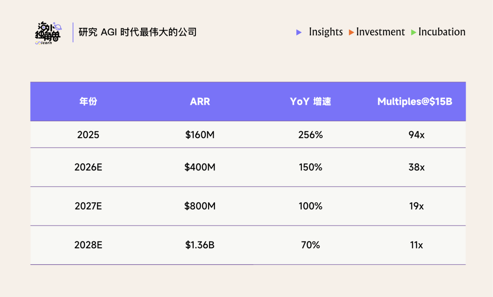

作为对比，一级市场里 Grafana 25 年 9 月完成了 4 亿美元 ARR，90 亿美元估值对应 22.5x。Databricks 的 54 亿美元 ARR 和 1340 亿美元估值对应 24x。二级市场 Snowflake 和 Datadog 等公司在 8-15x 区间。

**08.**

**Key Takes**

**•** 作为开源数据引擎的 ClickHouse 性能快、成本低的优势突出，非常适合 AI 时代的分析和可观测性用例。

**•** 在 Databricks 之外,ClickHouse 是布局 AI 时代数据基础设施平台化故事最完整的玩家之一，主战场在 Mid-market 和早期 Enterprise，目前主要用例还集中在分析及可观测性，token 消耗的增长带动 AI 推理在这两方面的增长。

**•** ClickHouse 作为一个一级市场的竞争者，是 Snowflake 和 Databricks 向实时 OLAP 市场拓展份额的最大障碍，也是 Datadog、Splunk、Elastic 等可观测性玩家的新晋威胁。

**•** 完全开源以及 Yandex 的背景限制了 ClickHouse 公司的商业化进展，虽然显著扩展了 TAM，但它在 OLAP、可观测性、AI 可观测性市场的绝对市场份额都不高。

**•** 目前不管是 Snowflake 还是 ClickHouse 等玩家都非常重视 Agent-Facing Analytics，但主要还是在完成让单个 Agent 代替人类分析师写 SQL 的需求，可以持续观察后续 Agent 更深度取代人类行为后 Analytics 的需求变化。

**09.**

**附录**

**ClickHouse 的技术特点**

ClickHouse 这个名词在大多数人的心智中不是一家公司，而是一个开源的列式实时分析分布式数据库，使用标准 SQL 接口，支持分布式部署，可以支撑每天 PB 级的数据。下面主要介绍 ClickHouse 作为一个开源数据库的核心技术设计和使用场景。

**ClickHouse 的核心任务类型：实时分析**

我们可以把 OLAP 分为离线和实时两大阵营，分别对应不同的技术指标要求和业务需求：

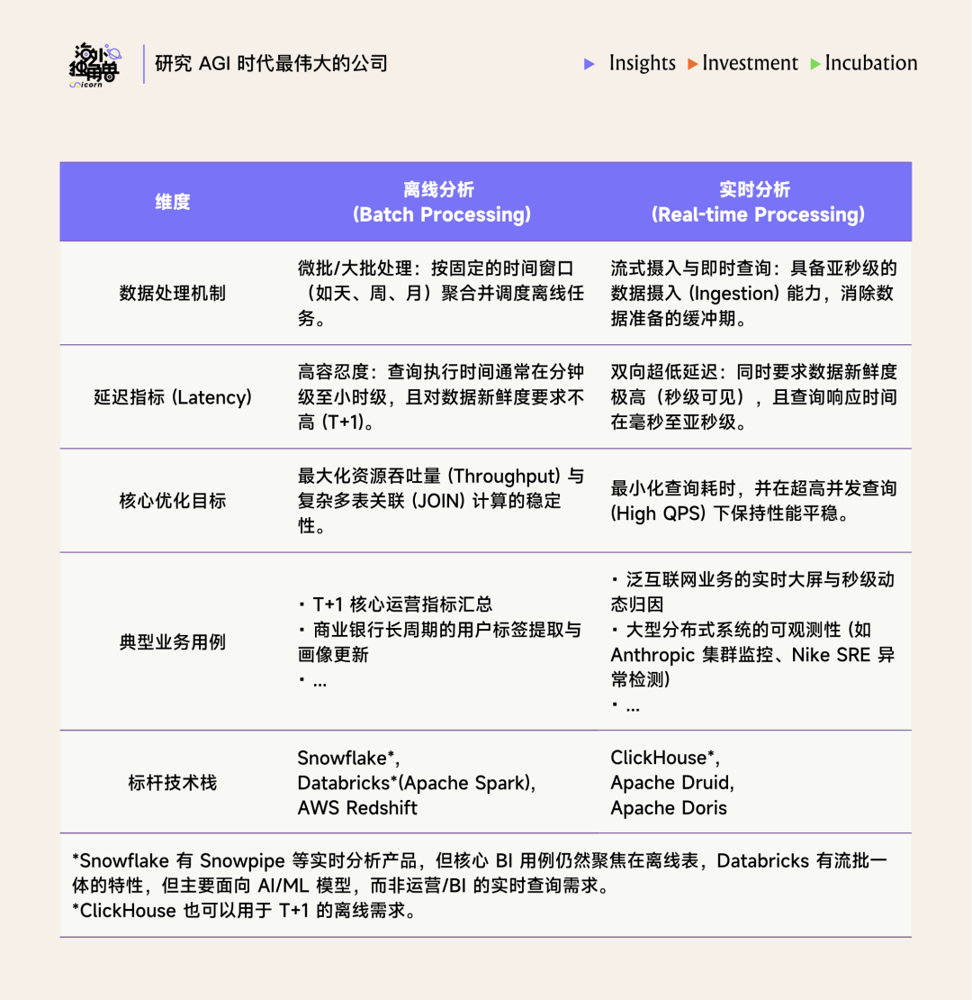

这两类 OLAP 任务对数据库要求有根本性差异，实时分析要求系统能够同时做到：

1）告诉接收新数据写入；

2）对刚写入的数据立刻可查询。附录中 15 位专家对 ClickHouse 的最强共识就是它的查询性能（单毫秒级扫描数十亿行数据）。

**ClickHouse 的技术设计：列式存储 + 向量化 + MergeTree**

根据不同专家的反馈，ClickHouse 在实时分析查询上比 Snowflake 快 5-13 倍、比 Elasticsearch 快 5-19 倍，成本低一个数量级。ClickHouse 在实时分析上的优势来源于它的技术设计：

**1.** 列式存储

传统数据库（MySQL、PostgreSQL）按行存储，一行数据的所有字段紧挨着存在磁盘上。当你想回答“一亿个用户的平均消费金额是多少”时，行式存储必须把每一行的所有字段都读出来，但其实你只需要“消费金额”这一列。如果一张表有 100 列，你读取了 100 倍于实际需要的数据。ClickHouse 是列式存储，同一列的数据紧挨着存放。查询只涉及 3 列时，它只读取 3% 的数据量。同时，同一列数据类型相同、相邻值往往相似，压缩效果极好。ClickHouse 的典型压缩率在 10:1 到 20:1，一个 1TB 的原始数据集压缩后可能只占 50-100GB（对比 Elasticsearch 的 1.5:1）。这让 ClickHouse 非常适合多列的大宽表，规避了 MySQL 典型的拆表和 JOIN。

**2.** 向量化执行

大多数数据库按单行为单位处理数据。ClickHouse 把数据分成块（通常每块 8192 行），对整个块同时执行操作，充分利用现代 CPU 的 SIMD 指令集。通常数据引擎在设计时会列式存储和向量化执行二选一，ClickHouse 是较早同时实现列式存储和向量化执行的开源数据库，这种组合后来成为现代分析数据库的标配。

**3.** MergeTree 引擎

ClickHouse 的核心存储引擎设计哲学是：数据写入后很少修改或删除，主要是不断追加新数据。每次写入时数据被组织成一个“小片段”快速落盘，后台线程再异步合并。这让写入时效率极高，缺点是删和改相对麻烦。

除了这 3 个特点之外，ClickHouse 开源维护团队和生态开发者的效率及工程执行力非常强，不断让 ClickHouse 分叉再分叉，为每个具体场景的数据类型、基数高低等等提供最契合的实现。ClickHouse 本身演进速度非常快，各种 fork（比如字节做了 ByConity 和 ByteHouse、TiDB 有 TiFlash 等）很难保持相应的工程速度。

上述技术决策让 ClickHouse 在 “大规模、只追加、实时聚合查询” 这个甜点区几乎无敌，但天然不适合频繁的单行删改、OLTP 事务性操作、小数据量的简单查询。同时这种只追加的特点跟可观测性数据（append-only 事件流）非常契合，因此 ClickHouse 在 OLAP 之外也越来越被视作一个可观测性平台。

**ClickHouse 的用例：从互联网到 AI**

ClickHouse 诞生于俄罗斯最大的搜索引擎 Yandex，最初就是为网站行为分析设计的，需要对每天数十亿次用户点击、搜索、页面浏览的行为实时分析。

这类 workload 最先爆发就是在互联网行业，中国也是 ClickHouse 最大的使用地之一，字节到 22 年已经开始维护着国内最大的 ClickHouse 集群，后续做了大量 fork 和二次开发。它的用例从用户行为的 T+1 离线分析开始，后续逐渐支持实时的 BI 需求、AB Test 的实时反馈需求、广告投放的实时效果监测等需求。如果能够内部从工程上解决一致性问题，ClickHouse 也可以被用到需要低延迟的策略性产品需求里，比如发券判定等。

理论上只要是“大规模、只追加、实时聚合查询”特点的需求，都适合 ClickHouse 来做，比如可观测性的日志数据、金融时序输入、IOT 传感器数据等。在用户行为分析之外，另一个明显在增长的 ClickHouse 场景是可观测性和基础设施监控。比如Nike 的可观测平台总监透露他们用 ClickHouse 替代 Splunk 做近实时基础设施监控，Splunk 年费数千万美元，ClickHouse 便宜 5 倍以上。Cisco 的数据分析/AI VP 用它做网络安全威胁检测。

AI 时代新增了大量的结构化日志，每一次推理请求理论上都有 token 消耗量、模型版本、推理延迟、GPU 集群编号、安全过滤结果、成本归因等几十个字段的日志。所以 AI 生态内的不同公司也开始使用 ClickHouse。

**ClickHouse 性能 Benchmark**

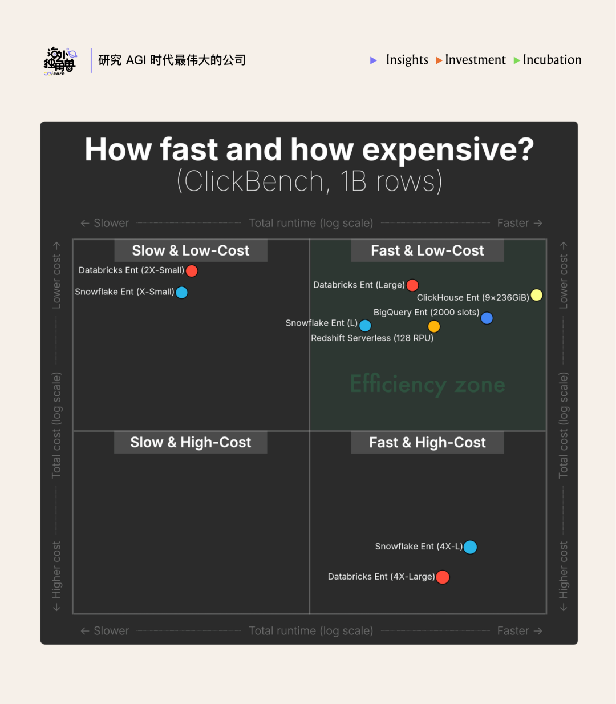

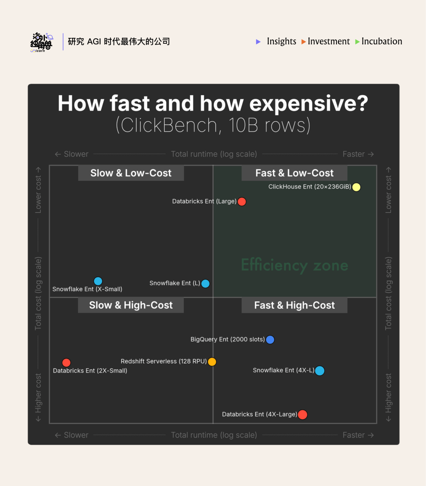

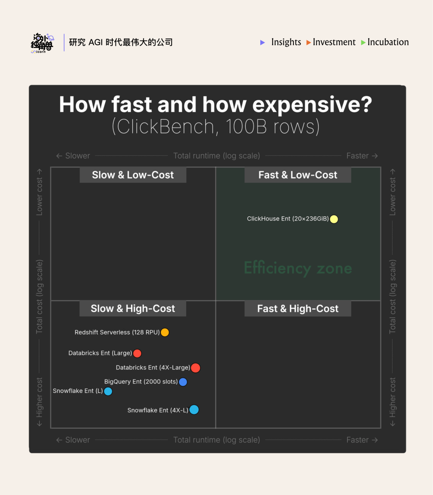

左右滑动查看完整图文

排版：夏悦涵

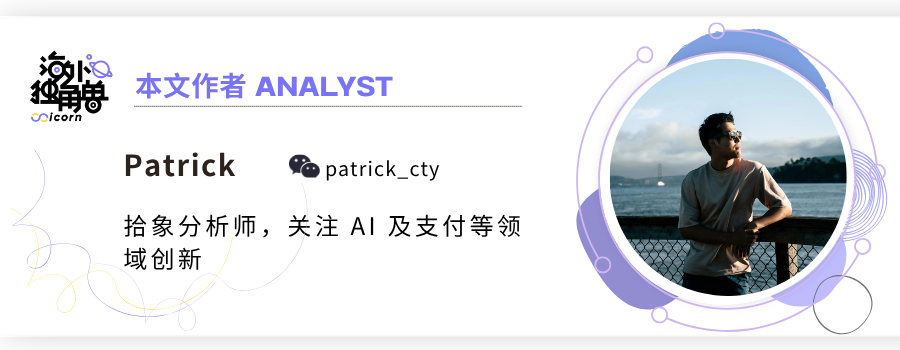

延伸阅读

[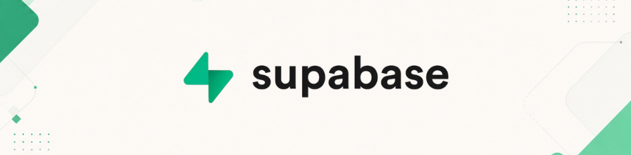](https://mp.weixin.qq.com/s?__biz=Mzg2OTY0MDk0NQ==&mid=2247523861&idx=1&sn=3b173d0c7b5c067ccde0cb439502426d&scene=21#wechat_redirect)

Supabase：百亿美元估值，vibe coding 的默认后端？

[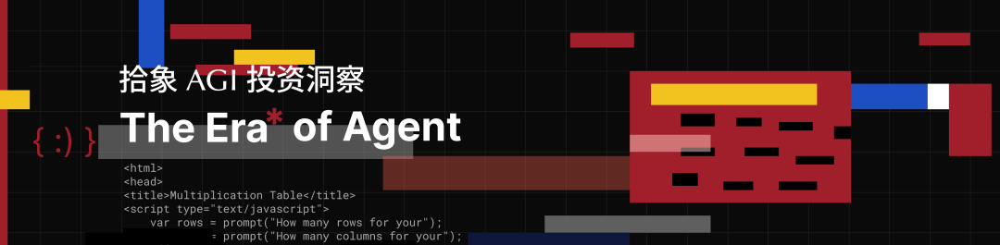](https://mp.weixin.qq.com/s?__biz=Mzg2OTY0MDk0NQ==&mid=2247523818&idx=1&sn=1d326b421640b980a3ea5cd1aed573b7&scene=21#wechat_redirect)

The Era of Agent：拾象 AGI 投资洞察

深度讨论新一轮模型发布：当智能进入月更时代 | Best Ideas

[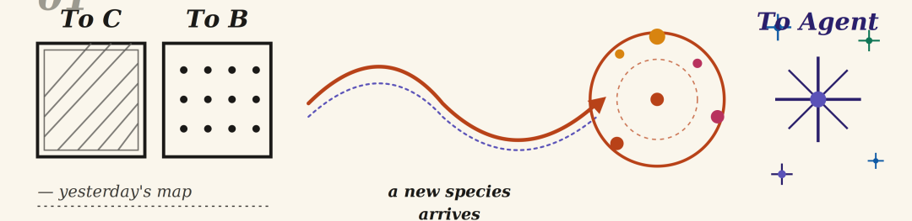](https://mp.weixin.qq.com/s?__biz=Mzg2OTY0MDk0NQ==&mid=2247523739&idx=1&sn=5489fa80a4602d5960b71a4bdea41241&scene=21#wechat_redirect)

Agent 时代启示录: 当 Agent 作为新物种加入经济系统

[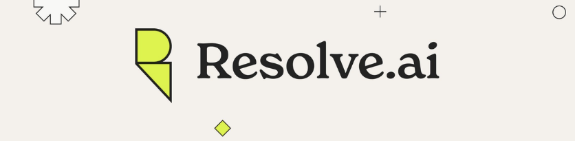](https://mp.weixin.qq.com/s?__biz=Mzg2OTY0MDk0NQ==&mid=2247523704&idx=1&sn=1f7fa8ee26264d9b8d5644089e53acb8&scene=21#wechat_redirect)

Resolve AI：为什么 AI SRE 领域有望诞生下一代 Datadog

