

作者：Jon Ma（Artemis 联合创始人、前 Insight Partners 投资人）

编译：Haozhen

今年 4 月，有买家给 Anthropic 开出约 6000 亿美元的估值，到了 8 月，部分投资人预计，Anthropic 上市时的估值可能达到 2 万亿美元甚至更高。事实上，要支撑这样的估值，Anthropic 需要在未来几年持续保持高速增长，但 OpenAI 的追赶给这一预期再次增加了不确定性。

⁠

就在上周，OpenAI 推出了 Astra，效果非常惊艳，不少开发者开始重新考虑要不要从 Claude Code 转向 Codex，这也让市场再次追问：**如果竞争对手的一次模型更新就能吸引用户离开，Anthropic 到底要靠什么维持长期增长？**

⁠

我们认为，即使竞争加剧，[Anthropic 的产品 taste 和组织凝聚力](https://mp.weixin.qq.com/s?__biz=Mzg2OTY0MDk0NQ%3D%3D&mid=2247523972&idx=1&sn=bf2c11ae0f5c283b9117a003a44fa784&scene=21&lang=zh_CN&poc_token=HFfun2qjOTdXacLiBvrTkOBUnHrfz-7zclLvX33k#wechat_redirect)%E4%BE%9D%E7%84%B6%E9%A2%86%E5%85%88%EF%BC%8C%E6%88%91%E4%BB%AC%E4%B9%9F%E7%9C%8B%E5%A5%BD [Claude tag](https://mp.weixin.qq.com/s?__biz=Mzg2OTY0MDk0NQ%3D%3D&mid=2247526551&idx=1&sn=0f5c4f88fcb6d5ccf7ddde93575049e4&scene=21&lang=zh_CN&poc_token=HFrun2qjCqGZLZoGKRyuC_NZpnpuvvdhYaSOgdlx#wechat_redirect) 的潜力，以及公司在 AI for Science 领域的投入，但这些机会能带来多少收入，除了模型能力之外，还取决于 Anthropic 能否接入企业的 context，并通过渠道和产品生态留住客户。

⁠

而投资数据平台 Artemis 联合创始人、前 Insight Partners 投资人 Jon Ma 对这个问题给出了更乐观的预测。我们编译了他的最新文章 Anthropic 2030：在他看来，Anthropic 在 2 万亿美元估值下仍然值得买入，公司 2030 年 ARR 能达到 1 万亿美元。长期来看，Anthropic 就是 AI 时代的 AWS，有机会成为全球第一家估值达到 10 万亿美元的公司。

|  |  |  |
| --- | --- | --- |
| ⁠ | / | ⁠ |

01.

## Anthropic 会成为全球第一家估值达到 10 万亿美元的公司

⁠

Anthropic 会成为全球第一家估值达到 10 万亿美元的公司，因为企业对它的 frontier models 和整套产品有着旺盛的需求。下图是 Artemis 结合内部估算和 SemiAnalysis 等第三方研究搭建的财务模型。

⁠

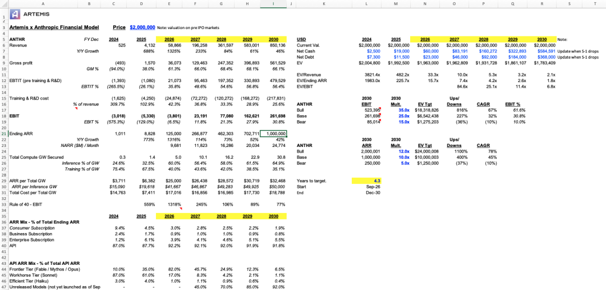

⁠

•从 AI 支出看，开源模型还没有对 Anthropic 构成实质性威胁：虽然 Artemis 已经把一部分 token 用量转向开源模型，但 AI 预算仍有 97% 花在 Anthropic 上。

⁠

•全球使用 agent 的企业还不到 1%，agent 的普及仍处在 S 形增长曲线的极早期。对 token 的需求将呈指数级增长。

⁠

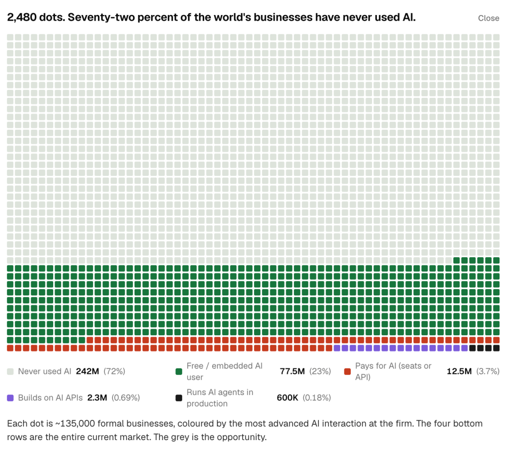

⁠

•算力限制会得到解决：Anthropic 可能通过 IPO 筹集超过 1000 亿美元的净资金，创下 IPO 募资规模的新纪录。而且公司还拥有一位能力很强的 CFO，就是曾在 Blackstone 任职的 Krishna Rao。有了充足的资金和这位 CFO 的帮助，Anthropic 到 2030 年可能能锁定超过 30 GW 的算力。

⁠

因此，在 2 万亿美元估值下，Artemis 明确看多 Anthropic。但考虑到开源模型的威胁、OpenAI 的模型逐渐追上，以及算力成本上升等风险，估值超过 3 万亿美元后是否仍值得买入，就不那么确定了。

⁠

⁠

02.

## Thesis：Anthropic 就是 AI 时代的 AWS

⁠

2015 年，很多人并不看好 AWS。在他们看来，AWS 是 Amazon 内部一个严重亏损的成本中心，提供的产品就像电力一样，没有多少差异。而且，当时人们还不确定云计算市场有多大，也担心 Google 和 Microsoft 等竞争对手会压低 AWS 的价格。

⁠

到了 2026 年，Amazon 已经是云计算市场公认的赢家。AWS 的业务早已超出最初的 S3，凭借一站式产品组合、规模优势和开发者生态，建立了很强的竞争力。

⁠

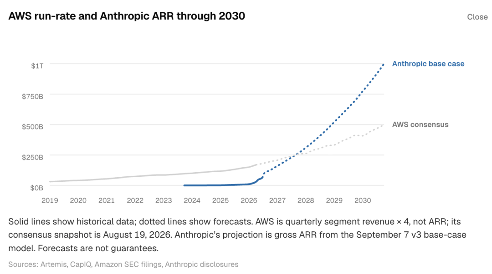

⁠

今年，Anthropic 也面临着类似的质疑：虽然公司已经筹集并花费了数十亿美元，但随着开源模型的发展，公司的前沿模型仍可能会失去差异化优势。

⁠

但在 Artemis 看来，Anthropic 凭借自身优秀的团队，还是可以持续提升模型能力，同时能开发出一整套让企业客户高度依赖的一站式 AI 产品，全球各行各业的企业都能用这套产品轻松搭建、扩展和维护 AI 系统，这个产品将会包括用于药物发现等特定领域的前沿模型，也包括保障 AI 安全、满足合规要求、优化性能的工具等。

⁠

最终，Anthropic 会像 AWS 一样，让企业客户难以离开自己的平台，并逐步把毛利率提高到接近 70%。Artemis 预计，到 2027 年，Anthropic 的 ARR 就会超过 AWS 的年化收入。

⁠

⁠

03.

## Anthropic 的业务本质是什么？

⁠

判断 Anthropic 的业务，核心要看它能否做好三件事：

⁠

1.招到优秀的 researcher 来开发前沿模型；

⁠

2.获取算力，并把成本控制在 10-15 美元/MW；

⁠

3.通过 API，能以较高的价格销售 token，比如让每 MW 算力带来 5000 万美元 ARR。

⁠

对应到具体指标，我们可以关注以下几个方面：

⁠

•需求：Artemis 估算，Anthropic 每月净新增 ARR 已达到 100 亿 -150 亿美元，虽然 token 价格在下降，但 token 用量仍在增长，企业对前沿模型和部署 agent 的需求已经有了较高的确定性。

⁠

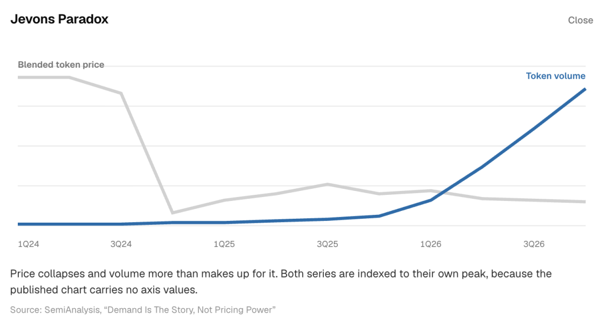

⁠

•供给：据报道，为了满足到 2030 年的算力需求，Anthropic 已经锁定了 15-16 GW 算力。但要支撑 1 万亿美元 ARR，公司至少需要 20 GW 训练算力。Artemis 认为，到 2030 年，Anthropic 可以达到这个算力规模。相比之下，到 2030 年，OpenAI 计划锁定至少 30 GW 的总算力。

⁠

•毛利率：每 MW 算力带来的 ARR 与对应算力成本之间的差额，决定了 Anthropic 长期的盈利能力，也决定了这是不是一门好生意。

⁠

另外，还有两点需要关注：

⁠

•Anthropic 本质上做的是面向企业的 API 业务，公司 90% 的 ARR 来自 API，个人订阅的贡献很小。如果要达到 10 万亿美元估值，Anthropic 需要把模型直接卖给企业，也需要通过 AWS Bedrock、Gemini Enterprise Agent Platform 和 Microsoft Foundry 等平台销售。

⁠

•评估 ARR 时，要看净额。投资者给 Anthropic 估值时，会先从收入中扣除 AWS、Gemini 和 Microsoft 收取的 15%-20% 分成。此外，他们还会剔除两类客户带来的收入：Meta，以及用 Anthropic 模型做蒸馏的中国 AI labs。

⁠

⁠

04.

## Upside：如果进展顺利，Anthropic 会怎样？

⁠

按照 Artemis 的预测，到 2030 年，Anthropic 能锁定至少 30.8 GW 算力，可以支撑 1 万亿美元 ARR。

⁠

假设每 MW 算力的总成本为 1800 美元（注：英文原文为“每 MW 算力总成本为 18 美元”，结合上下文推测应是“1800 万美元”），每 MW 推理算力能带来 5000 万美元 ARR，那么在 Anthropic 业务进入稳定阶段后，毛利率能达到 66%，EBIT 能达到 30%，训练和研发的总支出会降到收入的 25% 左右。

⁠

在这种情况下，Anthropic 会有非常可观的利润。而且随着 agent 在全球超过 3 亿家企业中不断普及，公司还会继续快速增长。

⁠

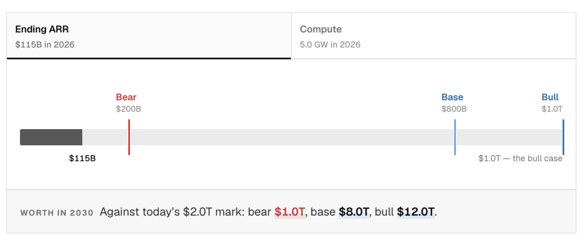

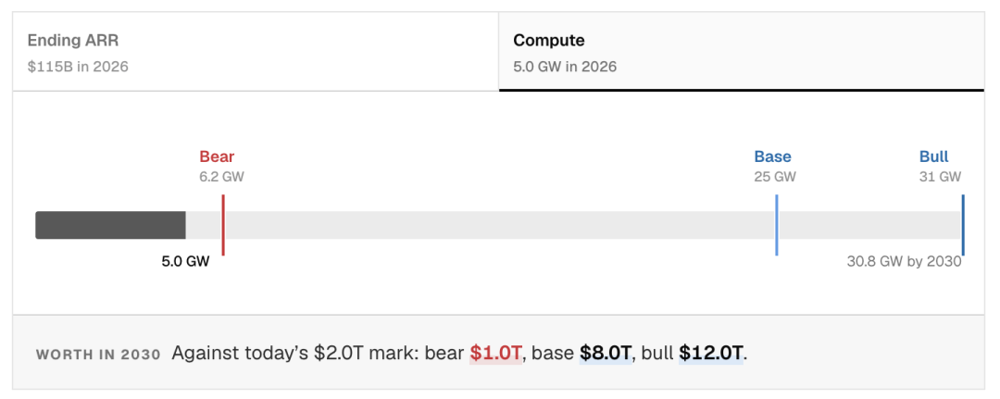

左右滑动查看更多图表

⁠

⁠

05.

## Downside：Anthropic 未来可能会出现哪些问题？

⁠

Artemis 也列出了 Anthropic 存在的风险，并按每项风险发生的可能性从高到低排序：

⁠

•高风险：Codex 和 OpenAI Astra 会抢走 Anthropic 的市场份额

⁠

Artemis 上周末试用了 Astra 和 Fable 后发现，OpenAI 和 Anthropic 这两家的差距已经明显缩小，客户可能转向 OpenAI，在 Artemis 团队里，就已经有工程师开始从 Claude Code 转向 Codex。下面这几个用户反馈也支持了这个观察。

⁠

Artemis 区块链数据负责人：“我最近一直在用 Codex，我喜欢它和我沟通的方式。有些人会把 Claude Code 和 Codex 搭配着用，让 Claude Code 做计划，再让 Codex 执行。但对我来说，两者可以互相替代，我现在只用 Codex。以前我经常在终端里用 Claude Code，现在更喜欢用 ChatGPT app 里的 Codex。”

⁠

Artemis 金融科技分析师：“OpenAI 的 Codex 真的很好用，一看就知道是为编程设计的。通过 GUI，用户能更直观地看到 agent 正在做什么，这一点比早期 Claude Code 的 CLI 好得多。Claude Code 作为第一代 CLI AI coding 工具，已经做得很好了，但我觉得下一代工具会是 GUI 应用。”

⁠

有位产品经理在一家估值 30 亿美元的公司工作，一直很推崇 Claude Code 和 Claude Harness。这个周末，他说：“我得说，Astra 实在太厉害了。”

⁠

•高风险：不同模型之间的切换成本很低

⁠

2026 年 Q2，Anthropic 总收入的 25% 是来自 AWS Bedrock、Gemini Enterprise Agent Platform 等第三方平台。企业通过 AWS Bedrock 调用 Anthropic 的 API 时，很容易改用 OpenAI 的 Astra 或别的开源模型。因此，如果 Anthropic 的模型不是 SOTA，公司就会面临困境：企业很容易换用别家的模型，Anthropic 也可能因此流失大量收入。

⁠

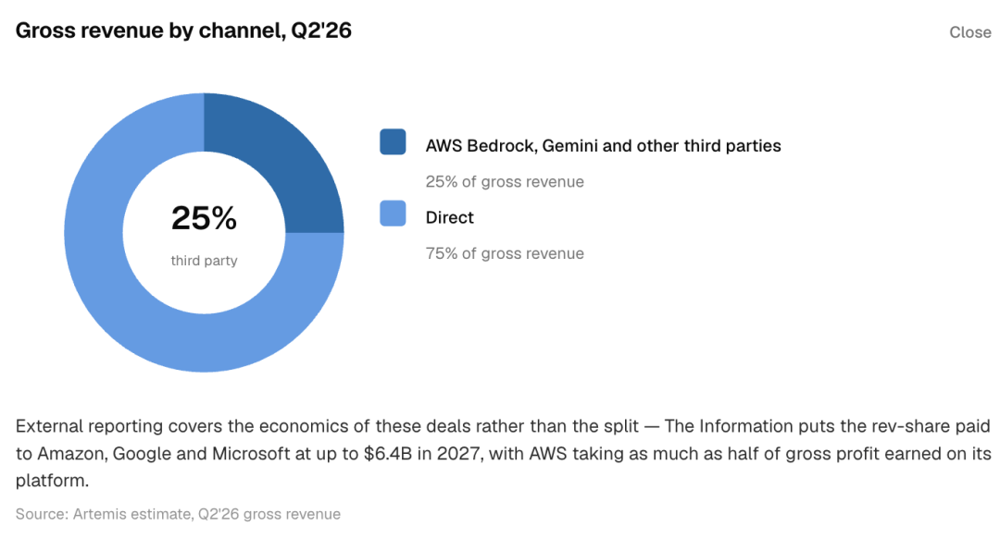

⁠

•中风险：Grokbot 和 Instinct 这类 agent 不依赖 Anthropic 的模型

⁠

虽然 Grokbot 使用的是 xAI 的模型，但也能与 Claude Cowork 等竞争。如果 Instinct 等 agent 和新出现的 AI 应用也选择开源模型或其他公司的前沿模型，Anthropic 就可能需要向应用层拓展，可能需要收购现成的 harness 或应用，也可能被迫自己开发新产品，就像之前推出 Claude Code、Claude Design 和 Claude Cowork 一样。

⁠

•低风险：Anthropic 拿不到足够的算力

⁠

Anthropic 已经锁定了接近 15 GW 算力，但要支撑 1 万亿美元 ARR，还需要再拿到 15 GW。如果 IPO 能筹集超过 1000 亿美元，公司就能获得购买算力所需的资金。但算力供应商与 Anthropic 的关系也比较复杂：Amazon、NVIDIA、Google 和 SpaceX 同时是 Anthropic 的供应商、股东和竞争对手（Amazon 有 Titan，SpaceX 有 Grokbot，NVIDIA 也在借助 Hugging Face 向上层软件业务拓展）。

⁠

•低风险：Anthropic 不再推出前沿模型

⁠

如果模型研究遇到技术瓶颈，或者 researcher 通过 IPO 赚到足够多的钱后不再像以前那样投入，Anthropic 就可能会停止推出前沿模型。

⁠

目前 Anthropic 的各项激励都让 researcher 有动力继续工作，但随着公司估值上涨，他们持有的股权奖励也会大幅增值：在公司估值为 1000 亿 -2000 亿美元时，一笔股权奖励价值 500 万 -1000 万美元，等公司估值达到 3 万亿美元，这笔奖励就能值上亿美元。当 researcher 持有的股权奖励价值 1.5 亿 -3 亿美元时，他们还会有同样的工作动力吗？

⁠

⁠

06.

## Anthropic 是不是值 2 万亿？

⁠

总的来说，与高增长的软件公司和 AI 公司相比，无论是用 EV/ARR 还是 EV/NTM Revenue 衡量，Anthropic 目前 2 万亿美元的估值都偏低，即使估值达到 3 万亿美元，也不算过高。

⁠

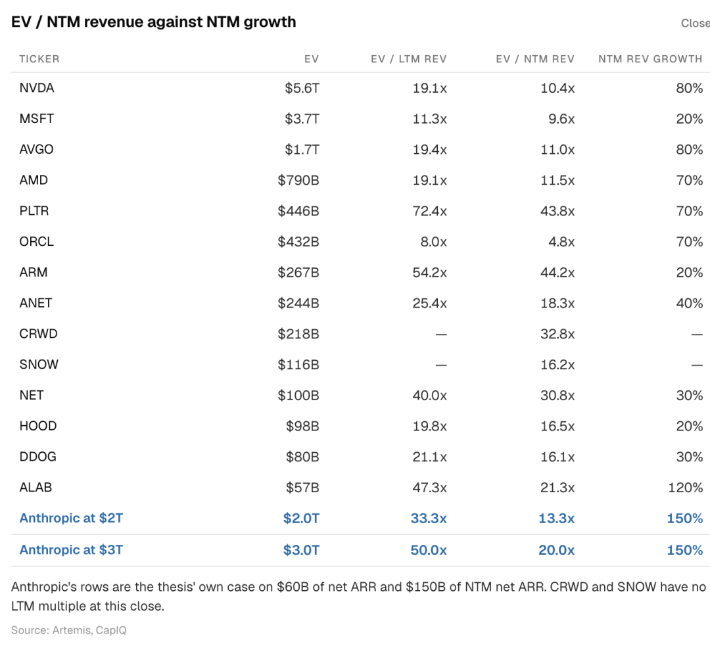

⁠

Artemis 预计，在 10 月中下旬，Anthropic 会以 2 万亿美元估值上市，散户和机构投资者的买入会推动估值上涨到 3 万亿 -4 万亿美元。

⁠

即便如此，Anthropic 仍可能值得买入。

⁠

•据报道，Anthropic 在今年 7 月净 ARR 已达到 650 亿美元（15× YoY），Artemis 预计，到 9 月底，ARR 会达到 900 亿美元（15× YoY）。这样的增长速度是非常罕见的。

⁠

•Artemis 预计，到 2026 年底，Anthropic 的 ARR 会达到 1250 亿美元，到 2027 年底，ARR 会达到 2750 亿美元。相比之下，SemiAnalysis 对 Anthropic 在 2027 年 ARR 的预测是 3000 亿美元，比 Artemis 更乐观。按 Artemis 预测的 ARR 计算，Anthropic 在 2026 年的估值倍数为 20 倍，2027 年为 7.2 倍。

⁠

•Anthropic 可能会成为历史上增长最快的上市公司之一，也是企业 AI 市场明确的赢家。面对这样一家公司，Artemis 认为很难不看多。

⁠

再往长期看，如果一家公司能实现 AGI，再把 AGI 卖给全球超过 3 亿家企业，同时这些企业都愿意用 AI 替代白领员工或提升员工的能力，那么这家公司到底该值多少钱？

⁠

Artemis 粗略算了一笔账：假设全球 3 亿家企业，每家用 AI 替代 1 名白领员工，对应每家 120 美元的 ACV，全球潜在 AI 支出就能达到 36 万亿美元。如果 Anthropic 拿到 20% 的份额，ARR 就是 7.2 万亿美元；如果拿到 30%，ARR 就是 10.8 万亿美元。

⁠

Ramp 估计，美国已经有 56% 的企业在为 AI 付费，但每月支出的中位数只有 12 美元。在 Artemis 看来，这些钱主要花在 ChatGPT 或 Claude 的个人订阅上。

⁠

虽然目前全球使用 agent 的企业还不到 1%，但随着越来越多的企业开始用 agent 完成工作，而不只是通过 Claude 或 ChatGPT 聊天，全球 AI 支出会加速增长。

⁠

Artemis 的基准预测是：到 2030 年，Anthropic 的 ARR 会达到 1 万亿美元。但这一预测可能仍然偏保守。

⁠

进一步看，如果超级智能（super intelligence）出现，Anthropic 能用自己的模型开发新模型，研究成本因此大幅下降，利润率随之提高，情况会怎样？如果只有 Anthropic 能提供超级智能，客户的付费意愿大幅提高，那么每 MW 算力带来 5000 万美元 ARR 的假设，会不会仍然过于保守？

⁠

总的来说，前沿模型正在逐步接近超级智能，这些可能性能否实现，还需要时间来验证。

⁠

最后，Jon Ma 引用了 Anthropic CFO 的一段话：

⁠

“大多数人习惯用线性、渐进的方式思考。在 Anthropic 工作的这两年里，我不得不改变这种思维习惯：不再只考虑线性增长，也开始从指数增长的角度思考。” (Humans mostly think linearly and incrementally. I’ve been at [Anthropic] for two years. That’s a paradigm I’ve had to break for myself. To stop just thinking linearly and think in exponentials)

⁠

|  |  |  |
| --- | --- | --- |
| ⁠ | ⁠ | ⁠ |

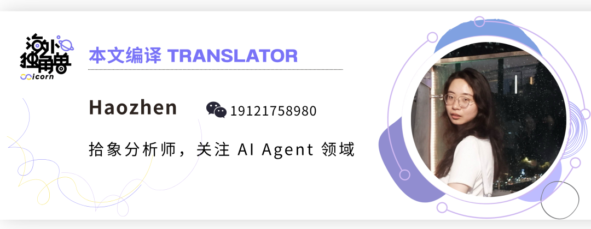

|  |  |  |
| --- | --- | --- |
| ⁠ | ⁠ | ⁠ |

延伸阅读

[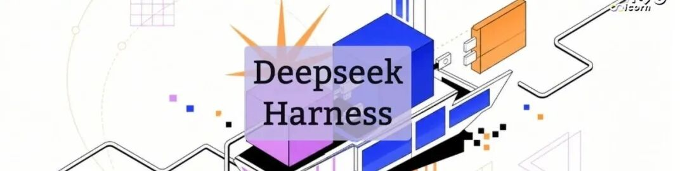](https://mp.weixin.qq.com/s?__biz=Mzg2OTY0MDk0NQ==&mid=2247526831&idx=1&sn=34adf8811a44f1d73c81ea2c28b875a3&scene=21#wechat_redirect)⁠

|  |  |
| --- | --- |
| DeepSeek Harness 是自进化 Agent 的基石 | › |

⁠

|  |  |
| --- | --- |
| Claude Tag 可能是一个 10x Claude Code 级别的产品 | › |

⁠

|  |  |
| --- | --- |
| 无法蒸馏的美国市场，谁在分食 Frontier Labs 百亿美金数据预算？ | › |

[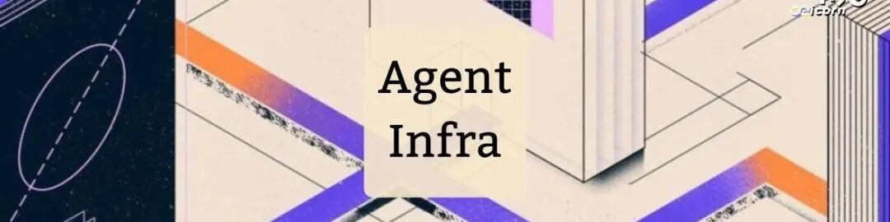](https://mp.weixin.qq.com/s?__biz=Mzg2OTY0MDk0NQ==&mid=2247526473&idx=1&sn=a6a6583dc8a4aa01a99df4916730f911&scene=21#wechat_redirect)⁠

|  |  |
| --- | --- |
| Agent Infra 赛道更新，一年后为 Agent 设计的基建发展如何？ | › |

⁠

|  |  |
| --- | --- |
| 当 Agent 成为 coworker：如何为新物种设计身份系统？ | › |
