

作者：Daniel

编辑：Cage　⁠

我们认为，AI for Science 是 AI 继 Coding 之后的下一个重点方向。而药物发现又是其中最有前景的赛道。一方面，药物试验拥有完整反馈闭环且高度可验证，是实现 RSI 的理想场景。另一方面，AI 可以解放实验人员的产能，使得大量休眠靶点有重新开发的机会。**我们有十足的理由相信，下一个药物大发现时代很可能便是由 AI 推动的。**

⁠

AlphaFold 让我们看到了 AI 理解蛋白质结构的能力，而 **AI 的下一个战场，是设计传统方法做不到的分子。**这是一个激烈竞争的领域，除了从 Google Deepmind 中诞生的 Isomophic 之外，Chai Discovery、Boltz、 Latent Labs 也分别发布他们的预测模型与药物模态区别化下注。蛋白质从头设计也逐渐走近药物研发的实际应用。

⁠

Latent Labs 是观察这一变化的重要样本：创始人 Simon Kohl 曾参与 AlphaFold 2 的核心研发，押注了环肽这一新兴模态类型并选择自建湿实验室。2025 年 2 月，公司以累计 $5,000 万融资走出隐身状态，吸引了包括 Jeff Dean、Aidan Gomez 的天使投资。同年 7 月，发布了面向小蛋白与环肽的生成模型 Latent-X。并在 12 月用 Latent-X2 进一步覆盖纳米抗体和抗体片段，并关注表达、稳定性及免疫原性等成药相关性质；2026 年 3 月发布的 Latent-Y 则是在这些模型之上构建的科研 Agent。

⁠

不可否认的是，目前各家正在测试的蛋白质还没到可以成药的阶段。他们只是完成了流程的第一步：证明自己能够作为结合物发挥作用。如果我们把药物的研发比作登山，人类过去已经攀登过无数山峰，且资本市场也给予了创新者极其丰厚的回报。从 PD-1 到 CAR-T，再到近期大火的 GLP-1 都是很好的证明。但攀登的道路极其困难，往往需要数年+数十亿美元作为成本。**AI 药物发现的目标，是把一条条狭窄的山路变成高速公路，且让人们向更高更危险的山峰发起冲击。**

|  |  |  |
| --- | --- | --- |
| ⁠ | / | ⁠ |

01.

## Key thesis:

⁠

•蛋白质生成模型的出现颠覆传统制药流程，很可能带来一个药物大发现时代

⁠

传统药物发现是在庞大的真实分子库中寻找少数有效候选，生成模型则可以根据需求设计自然界不存在的分子。变化不仅是筛选效率提高，更是能够探索过去难以触及的分子空间。长期价值不只是“更便宜地做药”，而是让同样的研发资源能够探索更多项目，未来的药物研发可能打破“反摩尔定律”，实现质和量的大幅跃升。

⁠

•结合物发现环节高度可验证，是实现 RSI 的理想场景，Latent 湿实验室自建为竞争优势

⁠

在药物发现里面，设计结合物环境是最为可控，最容易产生 loop 的。结合本质上就是两个分子表面的形状互补 + 化学互补，有明确的物理规律，终点明确且反馈回路快。随着计算生成成本下降，稀缺资源将逐渐从候选分子转向高质量的实验反馈。Latent 逐步将实验能力放于内部，有机会更紧密地连接模型研发与实验判断。

⁠

•生物医药领域长坡厚雪，每种模态都会诞生领先大玩家， Latent 模态选择上有差异

⁠

行业内短期的催化是专利断崖正在发生，各大药企开始重视药物发现相关技术。不同模态面对的设计约束和开发难点不同，单一模型难以在所有任务上保持优势，制药公司也倾向与多家公司合作。大环肽是 Latent 最值得关注的切入口。它有机会覆盖传统小分子难以处理的结合界面，同时在部分场景中提供不同于抗体的药物属性。它也是目前的热门赛道，已有多款新药受到市场青睐。

⁠

•以 AlphaFold 成员为班底打造的明星团队

⁠

创始人 Simon Kohl 参与开发 AlphaFold 2，随后发起并共同领导 DeepMind 的蛋白质设计团队；创始技术成员 Alex Bridgland 曾参与 AlphaFold 1、2、3，覆盖模型开发、评估与数据工程。团队中多数成员拥有丰厚药物模型研发经验，与专注实验平台与内部湿实验室的科学家形成互补。团队还有前默克集团 CEO 作为顾问参与，为团队打进大型制药公司奠定基础。

⁠

⁠

02.

## Latent Labs 技术路线

⁠

## Alphafold 之后，从预测蛋白到生成蛋白

⁠

如果说以 AlphaFold 2 为代表的结构预测模型是一台“AI 显微镜”，帮助人们看清蛋白质的形状，那么蛋白质生成模型更接近分子世界的 CAD：根据功能需求，设计自然界中尚不存在的分子。

⁠

以蛋白质结合物设计为例，它是在反向求解蛋白质折叠问题。结构预测从一条氨基酸序列出发，判断它会形成什么样的三维结构；生成设计则从目标出发：给定一个疾病靶点和希望结合的表面区域，寻找能够稳定折叠，并与之结合的新序列。

⁠

一条设计蛋白质的典型流程是：

⁠

获得靶点结构→生成结合物的结构与序列→重新预测复合物结构→筛选候选→湿实验验证

⁠

2023 年发表的 RFdiffusion，让分子世界的 CAD 初具雏形。研究团队将原本用于结构预测的 RoseTTAFold 改造成去噪扩散模型，让它从随机噪声中逐步生成蛋白质骨架，再交给其他模型配上氨基酸序列、检查能否折叠成预期的形状。几个模型各司其职，组成了一条早期的蛋白质设计流水线：先画出轮廓，再补齐细节，最后检查。

⁠

自此，预测模型从观察一个分子，走向理解多个分子如何共同组成一个系统。AlphaFold 2 可以从氨基酸序列预测蛋白质的三维结构。2024 年 5 月，AlphaFold 3 将蛋白质、DNA、RNA 和小分子等纳入统一的复合物预测框架。这让研究人员在设计新分子时，多了一种检查它与靶点是否匹配的工具。

⁠

除了 Ismorphic Labs，不少公司也从这一层切入。比如[Chai Discovery](https://mp.weixin.qq.com/s?__biz=Mzg2OTY0MDk0NQ==&mid=2247511393&idx=1&sn=a2445f938a5211261ed6692854bc2c55&scene=21#wechat_redirect)、Boltz。2024 年 9 月，Chai 发布 Chai-1，预测多类生物分子的结构及其形成的复合物；同年 11 月，Boltz 团队发布 Boltz-1，并开放训练代码和模型权重。

⁠

而 Latent Labs 没有跟随先做结构预测的路径，而是直接做蛋白质生成设计。创始人Simon Kohl是参与开发 AlphaFold2 的核心人员和论文作者，Isomorphic Labs 当时正在沿着 AlphaFold 向多个药物研发方向扩张，而他认为蛋白质设计本身已经足够庞大，值得由一个更小、更灵活的团队集中突破。于是决定单独创业。他们的伦敦团队负责开发基础模型，旧金山则有湿实验室和计算生物团队，测试模型设计出的分子，将实验反馈用于模型研发，并采集训练数据。

⁠

2025 年，三家公司开始交生成模型的答卷，第一代生成模型相继亮相：

⁠

•6 月，Boltz-2 在结构预测之外加入结合亲和力预测，迈出了生成模型的第一步；

⁠

•同月，Chai-2 发布，成为第一个从零设计抗体的生成模型。

⁠

•7 月，Latent 发布首个模型 Latent-X，首先展示了环肽和小蛋白的从零设计能力。

⁠

•10 月，Boltz 推出生成模型 BoltzGen，正式进入结合物设计。

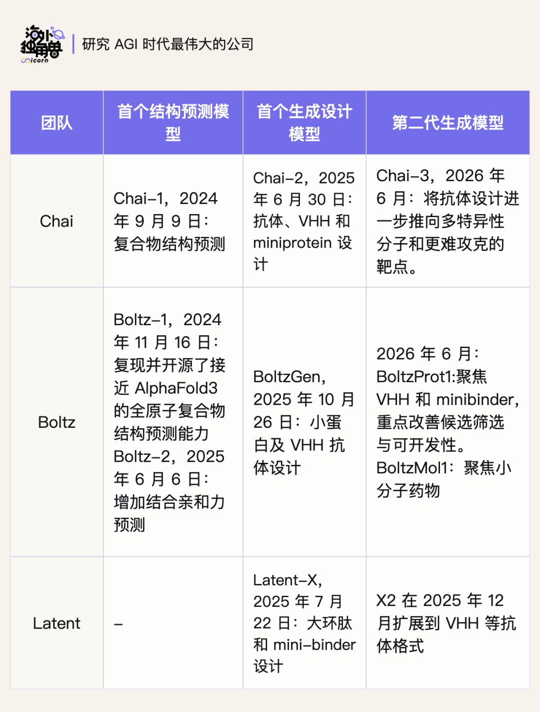

⁠

⁠

## 主力模型：Latent X

⁠

2025 年 7 月，Latent-X1 发布。

⁠

它首次公开展示了 Latent 的端到端全原子蛋白质设计能力。用户提供靶点序列、骨架结构和希望结合的热点后，模型联合生成新结合物的氨基酸序列，以及结合物—靶点复合物的全原子构象。

⁠

Latent-X 首先选择了大环肽（macrocyclic peptide）和小蛋白（mini-binder），而没有直接挑战完整抗体。团队在 7 个治疗相关靶点上进行湿实验，每个靶点最终测试 30 至 100 个设计。公司报告的大环肽命中率为 91%至 100%，mini-binder 为 10%至 64%，并获得了低纳摩尔乃至皮摩尔级 binder。

⁠

其中在环肽方面，Latent-X1 在三个靶点上的受测样品命中率达到 91%–100%，高于 RFpeptides 文献报告的 21%–38%，且在 MDM2 靶点的亲和力方面实现了更低的 KD 值。

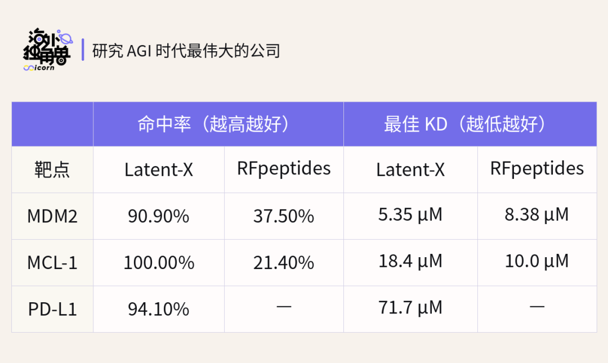

RFpeptides 是华盛顿大学蛋白质设计研究所（IPD）开发的 AI 环肽设计方法，由 David Baker、Frank DiMaio 和 Gaurav Bhardwaj 三个实验室联合开发，可以理解为 RFdiffusion 面向环肽设计的延伸。

⁠

2025 年 12 月，Latent-X2 发布，目标是生成更接近药物的分子。

⁠

X2 可以输入指定表位，只生成关键结合区域，并把能力扩展到 VHH 和 scFv。团队对每个组合只测试 4 至 24 个设计，在 18 个靶点中的 9 个上获得成功，同时评估表达量、聚集倾向、多反应性、疏水性和热稳定性；部分代表性 VHH 还进行了人源供体的离体免疫原性实验。

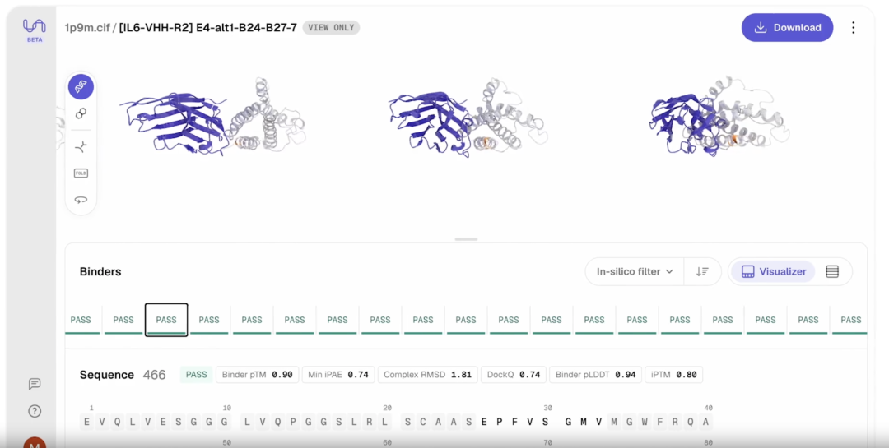

•Agent 产品 Latent-Y

⁠

2026 年 3 月发布的 Latent-Y 是建立在 Latent-X1 和 X2 之上的 AI Agent。它把原本需要多位专业研究人员完成的蛋白质设计流程，封装成一个可以用自然语言操作的产品。Latent-Y 可以从自然语言目标出发，完成文献检索、靶点分析、表位选择、调用 X2 生成、计算验证和候选筛选。公司报告中，它在 9 个靶点里为 6 个找到了实验确认的 binder，为科研人员打造蛋白设计的“Cursor”。

⁠

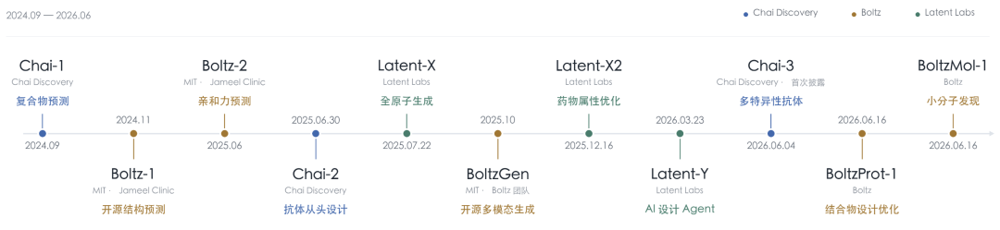

按时间顺序排列的三家公司主要产品发布

⁠

## Latent 的差异化下注

⁠

### 模态类型：环肽

⁠

从产品策略看，Latent 则先用大环肽与小蛋白展示生成模型的能力，再于 2025 年 12 月发布 Latent-X2，将设计范围扩展至 VHH 和 scFv 等抗体格式。环肽始终是这条产品路线中的重要组成部分。

⁠

环肽是近期比较热门的研发方向，它处在小分子与抗体之间的“中间地带”，容易进入细胞：它的接触面积大于传统小分子，因此有机会识别平坦的蛋白质相互作用界面，并有接近抗体的亲和力和特异性；环化又可能提高抗蛋白酶降解能力，可以作为口服、缓释药物。

⁠

比较出名的例子包括：

⁠

•强生与 Protagonist 合作开发的 icotrokinra，是一款靶向 IL-23 受体的口服大环肽药物，2026 年 3 月获美国批准用于中重度斑块状银屑病，预测峰值销售超 $50 亿。

⁠

•默沙东的 enlicitide ，一款靶向 PCSK9 的大环肽。2026 年 7 月获批，用于降低高胆固醇血症成人患者的 LDL-C，其 2033 年销售额预期超 $50 亿。

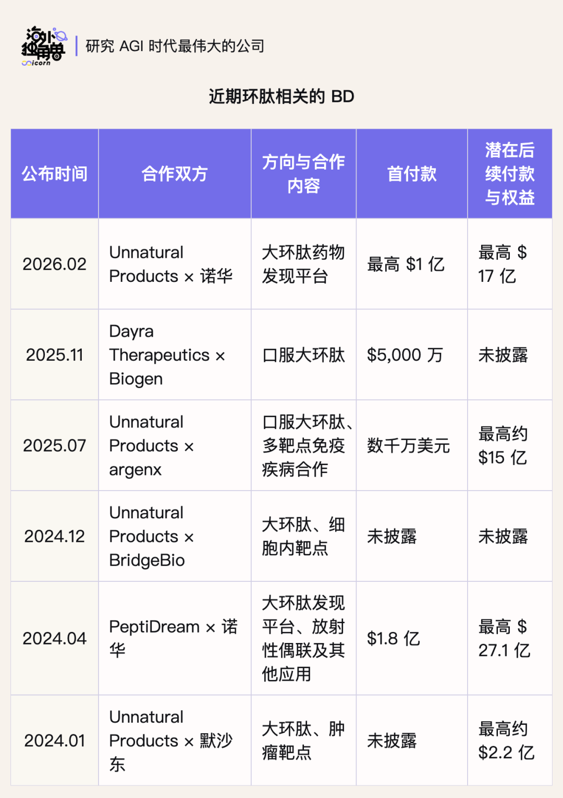

⁠

### 数据闭环：自建湿实验室

⁠

从 2024 年开始，Latent 便在旧金山运行湿实验室，并将实验验证作为模型研发的重要支点。从招聘信息可以看出，伦敦的 Computational Protein Designer 主要负责计算设计；旧金山的同岗位则额外要求较强的湿实验经验，需要亲自开展蛋白表达与纯化、生物物理表征和功能实验。

⁠

我们可以从 Latent X1 模型的实验论文了解内部实验平台的分工，以小型蛋白质结合物 mini-binder 为例，模型先为每个靶点生成约 2 万个设计，再根据预测结构选出 100 个候选进入实验，进入两条相互补充的验证路径：

⁠

•一条交给外部服务商 GenScript：先根据设计序列生产蛋白质，再用 BLI，检测它与靶点是否结合再进一步测量，确定结合强度及结合、解离的速度。

⁠

•另一条由 Latent 内部完成，采用的是哺乳动物细胞表面展示，简称 mDisplay。研究人员将编码候选蛋白的 DNA 导入细胞；随后加入靶蛋白，通过荧光信号观察候选是否成功展示、能否抓住靶点。

⁠

这套双重筛选方法，让研究人员能够在原理不同的结合检测平台上，交叉验证哪些候选真正命中了靶点。

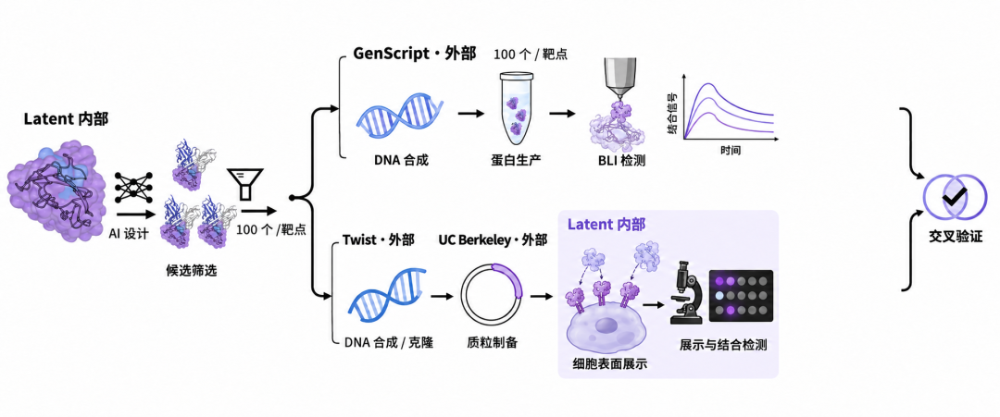

在这里，Latent 的自建实验室与外部服务商是协同关系。DNA 合成、部分材料制备，以及蛋白质生产和仪器测量，仍然由外部机构承担；Latent 则将一部分验证环节放在内部，让计算设计人员能够更直接地接触实验结果。

⁠

如果说 X1 论文更像是在验证自己内部的实验能力，那么近期我们能看到公司在越发重视实验的迹象。2026 年 3 月，Latent 在旧金山招聘 Head of Lab Platform 与 Research Lab Scientist。希望招聘具有从零搭建实验室经验的人，进一步扩展现有的高通量实验、自动化和数据管理能力。在未来，Latent Labs 可能会把更多湿实验室环节放进内部。

⁠

### 携手 AWS 接入客户

⁠

2025 年 5 月，Latent Labs 与 AWS 宣布多年战略合作，覆盖模型训练与推理所需的云基础设施，以及面向生命科学客户的商业推广。Latent 提供生物生成式 AI 模型，AWS 则作为其首选云服务商提供算力支持。Latent 使用 Amazon SageMaker HyperPod 扩展计算资源，支撑模型研发和客户使用；同时借助 AWS 的合作伙伴网络与市场拓展支持，触达更多药企、生物技术公司和科研机构。

⁠

Latent 旗下模型也接入了 Amazon Bio Discovery 平台：这是 AWS 于 2026 年 4 月推出的 AI 药物研发应用，目前主要面向早期抗体发现。平台将生物 AI 模型、科研助手和外部实验服务整合到同一个工作环境：科研人员可以选择模型并评估候选分子，再将选定候选交给合作实验室测试。

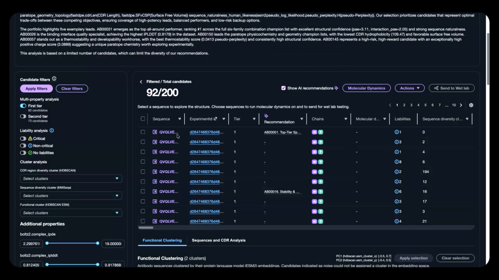

⁠

该平台已公布的早期采用机构包括纪念斯隆凯特琳癌症中心（MSK）、拜耳、Broad Institute、Fred Hutch Cancer Center 和 Voyager Therapeutics。

⁠

⁠

03.

## Why now

⁠

## De novo design：从创造分子到 RSI

⁠

传统结合物发现的流程需要：

⁠

1.先准备一个非常大的真实分子库；

⁠

2.用噬菌体展示、酵母展示、动物免疫等方式做实验筛选；

⁠

3.从百万到十亿级候选中找到少量结合者；

⁠

4.再做亲和力成熟、特异性和成药性优化。

⁠

而 De novo design（从头设计） 彻底改变了研发的起点：研究者可以先指定靶点、结合位置和功能要求，再设计满足这些条件的新序列，将自然界中原本不存在的分子纳入药物发现。只合成模型排名最高的一小批。

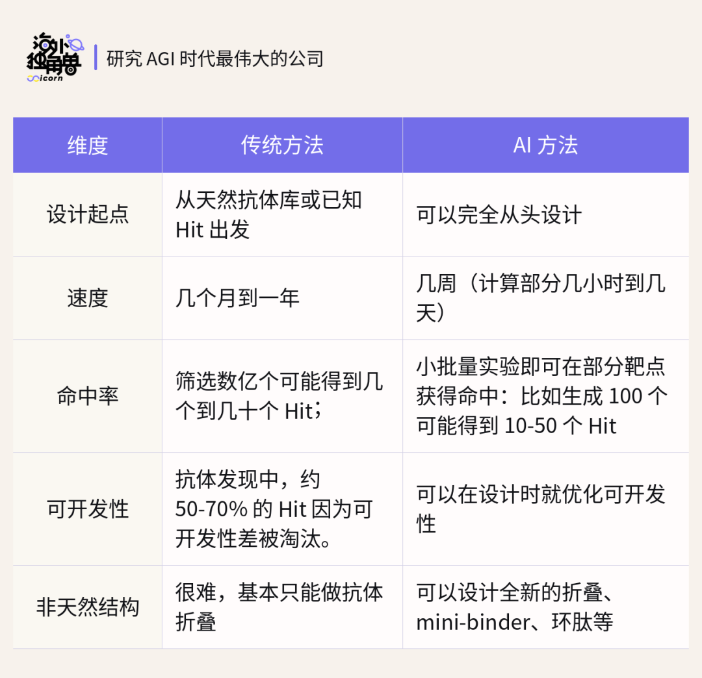

⁠

AI 最明显的突破是压缩早期结合物发现的时间和实验规模。传统抗体发现采用动物免疫等路线，获得初始结合物通常需要数月；之后还要完成候选优化和临床前开发。参考药明生物的公开材料，DNA-to-IND 阶段的典型周期为 6–15 个月，对应$500 万- 800 万。

⁠

同样类比早期发现环节，Chai-2 针对 52 个抗原，每个靶点、每种抗体格式测试不超过 20 个设计，报告约 16% 的候选级结合命中率，并在一半靶点上获得至少一个结合物；从计算设计到湿实验验证，用时不足两周。

⁠

通过对蛋白生成设计发展的观察，我们可以看到：

⁠

从模型能力到工作流编排，再到干湿实验闭环，竞争正向完整研发流程延伸。随着基础预测能力正在快速开源化，Latent 与 Boltz 纷纷发力 Agent 编排与工作流，希望争夺成为这个领域的操作系统。下一阶段，差异化可能更多来自能否有效连接计算设计与实验验证，让实验结果持续反馈到下一轮设计中。

⁠

药物发现的未来，将逐步走向智能科学的 RSI：lab-in-the-loop 是实现这一愿景的重要基础。它将湿实验室接入AI的设计与决策循环，让每一轮实验既筛选候选，也为下一轮探索提供信息，从而以更低的总成本、更短的时间，获得足以支持项目推进或终止的可靠证据。而在结合物设计阶段，更容易形成闭环，相较于药物研发的后续环节，这一阶段的实验环境更可控，评价终点更明确，反馈周期也更短。分子结合主要取决于两个分子表面在形状和化学性质上的互补，并受到明确的物理规律约束。这些特征使结合物设计更容易形成“设计—实验—反馈—改进”的循环。

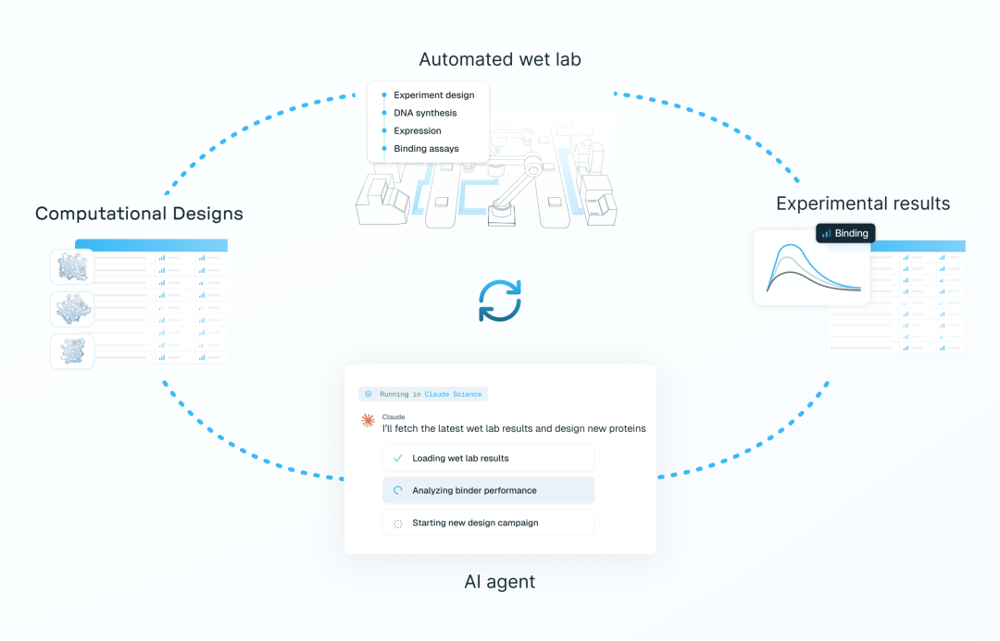

⁠

## 专利断崖正在发生，AI 加速新/旧靶点的开发

⁠

药物研发长期承受反摩尔定律的压力：Eroom’s Law 最初描述的是的 1950 年至约 2010 年间，每十亿美元研发投入对应的新药产出大约每九年减半。而AI可能是有潜力逆转这个趋势的技术。

⁠

而另一个大趋势是药企的专利断崖正在发生，根据 Evaluate 预测，我们即将迎来下一个专利到期的高峰。2026-2032 年，累计有超过 5000 亿美元销售额可能面临专利过期的风险，药企需要寻找下一个大药物。

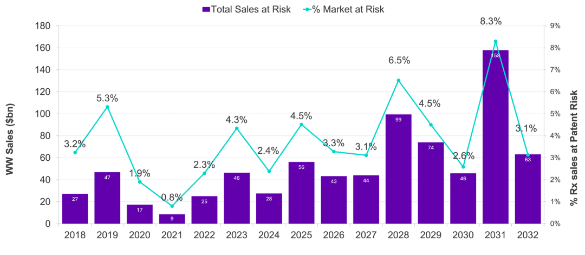

⁠

专利断崖会迫使大药企更积极地采用 AI 技术、投资 AI 公司、与 AI 公司合作。Isomorphic、Chai、Boltz 近期接连签下大订单，背后都有大药企面对专利断崖、需要新管线的驱动因素。而具体看，AI 带来的机会集中在两个方向：

⁠

1.大量未开发靶点迎来重新开发的机会

⁠

药企长期积累了大量尚未完成的研发项，这些未被开发的机会远比已经上市的药物多。2024 年的一项系统研究估算，在人类 19,813 个蛋白编码基因中，约有 4,729 个可能被生物药调控，但只有 755 个已经成为获批药物的靶点。即便只看曾经进入临床开发的靶点和疾病，约 170 万种潜在的“靶点—适应症”组合中，也只有 2.5% 被实际探索过。

⁠

过去，药企很难系统性地重新检查这些项目，而蛋白生成模型的出现，给了研究人员大量开发难成药靶点的机会。Isomorphic Labs 与 Novartis 最初围绕 3 个高难度靶点合作，一年后又增加了最多 3 个项目，说明大型药企已经开始把真实的早研问题交给 AI 平台。

⁠

2.AI 做 me-better /best-in-class 的机会

⁠

AI 可以针对这些已验证靶点，设计出更好的分子，AI 可以探索传统方法覆盖不到的序列空间，可以找到完全不同的结合模式，实现跨越式改进。另外，AI 蛋白设计本质上是高维搜索和优化。老靶点已经积累了大量结构、突变、药理和临床数据。问题因此从开放式的生物学探索，变成了一个边界清晰的分子优化任务。

⁠

生物医药领域特殊的行业结构，也为多家企业一同创造价值提供了空间。专利保护使任何成功创新有机会获得持续回报，而不同疾病、治疗机制和患者群体又形成了多个独立的市场。企业既可以通过 first-in-class 开辟新的治疗路径，也可以通过 me-better/best-in-class 在疗效、安全性或用药便利性上建立优势。因此，一家公司即使只在有限的治疗领域取得突破，也可能通过自主销售、授权或并购实现较大价值。

⁠

因此，这是一个极其长坡厚雪的赛道，一条条成功的管线则是这个领域可被验证的节点。

⁠

## 下一个大制药公司可能在 AI 发现平台中诞生

⁠

全球药企每年约有 3,000 亿美元研发支出，其中，top 25 家药企约花费 1760 亿，占全球约 61%，头部集中度高的特性。其中临床前部分约占到研发支出的 15%，大约占到每年 450 亿。这 450 亿美元构成了 AI 药物发现最直接的第一层预算池。如果 AI 能够避免临床前阶段 20%–40% 的低价值试错，对应每年约 90 亿至 180 亿美元的经济价值。

⁠

AI发现平台的长期上行，来自将药物发现转化为一种能够持续积累、重复产出新资产的研发能力。一个分子的设计和筛选成本，只是项目总投入的一部分。如果靶点选择、疗效或安全性问题直到临床阶段才被发现，此前投入的时间和资金便可能难以收回。AI如果能够更早识别高风险项目，提高进入临床项目的平均质量，其经济价值会显著超过减少几轮筛选实验。

⁠

历史上，新一代平台型药企的出现，往往都发生在一次科学突破被工程化、工业化的窗口期。重组 DNA 技术催生了 Genentech；受体陷阱蛋白和全人抗体工程平台支撑了 Regeneron；核苷修饰和递送技术促成了 Moderna。AI 与这些技术的不同之处在于，它不是一种单独的治疗模态，而是一套可以横跨小分子、抗体、蛋白质和核酸的发现基础设施。因此，它理论上能够支撑的管线宽度更大，平台的上限也可能更高。

⁠

目前而言，最接近下一代制药公司的是 Isomorphic Labs，公司在 2024 年与 Lilly、Novartis 的合作，首付款分别为 4,500 万和 3,750 万美元；另有分别最高 17 亿和 12 亿美元的条件性里程碑，以及销售分成。

⁠

⁠

04.

## 竞争格局

⁠

目前在大分子领域，最为突出的竞争者分别是前 OpenAI、Meta FAIR 研究者 CEO Joshua Meier 创立的 Chai Discovery 和从 MIT Jameel Clinic 研究项目发展出来的 Boltz。他们的路线差异具体如下：

⁠

•Chai Discovery：专注抗体，Enterprise-first，强调模型性能和大药企深度部署。

⁠

•Boltz：专注开源模型 + API 的收费逻辑，主打全模块。让 Claude/Codex/ 药企内部 agent 组合工作流

⁠

•Latent Labs：环肽路线，拥有湿实验室。目前与 AWS 合作负责分发，在客户方面走 Chai + Boltz 的混合路线。

⁠

## 技术

⁠

尽管缺乏 head-to-head 数据直接对比，但从三家公开实验中，我们可以看到各家的侧重点有所不同：

⁠

•纳米抗体与小蛋白模态更像是 AI 的低垂果实，是各家开始时共同选择的方向，但仍处早期方向。

⁠

•小分子与抗体类药物目前最成熟成药最多，都有数千亿美元的规模。但可能面临 Isomophic 的竞争。

⁠

•Chai 从一开始就专注抗体领域，目前属于领先地位。

⁠

•环肽是近期较热门的新兴方向，且这个赛道目前 Latent 暂时领先。

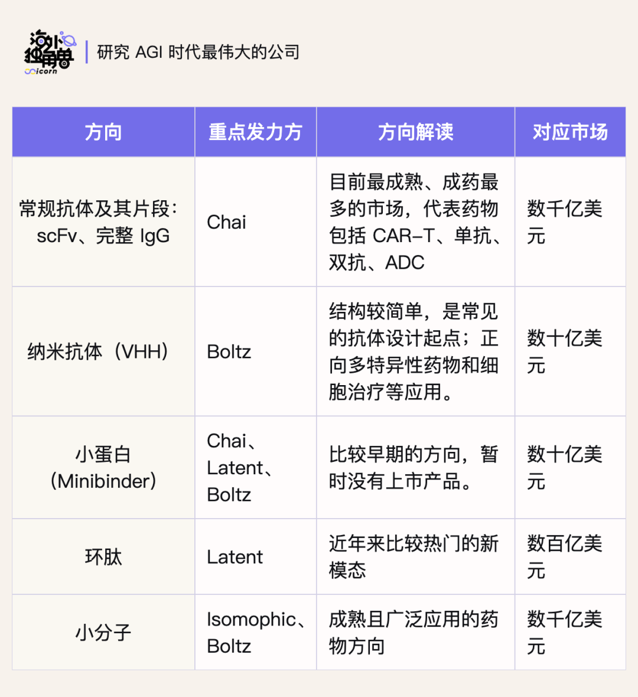

⁠

## 商业化

⁠

Chai 是三家中合作最成熟、交易结构最清晰的，已经进入了大药企正式部署阶段。其特点是定制模型路线，利用制药公司的专有数据，并深入适配其工作流。Chai 已公开宣布与五家独立药企合作，且年度订单费用高达中八位数美元。根据测算，其年度订单规模可能已经高达 2 - 3 亿美元。

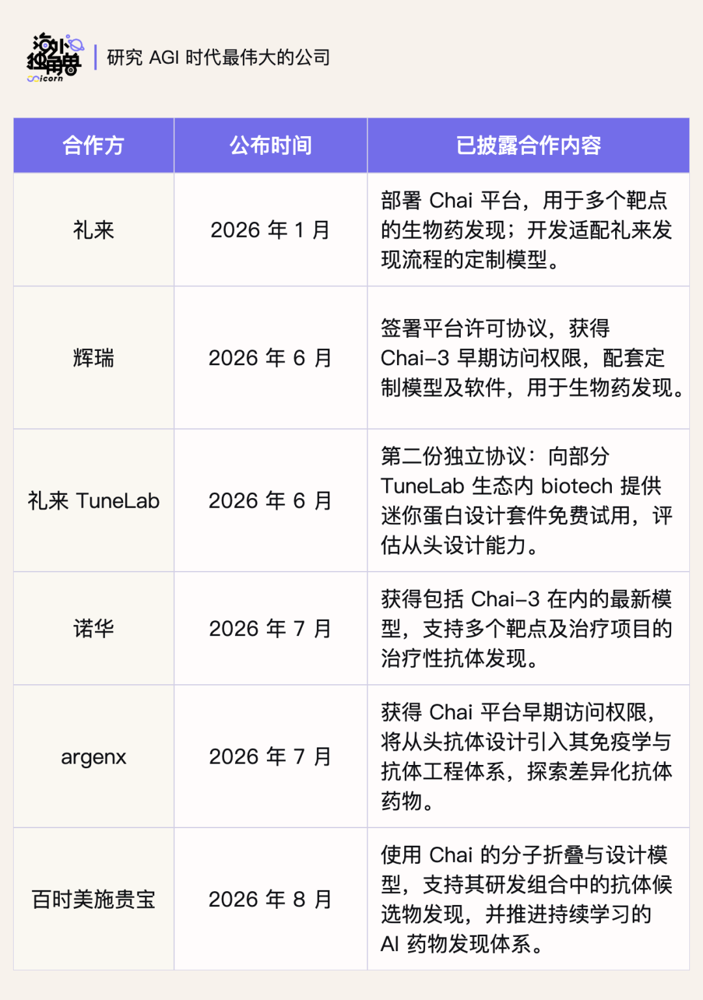

⁠

而 Boltz 走的是开源 + 基础设施路线，Boltz-1、Boltz-2 和 BoltzGen 形成了三家里最深的开放模型栈，产生明显的学术与产业分发。目前累计超过 500 万下载、被超过 10 万科学家和 1000 家公司使用，并覆盖前 20 的制药公司。公司已经推出 API 产品，与 Claude Science、Benchling、Phylo 等工具和平台的集成，作为其他科研平台的底层能力供应商。

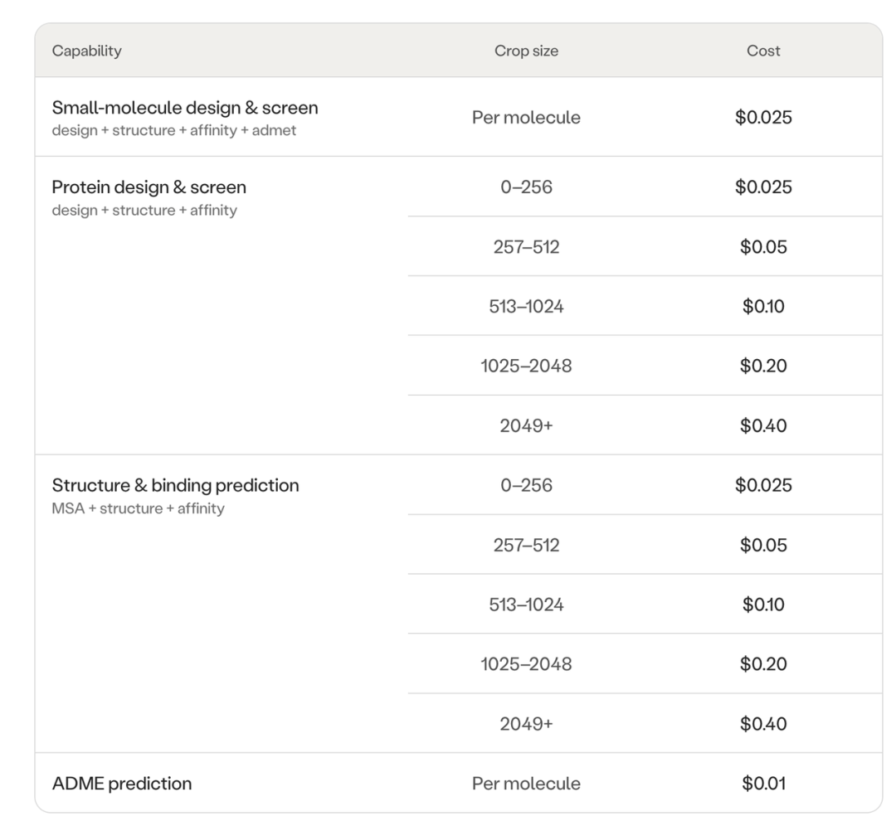

⁠

在费用方面，参考 Boltz 对 BoltzMol-1 的描述，一个小分子从靶点到实验验证的初始hit，计算加实验预算约为 10,000–15,000 美元，耗时 3–8 周。收费量级相比闭源合作类型少了一到两个量级。

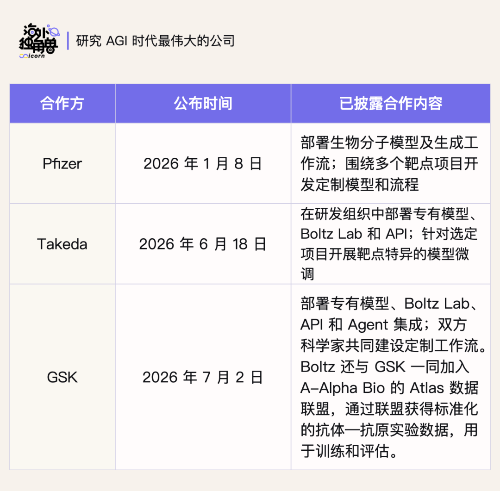

在商业合作方面，Boltz 获得了三家的医药公司合作订单，但跟 Chai 的模式不同的是，Boltz 并不保留平台开发产生的化合物所有权，因此更多扮演一个工具属性。

⁠

## 潜在范式竞争：Anthropic

⁠

Anthropic 是目前大模型公司中最看重 AI for Science 的，正通过大量科研实验和人才招聘进入生命科学领域。

⁠

在最近一次蛋白质设计实验中，Claude 根据操作手册自主查阅资料、制定设计策略，并调度专业模型生成和筛选候选分子，再由 Adaptyv Bio 和 Twist Bioscience 进行湿实验验证。

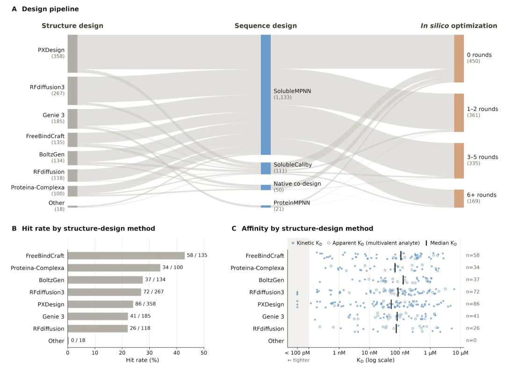

Claude 成功编排了多个开源蛋白质设计模型，生成了具有高成功率和高亲和力的结合剂。报告显示，整体结合命中率为 26.8%，15 个靶点中有 14 个获得结合分子。

⁠

这里 Claude 负责理解研究目标、选择设计策略并调度工具；具体到生成骨架、设计序列和预测复合物，仍由专有模型完成。从竞争格局看，通用模型公司与专业模型公司也可能形成上下游合作。通用 Agent 可能可以成为专业模型的分发入口。

⁠

另外，Anthropic 最近更新了一则招聘招聘企业发展负责人，主要职责为发掘并执行与 AI 原生生命科学公司的收购、投资和战略合作。说明 Anthropic 希望通过收购强化在生命科学中的地位。

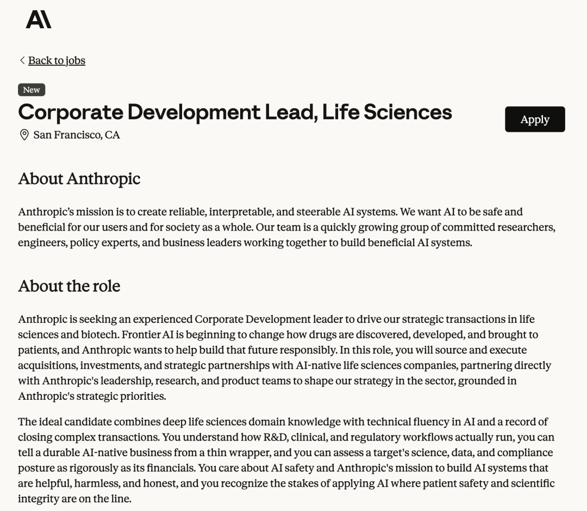

⁠

⁠

⁠

05.

## 团队与融资

⁠

## 以 AlphaFold 为班底的核心团队

⁠

•Simon Kohl｜创始人兼 CEO

⁠

早期在德国卡尔斯鲁厄理工学院（KIT）学习物理，随后在德国癌症研究中心与KIT开展医学影像机器学习博士研究。加入DeepMind后，是AlphaFold 2的核心研发成员之一、Nature论文同等贡献作者，参与了神经网络架构与训练开发。他还开发了广泛使用的结构置信度预测机制pLDDT，起并共同领导DeepMind的蛋白质设计团队。

⁠

•Paul F. Jaeger｜Head of AI

⁠

现任 Latent Labs AI 负责人。此前在 Google DeepMind 参与面向药物研发的大语言模型研究，是 TxGemma 的关键贡献者，并参与将大语言模型用于单细胞分析的研究。更早在德国癌症研究中心完成博士研究并领导交互式机器学习团队，是医学影像分割框架 nnU-Net 的共同一作。

⁠

•Alex Bridgland｜创始技术成员

⁠

曾参与 DeepMind 的 AlphaFold 1、2、3，积累了跨多代蛋白模型的研发与工程经验。他是 AlphaFold 2 Nature 论文的同等贡献作者，主要参与数据、分析与推理系统开发。加入 Latent 后，与 Simon Kohl 共同搭建最初的机器学习代码库，并参与 Latent-X 的模型架构、预训练方法及数据流程开发，是公司早期模型与工程系统的重要建设者。

⁠

•Stefan Oschmann｜战略顾问

⁠

曾任德国默克集团 Merck KGaA CEO，拥有大型医药与生命科学企业的管理经验。2025 年 12 月宣布其担任 Latent Labs 战略顾问。

⁠

除此之外，团队还有两名曾在 David Baker 团队的研究人员，以及专注实验平台与内部湿实验室设计的多名科学家。

⁠

## 融资历程

⁠

Latent Labs 最新一轮为 2025 年 2 月 天使轮 + A 轮融资 5000 万美元。A 轮由 Radical Ventures 与 Sofinnova Partners 共同领投，早期投资方包括 8VC、Kindred Capital 和 Pillar VC。天使投资人则包括 Google 的 Jeff Dean、Transformer 论文共同作者 Aidan Gomez，以及 ElevenLabs 联合创始人兼 CEO Mati Staniszewski。

⁠

相比之下，Chai Discovery 的融资节奏最快、规模也最大。从 2024 年 9 月的约 $3,000 万种子轮起，公司在不到两年内连续完成 A、B、C 三轮融资，累计融资约 $6.3 亿。2026 年 7 月的 C 轮融资金额为 $4 亿，估值达到 $38 亿，由 Index Ventures 领投，Kleiner Perkins、Sequoia 等参与；OpenAI 和 Thrive Capital 则是其早期投资方。

⁠

Boltz 仍处于更早期阶段，于 2026 年 1 月完成 $2,800 万种子轮融资，估值为 $1.25 亿。投资方包括 Zetta Venture Partners、Amplify Partners、a16z 和 Factorial Capital，个人投资者包括 Hugging Face 联合创始人兼 CEO Clément Delangue。

⁠

|  |  |  |
| --- | --- | --- |
| ⁠ | ⁠ | ⁠ |

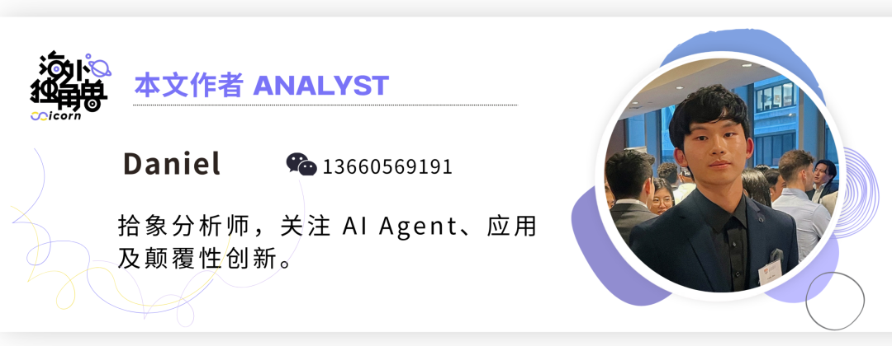

|  |  |  |
| --- | --- | --- |
| ⁠ | ⁠ | ⁠ |

延伸阅读

⁠

|  |  |
| --- | --- |
| Astra 的 Computer Use 能力是如何实现的？ | › |

⁠

|  |  |
| --- | --- |
| 2 万亿美元的 Anthropic 值不值得买？ | › |

[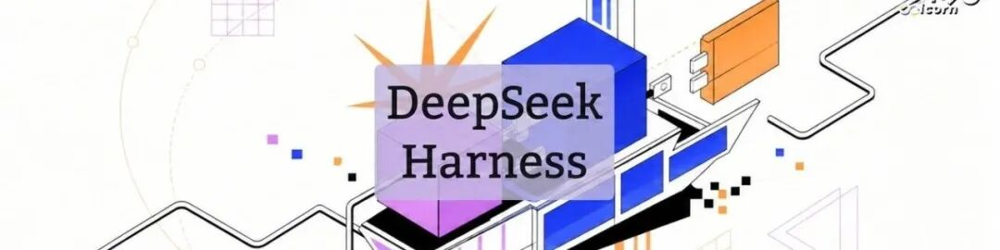](https://mp.weixin.qq.com/s?__biz=Mzg2OTY0MDk0NQ==&mid=2247526831&idx=1&sn=34adf8811a44f1d73c81ea2c28b875a3&scene=21#wechat_redirect)⁠

|  |  |
| --- | --- |
| DeepSeek Harness 是自进化 Agent 的基石 | › |

⁠

|  |  |
| --- | --- |
| Claude Tag 可能是一个 10x Claude Code 级别的产品 | › |

⁠

|  |  |
| --- | --- |
| 无法蒸馏的美国市场，谁在分食 Frontier Labs 百亿美金数据预算？ | › |
