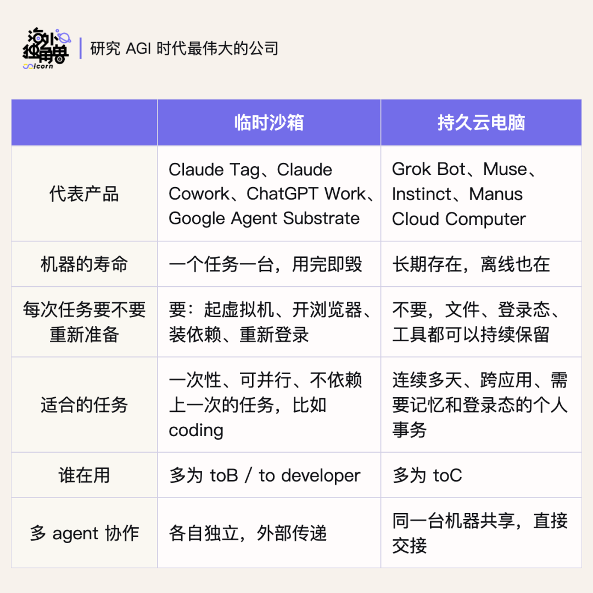
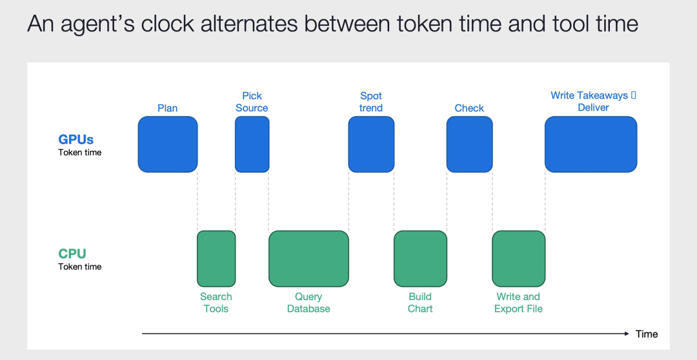
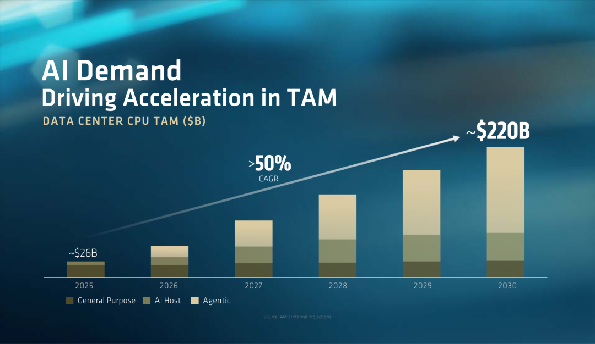
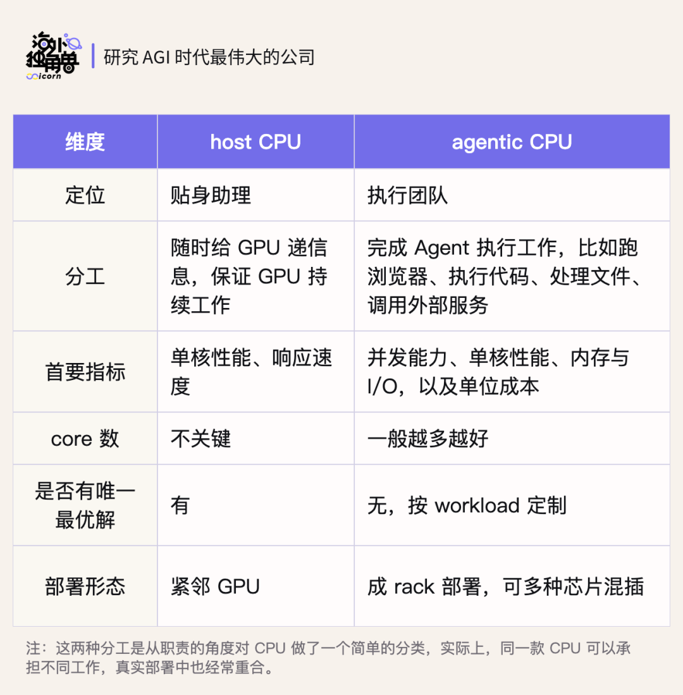
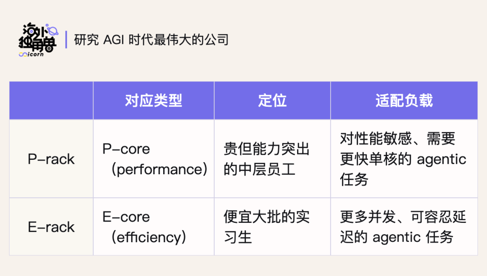

播客：Semi Doped

编译：Celia

编辑：Siqi

过去三个月，以 Claude Tag、Grok Bot、Muse、Instinct 为代表的各种云端 agent 开始起来。

⁠

我们相信，未来会有数十亿 agent 在云端持续工作，这会让算力瓶颈不仅仅局限于 GPU，而会同时带动 CPU 的爆发，甚至催生出一层独立的算力品类：Agentic CPU。

⁠

我们最近发现一期播客 Grok Bots and How CPUs are used in Agentic AI，对这个趋势拆解得非常清楚，两位主播都是资深半导体从业者。

⁠

以下结合我们自己的理解，做了一期编译。希望能粗略梳理一下这个问题：Agent 的爆发，到底会怎样改变 CPU 的需求？

|  |  |  |
| --- | --- | --- |
| ⁠ | / | ⁠ |

01.

## 云端 Background Agent 成为一个大趋势

⁠

过去一年，Agent 的主流形态还是 Claude Code、Codex 这种本地 agent，但现在，以 Claude Tag、Grok Bot、Muse 为代表的各种云端 agent 开始起来，并且这一定会在未来成为更主流的趋势。

⁠

云端的优势很直接，比如：

⁠

•云端任务可以不受个人电脑开关机的影响；

⁠

•Agent 可以在独立环境里操作浏览器、运行软件，不需要和用户抢资源；

⁠

•天然支持跨设备使用、团队协作和更好的安全隔离。

⁠

未来，一个人一定需要很多 agent 在后台 7×24h 持续工作，所以上云会是一个必然的趋势。

⁠

OpenAI 和 Anthropic 从 6 月开始发布的每一个新产品/功能，也都是默认在云端完成。

⁠

Anthropic 这边是 Claude Tag、Cowork（7 月起改成云端默认）、还有 9 月重做的 Claude Code Projects，它会为每个子任务单独开一台云端虚拟机。OpenAI 则在 7 月推出 ChatGPT Work，为每个用户提供云端工作区，9 月 10 日发布 Agents API，直接提供托管沙箱。

⁠

不过，上云也分两种模式：

⁠

第一种是临时起沙箱。每来一个任务，就临时拉起一个沙箱，让Agent在里面运行代码、使用工具，任务做完就将环境收回。Claude Tag就采用了这种方式。

⁠

第二种是给用户一台持久的云电脑。可以把它理解成一台放在数据中心的虚拟电脑，有操作系统、有浏览器、有文件夹，Agent会长久住在里面。

⁠

以 Grok Bot 为例，本地客户端只是一个交互外壳，真正执行工作的是云端虚拟机。所有工具、所有登录态都装在云端虚拟机里，当你跟 Agent 说 "帮我订下周去日本的酒店"，agent 会在那台机器上打开浏览器、比价、填表。当你关上笔记本，它也可以在后台持续工作。

⁠

⁠

对 Personal Agent 来说，持久环境的价值尤其明显，因为它的工作天然是连续的。

⁠

拿旅行规划来说，今天要研究目的地，明天可能要等酒店回复，后天又要根据新的航班调整行程。Agent 每次回来，都需要接上之前的工作。

⁠

如果账号还保持登录，之前比较过的酒店资料还在，行程表也保留着，它就能直接往下做。

⁠

如果说临时沙箱是个一次性的共享工位，自己的云电脑则相当于让它有了一个固定的办公室，不必每次任务完成都重新收拾书桌，省去下次登录账号、搬运资料等等的麻烦。一个用户同时用几个 Agent，它们也能在这里很方便地交换资料、接手彼此的工作。同时与其他用户保持隔离，保障隐私和安全。

⁠

随着工作跨越更多应用、持续更长时间，这种环境的连续性会越来越重要。

⁠

对 Personal Agent 来说，产品形态已经在向这一派收敛，Grok Bot、Muse、Instinct 就都不约而同地采用了这种架构。

⁠

⁠

02.

## 算力瓶颈从 GPU 外溢到 CPU

⁠

云端 Agent 的爆发也会让算力需求发生一些变化。

⁠

过去的 AI Infra，核心矛盾一直是 GPU，但未来，CPU 的需求也会显著增大。

⁠

•Chatbot 时代，典型的工作流程是：

⁠

用户提问 → GPU 推理 → 返回答案。

⁠

基本是一次往返，主要依靠 GPU。

⁠

•Agent 时代，流程变成了：

⁠

思考 → 调工具 → 读取结果 → 更新状态 → 再思考，循环几十甚至上百次。

⁠

这其中，模型推理主要依赖 GPU，而其它的调用工具、操作文件、执行代码、访问网络、管理状态等等，都依赖 CPU。因此，Agent 不仅会拉动 GPU，也会极大带动对 CPU 的需求。

⁠

Source：Agents Are the New Users of CPUs | Coatue

⁠

今年上半年，Agent 的增长还主要集中在 Claude Code、Codex 这类本地 Agent 上，所需的 CPU 资源可以由用户已有的笔记本提供。

⁠

而随着云端 Agent 起来，CPU 的需求会被真正带动起来。

⁠

这个需求逻辑包含两部分。

⁠

一部分是迁移：原本在用户笔记本上运行的程序，会转移到云端的数据中心。

⁠

另一部分是扩张：部署变简单，更多人可以使用 Agent；用户离线，Agent 会在后台持续工作；一个人，也会同时调动越来越多 Agent。使用人数、执行时长和任务并发，会一起推高云端的 CPU 负载。

⁠

这个需求的爆发性有多强呢？

⁠

AMD 本来在今年 5 月的 Q1 财报会上预测，到 2030 年，整个服务器 CPU 市场会超过 1200 亿美元。

⁠

紧接着，在 7 月 23 日的年度大会上，苏姿丰将预测上调到 2200 亿美元。她表示，过去六到八个月，AMD 已经反复修改这个数字，但仍然大大低估了需求的增长速度。

⁠

从 1200 亿又上调到 2200 亿，中间只间隔了两个半月。

⁠

Source：Advancing AI 2026 Keynote | AMD

⁠

供给端，CPU 已经开始供不应求。9 月 14 日，Intel CEO 陈立武在一场活动上表示：“CPU 需求太高，我们只能向一半的客户供货。”

⁠

最近，Muse 登上 App Store 免费榜首，又让市场对消费级 Agent 的普及多了几分信心，也抬高了对 CPU 需求的预期。9 月 21 日，AMD 股价上涨约 10%，正式迈入万亿市值俱乐部。

⁠

⁠

03.

## Agent 时代，CPU 的两种角色

⁠

接下来更值得关注的是：增长的 CPU，究竟在做什么？新时代需要什么类型的 CPU？

⁠

如果把一套 AI 系统想成一家公司，运行大模型的 GPU 就像一个身价很高的天才，负责思考和判断。为了让这个天才高效工作，公司还需要两类人：贴身助理和执行团队，对应 CPU 的两种分工：

⁠

•Host CPU 是天才的贴身助理，最重要的工作是不断给 GPU 喂活。

⁠

天才刚处理完手上的问题，下一份材料就应该递到面前。准备数据、安排计算、协调数据传输，都由这个助理负责。如果材料没有准备好，或者传递得太慢，昂贵的 GPU 就只能等待。

⁠

因此，这个岗位特别看重反应速度，以及与天才之间的沟通效率。这对应 Host CPU 的单核性能、CPU 与 GPU 之间的高速互连，以及更紧密的内存协作。

⁠

•Agentic CPU 是负责把事情做完的执行团队。

⁠

比如天才提出 “去找这些公司的财报”，“把这段代码跑一下”，接下来就需要有人打开浏览器、下载文件、运行程序、整理结果。

⁠

这些工作贴身助理也能做，但会占用他们大量的时间，影响它继续为 GPU 服务。所以，当执行量上来，就更适合单独配置一批 CPU，成集群、成机架地部署。GPU 提出任务，这支团队负责执行，再把结果交回来。

⁠

这就多出了一层可以独立扩容的 CPU 需求。 随着 Agent 未来完成的工作越来越长程，这会是未来 CPU 增长最主要的类别。

⁠

⁠

接下来的问题是，这支团队应该怎么配。

⁠

一颗 CPU 有很多 Core，我们可以把它想成一间有很多工位的办公室。核心的数量对应工位数量，单核性能对应每个员工的干活速度。对于一个任务，可能要给资料检索分 4 个工位，给数据处理再分 4 个工位。

⁠

但具体一个公司要招多少人、每个人能力需要多强，要看具体任务。

⁠

•如果大量独立任务可以同时推进，更需要并行算力，也就是扩大核数；

⁠

•如果某一步计算容易拖慢整个流程，需要更强的单核性能；

⁠

•如果主要在等网络、读文件，就要先看网络、存储和内存，换更快的 CPU 未必有明显帮助。

⁠

所以，Agentic CPU其实没有唯一的正确答案，需要按具体的workload定制。

⁠

未来，数据中心的配置会越来越像组织设计：工作不同，人员配置就不同。

⁠

今年夏天，Intel 就面向 Agentic AI 推出了两类 CPU 机架方案：P-rack 和 E-rack。前者更看重 performance，强调单核性能，后者更看重 efficiency，强调并发规模和成本。不同机架可以放不同配置的 CPU，再把合适的任务分过去。

⁠

⁠

不过，未来硬件越来越多样之后，怎样把它们用好，也会成为一个瓶颈。

⁠

这会给软件调度层带来一些机会，比如 Gimlet Labs 就在探索类似的方向。它搭建的是一种异构推理云，让不同类型的芯片分工完成 AI 工作。

⁠

Agent 工作时，会不断在 GPU 推理、CPU 执行之间往返。有的环节对速度敏感，有的更需要控制成本。Gimlet 目前更多是在 GPU 和其他加速器之间做推理调度；随着 Agent 执行的任务越来越多，CPU 这一侧的调度也会变得更重要。系统需要按任务需求分配硬件资源，再协调各环节之间的数据传递，减少彼此等待。

⁠

今年 9 月，a16z 领投了 Gimlet 的 3 亿美元 B 轮融资。它看中的也是异构推理的效率提升：电力有限，但如果任务分配得更合理、硬件配合得更好，同样的电就能支撑更快的推理和更大的处理量。

⁠

|  |  |  |
| --- | --- | --- |
| ⁠ | ⁠ | ⁠ |

延伸阅读

⁠

|  |  |
| --- | --- |
| 和一线研究员的闭门讨论：蒸馏变难后，下一步的重点是什么？ | › |

⁠

|  |  |
| --- | --- |
| Latent Labs：Alphafold 3 发布两年，AI 药物设计进展到了哪一步？ | › |

⁠

|  |  |
| --- | --- |
| Astra 的 Computer Use 能力是如何实现的？ | › |

⁠

|  |  |
| --- | --- |
| 2 万亿美元的 Anthropic 值不值得买？ | › |

⁠

|  |  |
| --- | --- |
| DeepSeek Harness 是自进化 Agent 的基石 | › |
