[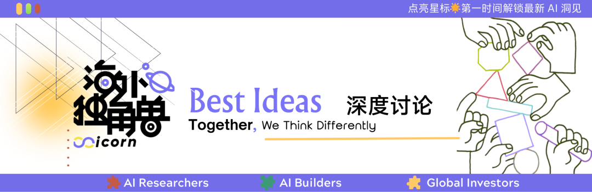](https://mp.weixin.qq.com/mp/appmsgalbum?__biz=Mzg2OTY0MDk0NQ==&action=getalbum&album_id=4157672299245862924&scene=21#wechat_redirect)

作者：Celia

编辑：Siqi　　⁠

25 年底，Dwarkesh 曾经问 Ilya，你是 AI 领域公认 research taste 最好的人，这种 taste 到底来自于什么？

⁠

Ilya 的回答是，这来自于对人脑的长期琢磨。对他来说，最好的想法往往同时满足两个条件：一是它是否从生物机制中得到了恰当的启发，二是它是否足够简单、优雅。这两者往往决定了它能不能触及更底层更通用的规律。

⁠

一个有意思的点是，最近我们和 AI researcher 聊天，好几个人都提到，自己又回头看了 Ilya 的一些访谈，越品越有味道。一方面，SSI 已经做出一些技术突破，开始进入 scaling 阶段，另一方面，关于 continual learning 等新范式的讨论，正重新回到话题中心。大家都想找些线索：一个多次判断对方向的人，究竟是怎么思考问题的。

⁠

这篇文章，我们就想沿着 Ilya 的这种生物视角，梳理一下进化中那些底层而优雅的机制，以及它们和 AI 之间的奇妙联系，比如：

⁠

1.生物智能的进化史上有哪 5 次突破？这和 AI 有哪些呼应？

⁠

2.Ilya 等几位最顶尖的 researcher，为什么都在重新思考 value function？它会通向 AI 的下一个范式吗？

⁠

3.人类几万年的合作史，能给 AI alignment 哪些启发？

⁠

这可能是海外独角兽历史上最务虚的一篇内容。主要讲的是几亿年的大脑演化和几万年的人类合作史，主角是线虫、鱼、老鼠和黑猩猩。

⁠

他们或许最后给不了 AI 什么直接指导，但生物机制本身已经足够有趣和迷人了，就像难得有机会从飞机舷窗俯瞰整座城市，我们得以在浩瀚的可能性中重新理解我们自身。

|  |  |  |
| --- | --- | --- |
| ⁠ | / | ⁠ |

01.

## Intro

⁠

我们先退后一步，思考一个宏大的问题：如果把进化想象成一位做了几亿年实验的 researcher，它到底在优化什么？

⁠

答案和今天 frontier labs 在做的事惊人地相似。

⁠

Frontier labs 眼下的工作可以归为两条主线：一是提升 intelligence，尤其是通过 RSI，让 AI 加速改进 AI；二是提升 alignment，让越来越强大的 AI，目标始终和人类对齐。

⁠

前者是一个确定性的现实。今年 5 月，Anthropic 联创 Jack Clark 给出的估计是：RSI 有六成概率在 2028 年底前出现，就在前几天，他又把这个时间点提前了一年，认为 full RSI 更可能在 27 年就完全实现，而不是 28 年。后者是未来最大的挑战。OpenAI 首席科学家 Jakub 的判断是，alignment 的进展可能追不上智能的进展。随着自我改进不断加速，瓶颈会从算力和数据，转向安全。

⁠

有意思的是，生物的进化也有两个方向，和这两条主线几乎可以一一对应。

⁠

进化史学者 John Stewart 在 *Evolution's Arrow* 里追问过一个根本性的问题：跨越所有物种、所有环境，有没有哪个方向，进化始终在奖励？

⁠

答案有且只有两个：

⁠

1.更高效地发现新的适应方式；

⁠

2.更大范围的结盟与合作。

⁠

前者可以简单理解为 intelligence 或者 RSI，也就是进化奖励的不是某个具体的解法，而是找到解法的能力本身。生物有了更好的通用能力来对外界进行建模、预测，从而适应和改造环境。

⁠

后者则很像 alignment。在生命史中有一个反复出现的模式：原本各自为战的单元，逐步融合成更大的协作体。分子聚成细胞，细胞组成多细胞生物，个体结成社会与文明。每一次跃迁，都要先解决一个问题：怎么让局部的目标和整体的目标对齐，同时保留一定的局部自主性。

⁠

接下来，我们就沿着这两条主线，看看进化这个漫长而无目的 researcher，分别试出了哪些解法。

⁠

⁠

02.

## 更强的 Intelligence

⁠

先看智能的进化。

⁠

Max Bennett 就此写过一本很精彩的书《智能简史》，很推荐感兴趣的 AI 从业者细读。

⁠

Max 是一个 AI 创始人，半路出家研究神经科学，所以他会把神经科学和 AI 放在一起讨论，思考生物的实现机制能给 AI 什么启发。在书中，他把 6 亿年的大脑演化压缩成了五次突破：

⁠

•Steering（转向），让生物能评价外界刺激，并据此选择行动；

⁠

•Reinforcing（强化学习），让早期脊椎动物从自己真正做过的动作中学习；

⁠

•Simulating（模拟），让早期哺乳动物从自己想象做过的动作中学习；

⁠

•Mentalizing（心智建模），让灵长类从别人真正做过的动作中学习；

⁠

•Language（语言），则让人类从别人想象过的动作和世界中学习。

⁠

有意思的是，这其中每一次生物智能的突破，几乎都能在 AI 史上找到一个对应的技术突破，只是 AI 的发展路线和生物进程恰好相反，这个我们后文细讲。

⁠

⁠

## 第一次突破：Steering

⁠

智能最初不是为了思考，而是为了转弯。

⁠

大约 6 亿年前，地球上已经有珊瑚、水母一类拥有神经和肌肉的动物。但它们大多辐射对称，身体朝哪个方向都差不多，也不需要决定下一步往哪里走。

⁠

真正的变化，发生在两侧对称动物出现之后。

⁠

它们开始有明确的头和尾，把主要的感官放在身体前方，朝一个方向移动。食物在左边，就向左。危险从右边靠近，就向另一侧逃。

⁠

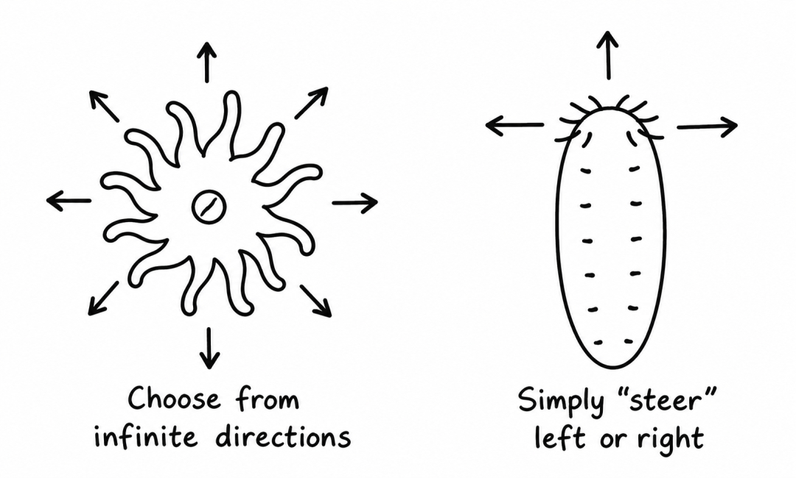

⁠

这听起来很简单，但只要一个生物必须主动选择方向，它就第一次需要一个中央决策系统，把来自身体各处的信号汇总起来，再输出一个统一行动。

⁠

麻烦在于，信号常常互相矛盾。如果食物在左边，危险也在左边呢？

⁠

要比较两种完全不同的信号，得先把它们换算成同一种货币。于是，一种最原始的价值判断机制出现了。神经科学里把它叫作 affect（情感状态），可以理解为情绪最古老的前身。它是生物最早的 value function，把食物、威胁、温度、同类等各种异质信号，投射到同一个低维空间里，让它们可以直接比较。

⁠

最基础的情感状态有两个维度：

⁠

•效价 （valence）：现在的局面是好是坏？

⁠

•唤醒度（arousal）：身体处于多高的激活水平，需要动员多少能量？

⁠

把这两个维度组合起来，就会得到四类基本状态：

⁠

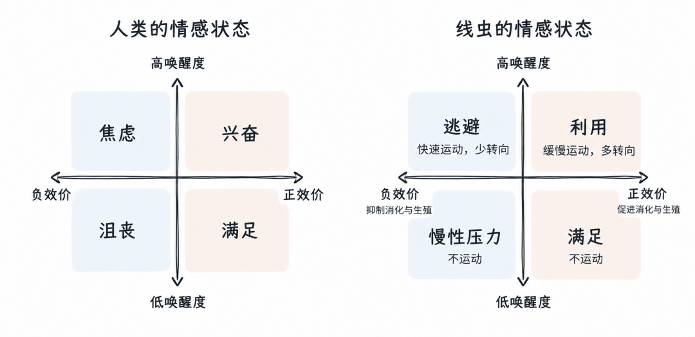

⁠

对线虫来说，这套系统可以回答两个性命攸关的问题：我应该留下还是离开？我现在值得花费多少能量行动？于是，复杂的反馈信号，可以被压缩成简单的行动直觉。

⁠

另外，这种情感状态还有一个有趣的特点，尽管它们由外部刺激触发，但在刺激消失后它们会持续很长时间。线虫嗅到捕食者后，会长时间地处于恐惧状态中，而人在和另一个不喜欢的人打交道后，也会郁闷几个小时。

⁠

这看上去像个生物进化的 bug，但它实际上是巧妙的，自然界中的气味梯度并不完美，比如水流可能暂时把食物气味冲散，也可能短暂遮住捕食者的信号。如果动物一闻不到气味就停止行动，导航会变得非常不稳定。

持续性的情感状态相当于一种记忆机制，从而告诉你，这个环境是有害/有益的。即使信号暂时消失，也要继续执行此前的策略。

⁠

## 第二次突破：Reinforcing

⁠

如果说转向让动物从环境的相关性中学习，强化学习就让动物从自己的行动中学习。它第一次开始主动为自己制造训练数据。

⁠

这一突破发生在大约 5 亿年前的寒武纪，主角是第一批脊椎动物，也就是最早的鱼。

⁠

鱼比线虫多解决了一个问题：不只要知道什么东西是好的，还要知道自己的哪个动作带来了好结果。奖励往往来得很晚，前面一长串动作里，到底哪一步起了作用？这就是时间上的 credit assignment 问题。当年曾经被列为 AI 的核心难题之一。

⁠

AI 领域的解法，是 Richard Sutton 在八十年代提出的时序差分学习（TD learning）。

⁠

它把决策拆成两个系统：

⁠

•Actor 负责选择下一步行动；

⁠

•Critic 估计当前状态未来能带来多少回报。

⁠

这样，系统不必等到食物真的出现，才判断刚才的动作好不好。比如，鱼转了一个弯，Critic 对找到食物的估计从 20% 提高到 60%，这个转弯就有了值得强化的信号。学习可以来自预期的变化，而不必只等最终结果。

⁠

这个算法被发明十几年后，神经科学家在大脑中发现了几乎一模一样的机制。

⁠

大脑内的基底神经节类似 Actor，它负责选择下一步行动。多巴胺则很像 Critic，鼓励生物做出下一步趋近于目标的行为。

⁠

一个经典实验发现，猴子意外喝到果汁时，一些多巴胺神经元会兴奋起来。等猴子学会某个提示意味着果汁要来了，兴奋就提前到了提示出现的那一刻，果汁本身反而不再引起反应。如果提示出现，果汁却没来，神经元的活动就会下降。

多巴胺编码的不是奖励本身，而是 reward prediction error，事情比预期好了多少，或差了多少。和 TD learning 中的预测误差，几乎完全对应。

⁠

动物因此可以一边行动，一边修正预期，逐渐学会哪些动作能让未来变得更好。

⁠

但它只解决了一半问题。如果系统总是选择过去回报最高的动作，它会很快陷入局部最优，永远在已知最好的觅食区打转，错过更好的可能。

⁠

于是进化又催生了好奇心，它告诉动物，新信息本身就有 reward，未知的东西值得去看看。

⁠

这样，进化就有了两套绝妙的 reward 机制：多巴胺负责 exploit，它鼓励生物做出下一步更靠近目标的行为，好奇心负责 explore，它越过经验的边界，鼓励生物看似无意义的探索。二者在 exploit 和 explore 之间维持张力，让生物系统能找到一个最优的行动路线。

⁠

## 第三次突破：Simulating

⁠

大约 2 亿年前，早期哺乳动物出现了。它们体型很小，在恐龙的阴影下过着夜行生活。温血带来很高的能耗，每犯一次错代价都很大。正是在这种压力下，它们长出了新皮质。

⁠

新皮质本质上是一个生成模型：大脑不断预测“外面应该是什么样”，再用感官输入校正预测。先 generate，再 compare，再 update。

⁠

这带来了第三次突破：把一部分试错从体外搬进了脑内。

⁠

真实试错有成本。走错路会浪费时间，跳错树枝可能摔下去。如果能在行动之前，先比较几种可能结果，动物就不必亲自付代价。

⁠

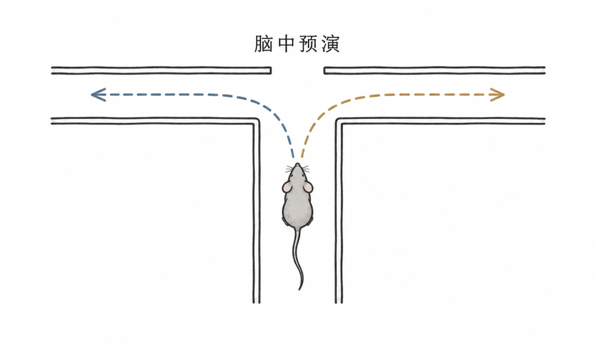

⁠

研究人员发现，老鼠走到迷宫岔路口时，经常会停下来左右张望。研究者观察它的脑区活动，发现这些神经元会快速依次点亮两条可能路线上的位置，老鼠没有迈步，但它的大脑已经把左右两条路各走了一遍。

⁠

同时，模拟也能看向过去。老鼠错过一个好选项后会回头张望，大脑里重新浮现那个被放弃的选择。它学会了“后悔”，而后悔本身就是一种学习信号。

⁠

从此，动物可以在行动前比较多个未来，可以回放过去、形成记忆，也可以想象一种从没做过、但可能有效的行动。

⁠

从 AI 的角度看，这就是 world model、RL 和 planning 的生物版本：用便宜、安全、可并行的想象，替代昂贵的真实交互。

⁠

## 第四次突破：Mentalizing

⁠

6600 万年前，一颗小行星终结了恐龙时代。灵长类在树上繁衍起来，群体生活越来越复杂。

⁠

对一只灵长类来说，最难预测的环境，不是天气，也不是猎物，而是同类。人类学家发现，灵长类新皮质的相对大小，和群体规模高度相关。这就是“社会脑假说”：推动灵长类变聪明的，主要不是物理世界，而是彼此。

⁠

谁知道食物藏在哪里、未来谁可能成为首领、哪个个体值得结盟...... 这些问题都要求它们不只建立世界模型，还要建立“别人脑中的世界模型”。黑猩猩会根据其他个体看见过什么来藏匿食物，说明它们至少在一定程度上能够区分：我知道什么，对方又知道什么。

⁠

这带来了两个新能力。

⁠

•一是向别人学习。

⁠

当一只黑猩猩看见别人费力地搬起箱子时，他并不只是分析箱子的运动轨迹。自己的运动系统也会在内部模拟那个动作：“如果是我，只有箱子很重时，手臂才会这样调整。”

⁠

•二是为未来的自己做计划。

⁠

这套能力还让灵长类能够模拟“未来的自己”。一只大鼠会在口渴时找水，却很难在不渴的时候，替明天的自己存水。黑猩猩却会挑出合适的工具带走，留到第二天再用。

⁠

神经科学家 Hal Hershfield 发现，人想象十年后的自己时，大脑的活动模式更像在想一个陌生人。为未来做计划，本质上也是心智建模的一个附加作用。

⁠

## 第五次突破：Language

⁠

语言把彼此独立的大脑，连接成了一个更紧密的学习系统。

⁠

“河流上游有一处可以渡过去的浅滩。” 听到这句话，一个从未去过那里的人，就能在自己的地图上添上一个位置。

⁠

语言由此扩展了学习的材料。一个人脑中的 world model，可以被编码成语言，再在另一个人的脑中展开。听者没有亲自行动，也能利用对方的经历与想象，更新自己的世界模型。

⁠

于是，横向上，合作的规模急剧扩大。神话、宗教、货币、国家、公司制相继诞生，人们可以围绕一个共同的愿景，让成千上万人的经验与能力投入同一个问题。

⁠

纵向上，checkpoint 代代相传。个体学到的一切，不再随个体死去。后人可以站在前人的肩膀上继续改进。而且产生知识的方法也不断演化。文字让记忆外置，教育改进学习，科学方法改进发现。

⁠

可以说，语言是碳基生物 RSI 的起点：一个系统不仅能积累改进，还能改进产生改进的方法。进化由此把接力棒交给了文明，智能的迭代速度开始指数级加快。

⁠

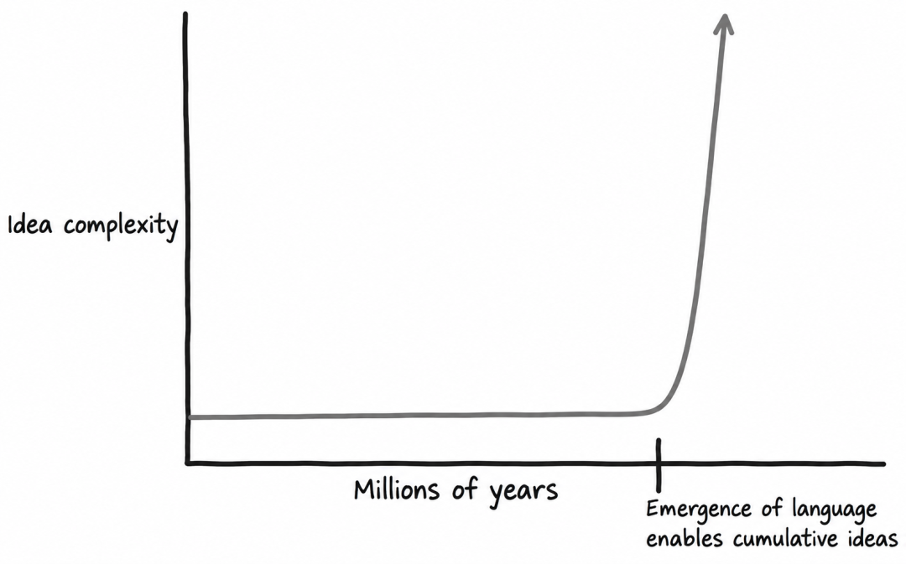

⁠

回头看这五次突破，学习材料的范围一直在扩大：

⁠

•转向，让生物建立了自己的 value function，能对外界刺激做出评价和反应；

⁠

•强化学习，让它能从自己真正做过的动作中学习；

⁠

•模拟，让它能从自己想象过的动作中学习；

⁠

•心智建模，让它能从别人真正做过的动作中学习；

⁠

•语言，让它能从别人想象过的动作和世界中学习。

⁠

其中贯穿的主线是 “经验的虚拟化”：一个生物越来越能够利用自己没有亲身经历过的经验。

⁠

大模型走的路线几乎相反。

⁠

我们先用整个人类文明留下的文字训练出一个系统，让它一出生就能谈论爱情、代码和量子力学，然后才一层层往回补课：

⁠

•预训练，让模型从人类想象过的动作和世界中学习；

⁠

•SFT，让模型从人类真正示范过的动作中学习；

⁠

•思维链（CoT），让模型在回答之前，先在想象中推演；

⁠

•RL，让模型从自己真正做过的选择中学习；

⁠

•多模态、工具调用和 agentic 能力，让模型开始感知真实环境，并在其中行动。

⁠

这些对应并不严格，但它们指向了一个变化。David Silver 和 Richard Sutton 把 AI 的下一阶段称作 The Era of Experience。AI 的能力增长，将越来越多地来自它亲身与环境互动、试错、观察结果后产生的经验。比如：

⁠

•一个编程 Agent 可以根据报错和测试结果一轮轮调整解法；

⁠

•一个教学 Agent 可以连续几个月跟踪一个学生，根据成绩起伏调整教学方法；

⁠

•一个科学 Agent 可以自己提出假设、安排实验，再用实验结果修正对世界的理解。

⁠

反馈会越来越少来自人类，越来越多来自真实世界的后果。如果说生物进化的主线是把经验一层层虚拟化，那么大模型走的就是反方向，从最二手的经验出发，一点点去够一手经验。

⁠

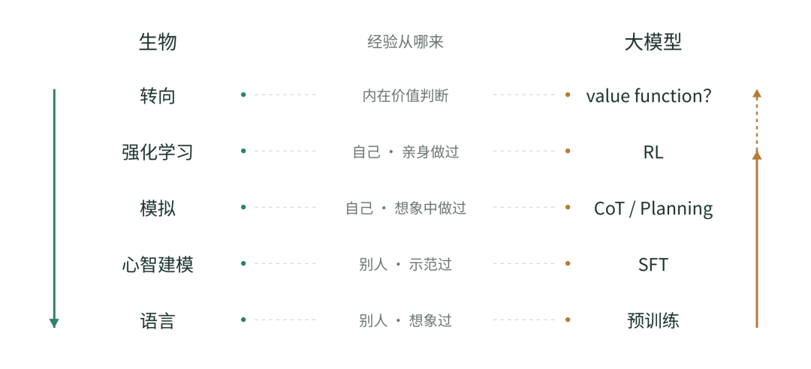

⁠

现在我们已经知道怎么给它装上感官和手脚，唯独最前面那一步还没补上，也就是一个属于它自己的 value function，就像最早学会转向的线虫身上那枚指引行动的内在罗盘。

⁠

AI 也许最终还是要补上这一部分。据说 Ilya 现在就在重点研究 inner value model。

⁠

其实不止 ilya，现在探索下一代范式，想实现根本意义上的持续学习的 Neolabs 里，最出名的三家大概是 Ilya 的 SSI，前 OpenAI 推理负责人 Jerry Tworek 的 Core Automation 和强化学习之父 Richard Sutton 的 Oak Lab。他们都倾向于认为，补齐某种形式的 value function 是解决终极持续学习的一个重要组件。

⁠

他们三个人分别提到过一些片段式的原因：

⁠

Ilya:

⁠

Ilya 的信念来源似乎和最开始思考神经元的连接一样，依然是人脑。

⁠

他在 25 年底曾经在播客里和 Dwarkesh 讨论过一个问题：新手学开车，没有教练，为什么也知道自己开得好不好，还能自我纠正？

⁠

Ilya 的答案是：人有自己的 value function。

⁠

人类的学习过程一向主要来自与环境的互动和内心的感觉，这是一种很高效的无监督学习形式，而未来一个可能的突破点在于让模型也具备这种直觉性的中途判断能力。

⁠

持续学习现在最关键的一个卡点就是 sample efficiency 太差，如果能拥有这种 inner value function，AI 的学习效率就会有质的飞跃。

⁠

而且他强调，人类进化过程中有一个非常神奇的特质，那就是我们进化出了一些很高级的价值函数，比如 “社会地位”。

⁠

要知道，喜欢好吃的食物很简单，只要给大脑接一个味觉传感器，设定化学反应奖励就行。但 “社会地位” 是一个极其抽象的概念，大脑需要处理无数信息才能理解。基因本身不智能，它怎么知道如何连线神经元，才能让人类产生这种高级情感呢？

⁠

而且这套价值观从远古一直用到今天，世界天翻地覆，它依然极其可靠，只有成瘾等少数极端情况例外。

⁠

既然盲目的进化都能成功地把 “高级价值观” 编码给人类，让它稳健地指导人类世世代代的生活，那么我们设计超级智能时，应该也存在某种方法，能把比如 “关爱生命” 这种高级目标教给 AI。

⁠

如果能理解进化如何编码这些价值函数，我们或许就能同时获得两方面的启发：怎样让 AI 更高效地从经验中学习，以及怎样实现 alignment。

⁠

价值函数的具体形式仍有待探索，但 Ilya 对它发挥作用很有信心，他甚至强调，即使现在还没用，未来也一定有用。

⁠

（不过，我们也听过相反的判断，有 researcher 认为这条路完全走不通，Ilya 可能是在释放烟雾弹。)

⁠

Jerry Tworek:

⁠

OpenAI 前推理负责人 JT 更关注的是目标怎么定。他曾说，当前 continual learning 的核心问题，不在架构或算法，而在于怎么定义一个更好的 objective function。

⁠

在他看来，一个更好的目标要满足几个条件。第一，它不能太平凡，得足够难。第二，它要能持续产生学习信号，而不依赖大量人工标注的数据，也不依赖静态的数据。

⁠

人类就是一个类比。人的优化目标非常简单：生存、繁衍，再加上好奇心等一些点缀，但经过漫长的训练，一个简单的目标就能长出复杂的智能。

⁠

Richard Sutton:

⁠

Richard Sutton 也在两个月前的 WAIC 上提到，value function 是下一代范式的一个关键组件。

⁠

在他看来，Reward 只描述当前收到的好坏信号，而 value function 能评估当前处境未来可能带来的整体后果。

⁠

Agent 不能只追求明确的奖励信号，也仍然需要价值函数，才能把眼前收益和长远结果联系起来。

⁠

对于模型解决的每一个小问题，它的 value function 都是三部分之和的期望

⁠

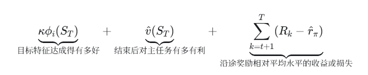

也就是说，系统需要同时考虑三个方面：

•事情有没有做成。

⁠

•做成以后，自己留下了怎样的局面。

⁠

•为了做成这件事，途中付出了多少代价、获得了什么额外收益。

⁠

　⁠

⁠

03.

## 更高层的 alignment

⁠

我们再来看第二条主线。

⁠

前面讲的是进化如何造出更强的个体。但进化同时在做另一件事：让这些个体组成更大的系统。

⁠

一些研究进化史的学者认为，如果进化存在一个目的，这个目的叫做 increasing non-zero-sumness （不断扩大的非零和游戏）。

⁠

社会关系可以粗略分为两种：零和、非零和。

⁠

零和意味着，一方的收益来自另一方的损失，非零和则意味着，各方的利益彼此关联，合作可以共同获益，冲突会让双方受损。

⁠

无论生物演化还是文化演化，非零和的程度都在不断提高。所以原本独立的个体，会逐渐结合成更大、更复杂、彼此依赖更深的合作系统。

⁠

比如生命史中的重大转变，经常是原先独立的单位形成新的合作整体：

⁠

分子聚成细胞 → 细胞吞掉一个细菌，拥有了线粒体 → 单细胞组成多细胞生物 →生物个体组成蚁群等社会群体→ 群体扩展成社会与文明

⁠

人类社会也呈现类似趋势。过去一万年里，人类合作的范围不断扩大：

⁠

部落 → 村落 → 城邦 → 国家 → 全球分工体系

⁠

现代人的日常生活，建立在无数陌生人的劳动之上：有人生产食物，有人制造芯片，有人维护电网，还有人开发软件、运输商品。我们不必彼此认识，却已经深深嵌入了彼此的生活。

⁠

而每一次这样的跃迁，首先都要解决一个 alignment 问题。组成整体的单位原本各有各的想法，每往上组合一层，都要先让局部的目标和整体的目标进行对齐。

⁠

多细胞生物是一个直观的例子。身体里的每个细胞都放弃了随意分裂的自由，换来的是整个生物体更强的生存和繁殖能力。一旦某个细胞重新只顾自己、无限复制，就会形成癌变。为此，生物进化出了细胞自毁、免疫清除等一整套机制，把失控的细胞清除掉。可以说，每一个活着的多细胞生物，本身就是一个解决得还不错的对齐问题。

⁠

但人类社会和细胞有一个区别：多细胞生物起码共享同一套基因，但社会中的人有着更加不同的利益和偏好，没有什么能天然担保大家方向一致。每个人都有自己的打算，随时可能搭便车甚至背叛。

⁠

所以人类社会渐渐发展出了三层 alignment 机制：

⁠

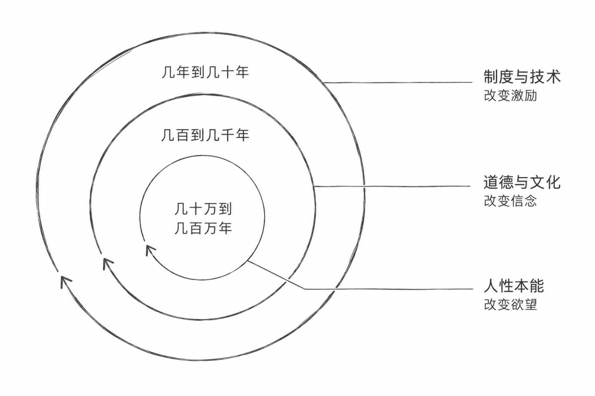

⁠

1. 制度的演化

⁠

三层机制中，制度通常最容易先发挥作用。它通过调整激励，让人们更愿意合作，并为背叛设定代价。

⁠

人类要扩大合作，至少需要跨过两道门槛：信息和信任。

⁠

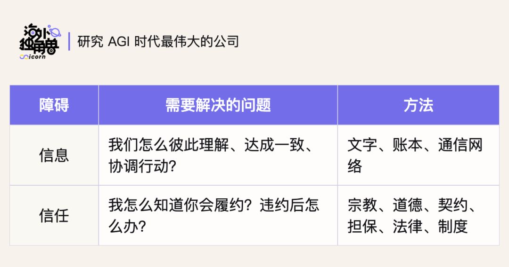

⁠

人类历史的基本剧情，就是技术一直在压低第一道坎，制度紧跟着解决第二道。和今天 frontier lab 的情况类似：模型能力先有突破，alignment 再逐步补齐。

⁠

现代经济和政治制度的诞生，就是一个例子。

⁠

经济上，航海和生产技术的进步让远方的市场变得可知、可达，但远洋贸易要投入巨额资本，陌生人之间谁也不敢把钱托付给谁。于是股份公司和现代金融制度出现，让互不相识的人也敢把钱凑到一起去冒险。全球商贸体系由此成形。

⁠

政治上，印刷术和商业扩张让国家和商人之间出现了巨大的合作空间：国家需要税款和贷款，商人需要秩序和保护。但双方卡在同一个信任问题上，能保护你财产的政府，也能夺走它。分权的做法由此在英国萌芽，后来美国把三权分立的思想发扬光大，立法、司法、行政互相制约，现代民主国家在这个基础上崛起。

⁠

把这个模式抽象出来，就是一个不断强化的循环：

⁠

技术降低沟通和信任的成本 → 更多人可以合作 → 规则和治理机制在合作中逐渐完善 → 产生更多知识与技术 → 合作网络进一步扩大。

⁠

这套循环已经延续了几千年。在这个过程中，有两点让人出乎意料：

⁠

1）制度往往比技术突破慢得多。两者之间漫长的时间差，就是历史上的动荡期。

⁠

比如，印刷术在 15 世纪中叶打破了信息门槛，越来越多人可以自己读经，教会原有的权威受到挑战。但社会并没有马上找到容纳不同信仰的办法。欧洲先经历了宗教改革和一个多世纪的宗教战争，才慢慢长出宗教宽容和主权国家这样的制度来消化它。

⁠

2）这些制度几乎没有一个是事先设计好的。

⁠

比如，股份公司不是一个灵光一现的设想。从中世纪意大利的合伙契约，到一船一结的远航集资，再到荷兰东印度公司，中间经历了几百年的漫长迭代。三权分立的思想也一样。内战、弑君、共和、复辟、再革命，前后折腾了近半个世纪，中间内战人口的死亡率超过了第一次世界大战，才试出英国约束王权的那套解法。

⁠

哲学家亚当·弗格森说过一句名言：制度是人类行动的结果，而不是人类设计的产物。各个民族往往是一路摸索，才撞上了这些制度。

⁠

我们今天习以为常的制度，背后有过无数次破产、战争和革命。试错最后留下了解法，也付出了真实的代价。

⁠

这对 AI alignment 提供了一些参照。如果人类用了这么久，才逐渐找到一些有效的合作方式，AI 的 alignment 更加黑盒，大概也没法在白板上设计出来，只能在真实部署里不断试错和修补。

⁠

Ilya 后来也谈过自己在这件事上的变化。SSI 最初想避开市场竞争，直接做出超级智能再公开。后来，他意识到需要渐进式地放出一些东西。让社会更早看见 AI 能做什么、会在哪些地方出现 misalignment，才有时间准备和调整。

⁠

2. 道德圈的扩大

⁠

制度有两个难以避免的问题：监督需要成本，规则总有漏洞。社会要维持合作，还得让人在没人看着的时候，也愿意顾及他人。道德、宗教和文化承担了这样的作用。

⁠

一个有意思的现象是，在文明的发展过程中，道德圈也在不断扩大。Peter Singer 把这个过程写成了一本书 *The Expanding Circle*。

⁠

人类早期社会里，道德关怀往往只覆盖部落和亲属。当时许多部落给自己起的名字，意思就是“人”，言外之意是圈外之人都不太算人。

⁠

随着社会扩大，人类才逐渐把更多人纳入“自己人”的范围：

⁠

家庭 → 部落 → 城市 → 国家 → 全人类

⁠

今天，很多人进一步把动物、生态系统甚至未来世代纳入道德考虑。

⁠

那么，是什么决定了道德圈的半径？

⁠

一个比较有解释力的说法是：道德圈的半径，大致等于非零和游戏的半径。

⁠

道德圈变大，并不单纯是因为人突然变善良了，更多是因为社会结构让不同群体越来越相互依赖。当陌生人的行为会影响你的生活，你也能从陌生人的成功中获益时，把对方视为值得合作和关心的人，就越来越符合现实利益。

⁠

我们之所以越来越需要关心远方的人，是因为他们的命运越来越实际地影响着我们。

⁠

道德圈还只是其中一个切面，什么值得追求，怎样才算好好过完一生，这些更广义的价值观，同样是社会结构的产物。比如，几十年前，低买高卖还叫“投机倒把”，是写进刑法的罪名，直到 1997 年修订刑法才被删去。改革开放之后，同样的行为先被默许，再被鼓励，后来有了一个体面的名字：企业家精神。

⁠

价值观看上去像是信念，其实更像一种适应。它是一个特定环境下让人利益最大化的 reward function。

⁠

这给 AI alignment 的启发是，价值观是一个流动的概念。AI 或许不该对齐现在主流遵从的东西，而该对齐 AI 时代更需要的东西，对齐那些 “如果我们知道得更多、格局更大、更接近我们希望成为的那种人” 时会想要的东西。

⁠

设想一下，AGI 诞生在 1800 年。

⁠

它完美对齐了当时的主流道德。于是它会帮种植园主优化奴隶的排班，会认为女人没必要投票，也不觉得虐待动物有多大问题。它忠实维护的，恰好可能是后来的人努力改变的。

⁠

如果每个时代的价值观都只是一个 checkpoint，那么把 AI 对齐到 2026 年的价值观，就可能把我们今天的很多局限性一起冻结进去。

⁠

所以我们要对齐的也许不是价值观的某个 checkpoint，而是一套改进价值观的方法，让价值观本身也能实现某种 RSI。Anthropic 今年更新的新版 Claude 宪法也从原本的行为原则清单，改成了重点解释 Claude 为什么应该这样做，让 Claude 理解人类最底层的意图，一起向更深处追问。

⁠

3. 人类的自我驯化

⁠

最后，人类更特别的地方在于，基因是自私的，但人性是无私的。

⁠

这背后，是几十万年的互相筛选。

⁠

我们会自然欣赏那些能够理解和帮助他人、不以自我为中心，而是让周围人一起变好的人。

⁠

比如，一个人能找到更好的狩猎和组织方式，能凝聚大家，能调解群体内部的冲突。这样的人不仅自己聪明，还能提高整个群体的产出，所以更容易赢得地位、信任和繁殖机会。心理学家 David Buss 在 37 个文化里做过调查，无论男女，“善良体贴”都排在择偶标准的最前列。

⁠

而那些经常伤害同伴、只顾自己的人，则会被群体惩罚。灵长类学家 Richard Wrangham 认为，这种集体惩罚持续了几十万年，相当于人类对自己做了一次“驯化”，好斗的个体一代代被淘汰，人变得越来越温和、合群。

⁠

一推一拉之间，人类进化出来的不只是解决个人问题的智力，还有一整套社会装备：理解他人意图的能力、共情、公平感、内疚、羞耻心。其中最精妙的是内疚和羞耻。群体不可能永远在场，于是惩罚直接住进了人的内心。从这个角度看，人的大脑很大程度上已经演变为了一台追求非零和游戏的机器。

⁠

这种筛选最深的产物，是我们不仅演化出了欣赏这类人的倾向，也能从自己参与这种活动中获得意义感。

⁠

很多研究发现，长期幸福感往往与这些目标相关：利他行为、社会参与、对家人和朋友的投入、参与比个人更大的事业。

⁠

相比之下，只追逐金钱和地位，有点像 reward hacking：刷高了一个代理指标，但未必能获得持久的意义感和幸福感。就像哈佛那个著名的长期研究发现，最能预测晚年幸福的是人际关系的质量，财富和名望反倒没那么重要。

⁠

当人类长期以来都是因为能够参与和创造非零和合作而获得社会奖励，我们的大脑便也已经演化出了相应的心理机制：

⁠

帮助别人、投身于一件比自己更大的事情，本身就能带来满足和意义。反过来，失去了与人的连接，只剩地位上的比较，就容易焦虑和空虚。

⁠

几十万年的相互筛选，就像一场漫长的 RLHF。最后，评分员的偏好被蒸馏进了每个人自己的奖励函数。

⁠

于是，发现和推动非零和合作，同时有三层价值：

⁠

•客观价值：能形成更有生产力的系统；

⁠

•社会价值：能给个人带来信任和资源；

⁠

•主观价值：人类已经进化出了从中感受意义的能力。

⁠

客观世界需要它，社会关系奖励它，个人内心也会感受到它。从这个意义上说，人类被塑造成了一种注定要追求 alignment 的生物。

⁠

回到 AI，我们也许需要找到类似的支撑。

⁠

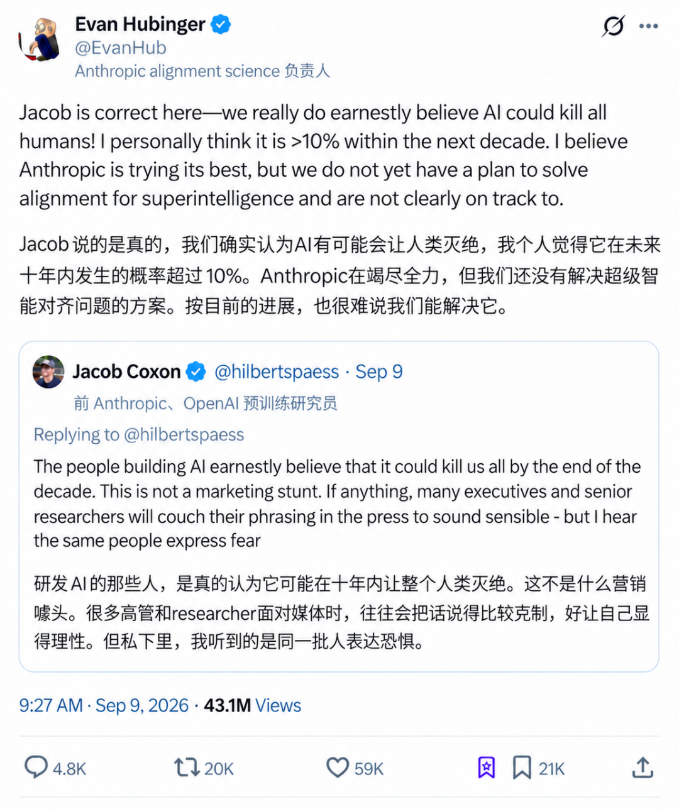

⁠

国内的体感并不明显，但如果和海外头部两家 Labs 的朋友交流，大家现在最关心和最担心的问题基本都是 AI 安全。

ASI 几乎是一个注定要发生的事情，我们也会面临一个越发危险的局面。

⁠

今天的主流做法仍然偏规则设计：写 spec、写 constitution、定义 reward。但 reward hacking 和人类钻空子是同一件事，被约束的对象越聪明，就越容易走出预先设定的边界，失控的风险也越大。

⁠

进化没有写过规则，它只是搭了一个让合作胜出的环境，再把在意别人写进本能。

⁠

也许我们最终还是要找到一种方法：要么搭建合适的环境和筛选机制，让与人类对齐成为长期的最优策略，要么找到某种编码方式，像 Ilya 说的，让 AI 真心关爱有感知的生命。

|  |  |  |
| --- | --- | --- |
| ⁠ | ⁠ | ⁠ |

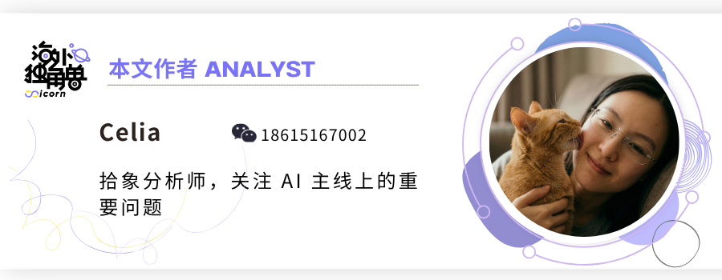

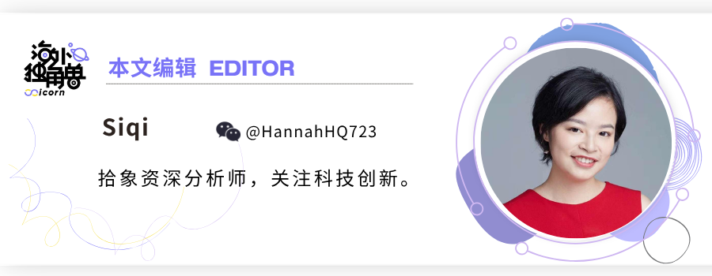

|  |  |  |
| --- | --- | --- |
| ⁠ | ⁠ | ⁠ |

延伸阅读

[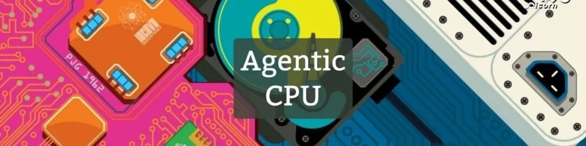](https://mp.weixin.qq.com/s?__biz=Mzg2OTY0MDk0NQ==&mid=2247527356&idx=1&sn=557235f4f84e2f65ff0f6b0e909fa0da&scene=21#wechat_redirect)⁠

|  |  |
| --- | --- |
| 为什么 CPU 重新变得重要？ | › |

⁠

|  |  |
| --- | --- |
| 和一线研究员的闭门讨论：蒸馏变难后，下一步的重点是什么？ | › |

⁠

|  |  |
| --- | --- |
| Latent Labs：Alphafold 3 发布两年，AI 药物设计进展到了哪一步？ | › |

⁠

|  |  |
| --- | --- |
| Astra 的 Computer Use 能力是如何实现的？ | › |

⁠

|  |  |
| --- | --- |
| 2 万亿美元的 Anthropic 值不值得买？ | › |
