

作者：Daniel

编辑：Cage　⁠

模型开发的 RSI 已经得到了初步实现，在芯片设计领域，这条路径也在逐步跑通：AI 已经在深度参与电路设计、验证与优化，并根据反馈修改方案。目前 AI 正在将芯片设计 18～24 个月的周期压缩至一年之内。

⁠

模型公司也在大力发展这个方向，OpenAI 与 Broadcom 合作的推理 Jalapeño 芯片代表着模型公司正在自己下场打造芯片。除了自研芯片，模型公司还在推动 Coding Agent 接入 EDA 工具链，并与 EDA 巨头联手开发芯片专用模型，从芯片设计与工具两端同时发力。

⁠

芯片设计是一个适合 RSI 的领域已经成了业内共识。包括 Jeff Dean 创立的 Discovery Loop，也明确会涉及芯片设计。除此之外，今年也有很多初创公司广受关注，大致可以分为三类：

⁠

•Chip Design Agent 公司：加速芯片开发。接入客户现有 EDA 流程，协助设计、验证和调试，并在持续使用中积累客户工程经验 close the loop。

⁠

•RL 环境公司：培养模型的芯片设计能力。把难以获取的工程反馈组织成训练任务、工具环境与评价机制，直接受益于模型公司对芯片设计能力的投入。

⁠

•AI Native 芯片公司：降低定制芯片门槛。以 AI 重组研发流程，直接交付定制设计或芯片，让更多企业拥有专用硬件实现芯片设计能力平权。

⁠

这里第一类公司更接近工具层，第二类更接近模型训练层，第三类则直接参与芯片竞争。

⁠

我们认为，芯片设计流程中最核心的壁垒是数据和 IP：真实设计大多沉淀在芯片公司内部，成熟 IP 与工程经验也难以复制。因此优先看好两类公司：一是深入客户现有工作流的 Chip Design Agent 公司，在使用中持续积累客户工程经验、提高切换成本，护城河更深，但短期内起量较慢，且面临模型公司的竞争；二是为模型公司打造训练环境的 RL 环境公司，直接承接模型公司对芯片设计能力的核心需求，收入兑现更快、确定性更高。AI Native 芯片公司长期空间值得期待，但商业兑现周期更长，也容易芯片公司被视为竞争对手，合作和数据获取也会更困难。

⁠/⁠

01.

## 行业现状

⁠

芯片设计是一个高度依赖工程经验和人力投入的行业，每年有超过 800 亿美元的人力成本。随着芯片越来越复杂，设计工作量持续增加，行业面临两大问题：

⁠

•如何让有限的工程师完成更多设计：随着芯片越来越复杂，设计的工作量也水涨船高，而行业长期面临人才短缺，约 53% 的半导体企业反映难以招募到具备先进 EDA 平台专业知识的工程师。如何让有限的人力完成更多设计，正在成为芯片行业的重要问题。

⁠

•芯片开发的速度越来越难以匹配需求变化：AI 的需求正在加速演进，不同场景需要不同的计算架构。企业却仍需提前数年预测工作负载，再投入漫长的开发与验证过程。有时芯片还没做出来，AI 已经出现了新的计算需求和执行模式变化，原来芯片的架构不再支持。

⁠

AI 在算子优化上的进展，为芯片设计行业提供了一个很好的先行案例。在一些目标明确、结果可以验证的任务中，AI 已经能够通过反复修改代码、测试和筛选，找到优于已有人工实现的方案。芯片设计也包含大量这样的迭代：工程师修改电路，调用 EDA 工具检查功能、评估功耗和性能，再据此调整方案。这为 Agent 提供了发挥空间。只是相比算子优化，复杂电路的评估往往更慢，也更昂贵。

⁠

今年 AI 在芯片设计领域也广受资本市场关注，今年 1 月，来自 Google AlphaChip 的 AI Native 芯片公司 Ricursive Intelligence 完成了 $3 亿 A 轮融资，投后估值达到 $40 亿，开启了硅谷对芯片设计领域的关注。从今年融资看，Chip Design Agent 与 AI Native 芯片公司是今年最常见的两条路线：前者合计融资约 $1.8 亿，后者约 $3.8 亿（主要由 Ricursive Intelligence 贡献）。

⁠

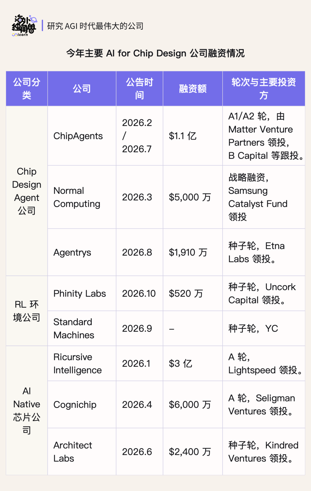

⁠

⁠

02.

## EDA：芯片设计背后的高壁垒生意

⁠

EDA，即电子设计自动化，是工程师设计芯片所使用的软件工具。从描述电路功能、检查设计是否正确，到安排元件的位置和连线，EDA 贯穿芯片开发的主要环节，帮助工程师把设计想法变成能够交给晶圆厂制造的版图。

⁠

EDA 是一个年收入百亿美元级、由少数头部公司主导的市场。按 SEMI/ESD Alliance 的季度数据加总，2025 年全球 EDA 工具收入约为 $125 亿；如果计入半导体 IP 和相关服务，广义电子系统设计市场约为 $212 亿。

⁠

这是一个高度集中、进入壁垒极高的行业。2025 财年 Synopsys 和 Cadence 的收入分别约为 $70.5 亿和 $53.0 亿。Synopsys、Cadence 和 Siemens EDA 三家巨头合计占据全球 EDA 收入的 90% 以上。它们凭借长期研发投入、与晶圆厂工艺设计套件（PDK）的深度适配，以及大量经过验证的半导体 IP，建立了难以复制的优势。对客户而言，工具是否可靠尤其重要：芯片制造成本高，一处设计错误就可能带来数月延误和耗费上千万美元的重新流片。

⁠

EDA 工具早已经与客户、晶圆厂的开发流程有着极深的绑定。企业围绕这些工具积累了设计代码、IP 库和自动化脚本，工程师也形成了相应的使用经验。更换工具需要重新适配和验证，切换成本高，使头部厂商拥有较强的定价能力和稳定的客户关系。

⁠

与半导体行业相比，EDA 的收入表现更有韧性。其收入主要来自软件授权与订阅，需求更多由下一代产品研发、技术迭代和设计复杂度驱动。过去十余年，Synopsys 和 Cadence 即便在半导体下行周期中，也总体保持了营收增长。这与客户的预算结构有关：EDA 费用通常来自研发预算，而非资本开支。市场低迷时，企业可以推迟扩产，但很难长期停止下一代芯片的研发。

⁠

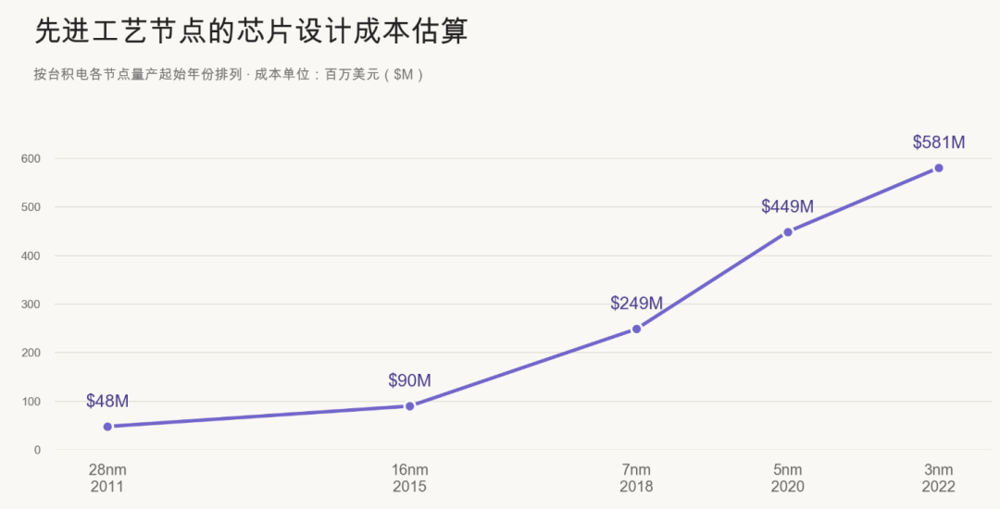

新的计算需求不断推动芯片开发，芯片设计的成本水涨船高

⁠

⁠

03.

## 一颗芯片被设计出来需要经过哪些步骤

⁠

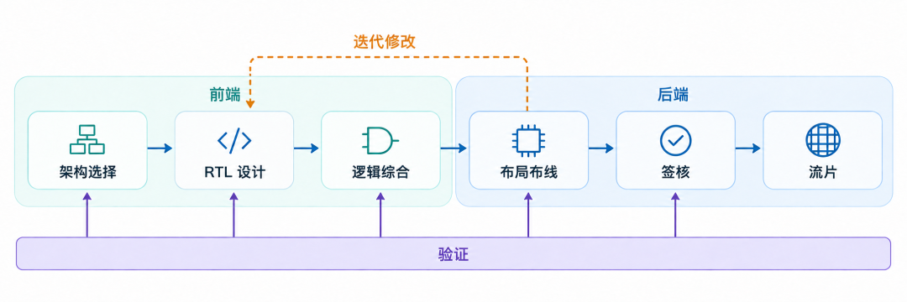

⁠

要理解这些机会，先看一颗芯片是怎样被设计出来的。

⁠

以数字芯片的设计周期为例，从想法到流片，首先要明确功能和性能目标，再由工程师编写 RTL 代码，描述电路如何工作。团队一边开发，一边通过测试检查设计是否符合要求。随后，设计工具将代码转换为实际的电路版图，安排元件的位置和连线。完成检查后，版图才会交给晶圆厂制造。

⁠

这个过程最耗时的，是反复检查和修改。代码中的错误需要排查，电路运行速度不够快、功耗过高或面积过大，也可能要求团队重新调整设计。每次修改后，还要再次测试，确认没有引入新的问题。专家访谈提到，在复杂逻辑芯片约两年的设计周期中，仅 RTL 编写和功能验证就可能需要 12—14 个月。

⁠

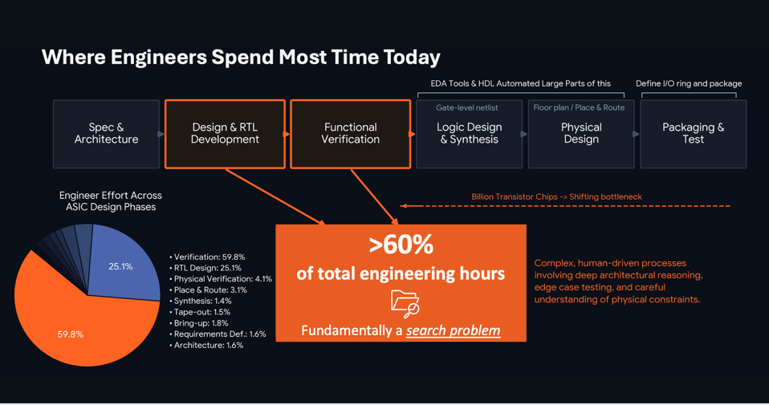

ChipAgents 发布的报告称，功能验证占工程投入时间约 60%，RTL 设计占约 25%，两者合计约 85%。

⁠

芯片设计中的这些任务，十分适合 AI 发挥：目标相对明确，操作集中在代码和工程工具中，结果可以通过仿真、验证和性能分析来检查。AI 因此有机会反复执行“提出方案—运行工具—根据反馈修改”的过程，减少人工操作，加快设计迭代。

⁠

这也为 AI 的持续改进提供了条件：设计方案可以交给工具测试，执行过程和结果又能成为模型训练的反馈。但我们同样能观察到：越接近真实世界，模型试错通常越贵、越慢。芯片设计虽然有可反复测试的软件流程，但可靠反馈并不容易。综合阶段看起来更好的方案，经过布局布线后往往未必更好；要判断一次修改是否有效，往往需要运行后续流程，而中间反馈就可能耗费数天。

⁠

这也给了创业公司发展的契机，如果从最终向客户的交付物来分类，可以分为三类：

⁠

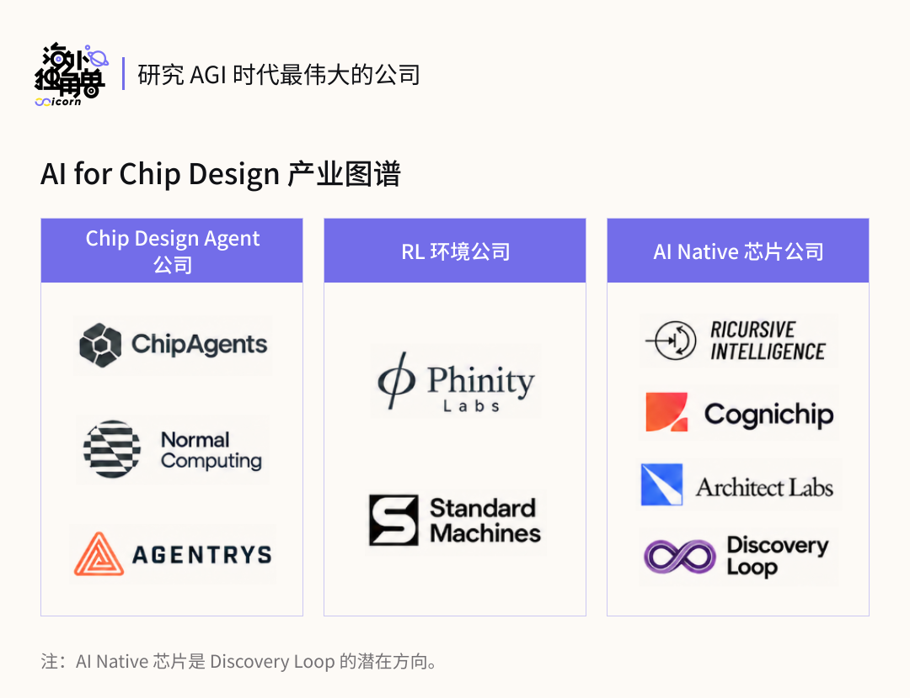

⁠

⁠

04.

## 大模型公司在芯片设计的动作

⁠

在看这个领域的创业公司之前，我们也可以先看一下模型厂在芯片设计领域的动作。具体而言，Anthropic 更关注在少数如生物医药等高价值研究领域，而 OpenAI 则更希望覆盖广泛的商业与工业软件，因此在芯片设计领域的进展也更为明显。

⁠

## 加速自研芯片：

⁠

模型公司本身是芯片需求大户，拥有很强的动力自研芯片。它们理解芯片所需要的能力和参数。自己参与芯片设计，就可以把这些需求提前纳入硬件，实现成本降低。

⁠

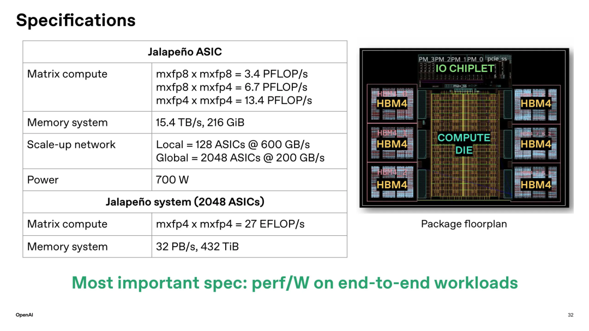

⁠

2026 年 6 月，OpenAI 与 Broadcom 公布了面向大模型推理的 Jalapeño 芯片。OpenAI 围绕模型需求设计架构，Broadcom 提供芯片实现与网络技术。双方披露，项目从初始设计到流片约用了九个月，OpenAI 的模型参与了部分设计与优化工作。模型帮助团队探索不同实现方案，缩短设计与验证之间的迭代，并优化芯片中的运算电路。最终签核仍然使用标准 EDA 流程；芯片回片后，团队又使用 Codex 优化运行模型的软件。优化后的 attention 和 MoE kernel 比人类专家手写实现快 1.5–1.8 倍。

⁠

而另一边，Anthropic 也在组建自研芯片团队。也在招聘为 Claude 开发定制芯片的人员，工作覆盖架构定义、流片和回片调试，为量产准备。

⁠

这里更多还是满足模型公司自己的需求，对这个领域的创业公司影响暂时相对有限。但大模型公司入场之后，也会加速各家芯片公司对 AI 芯片设计的重视程度，利于渗透的提升。

⁠

## 联手开发芯片专用模型：

⁠

2026 年 9 月 30 日，OpenAI 与 Synopsys 宣布合作开发 GPT-Synopsys。双方计划让模型学习直接操作 Synopsys 工具，理解工具输出，并围绕功耗、性能和面积等目标反复修改设计。OpenAI 将获得 Synopsys EDA 工具许可，用于专用模型开发。

⁠

合作同时双方约定收入分成，并计划将计算资源、模型和工具许可证打包提供。公告称，已经与领先半导体客户开展早期技术合作。这让客户未来可能从同一套服务中获得模型能力和 EDA 工具，减少自行集成的工作。

⁠

这展示了一种 EDA 商业模式的新方向：从单独提供工具许可，延伸到同时提供模型与计算服务，并可能按照 token 进行付费。这对希望自己开发芯片专用模型的公司来说形成强大的竞争压力。

⁠

## Coding Agent 成为使用 EDA 的入口

⁠

从另一方面，EDA 巨头也主动向 Coding Agent 靠拢，并开放接入。2026 年 2 月，EDA 巨头 Siemens 发布 Questa One Agentic Toolkit，明确支持 Claude Code、Cursor 等编程工具。它提供 RTL 生成、验证计划和调试等功能，通过 MCP 接口连接自家的验证工具，公告时向客户提供早期接入。

⁠

这表明了 Coding Agent 希望成为工程师使用的工具，并接入相关的 EDA 厂商开展操作。EDA 是重要入口，但模型与 EDA 合作未必足以形成完整闭环。 EDA 提供设计、仿真和验证工具，但大量设计经验及流片反馈仍掌握在芯片公司手中。因此，要持续改进设计能力，可能还需要芯片公司的数据和实际项目参与。

⁠

⁠

05.

## Chip Design Agent 公司：用 Agent 加速芯片开发

⁠

这类公司提供面向芯片设计的 Agent，接入客户已有的 EDA 工具，大型芯片设计公司是其重要目标客户。芯片设计公司的流程复杂，一旦出错，可能需要重新流片，增加成本并延误上市，因此通常从审慎试点开始：先检查工具能否接入现有流程，再用小模块或历史设计评估效果，通过后才扩大到真实项目。试点的规模和周期各不相同。一个典型例子是由少于十人的团队使用约四五个许可证，投入数十万美元，观察一年至一年半后再决定是否扩大使用。

⁠

这类公司的优势，在于深入进入客户的真实工作流程，深度绑定后建立长期壁垒。过程中积累该客户的历史问题和有效处理方法，把工程经验沉淀并 close the loop。这是帮助芯片公司 AI 提效最直接的办法，可以在特定领域中实现 RSI。而这类公司面临的挑战，除了模型公司下场竞争以外，也存在大型 EDA 厂商可能通过接口限制第三方 Agent 的风险。

⁠

## ChipAgents

⁠

ChipAgents 从芯片设计与验证切入，希望让 Agent 承担工程师日常耗时的工作：读懂已有代码，按照规格完成修改，再调用仿真和验证工具检查结果、定位问题。产品接入客户已有的开发环境，处理 RTL 和设计规格，也结合验证代码、仿真日志与波形开展分析，让代码修改和验证反馈形成持续迭代的工作流。

⁠

公司已在 AWS Marketplace 上架 ChipAgents，同时支持在客户自己的 AWS 环境中部署，使设计 IP 保留在客户控制的基础设施内。这种 SaaS 部署方式有助于降低客户的部署门槛，推动产品推广。

⁠

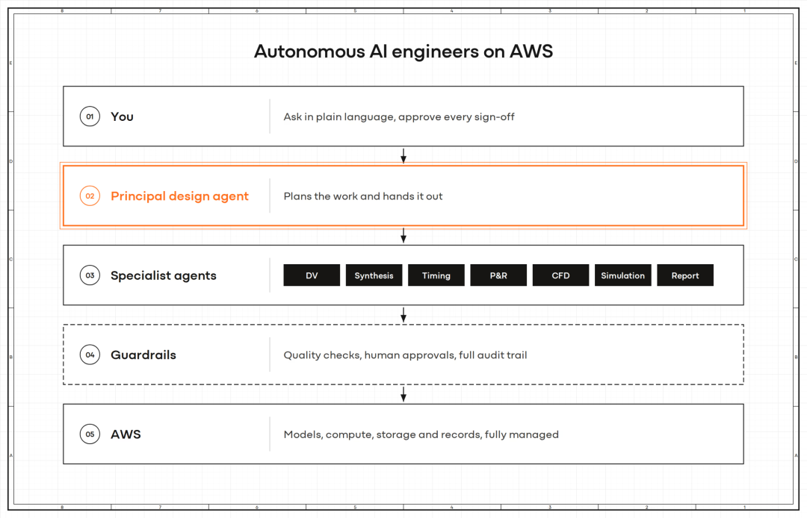

⁠

在 Agent 产品之外，公司也开始开发面向芯片工程的微调模型。2026 年 6 月 17 日，ChipAgents 发布首个微调模型 Renoir，以一个开放权重的 MoE 模型为基础，训练任务覆盖 RTL 生成和规格理解，也包括调试、测试生成及工具使用。

⁠

根据专家访谈，公司收取的是固定费用 + token 费用的模式。以 ADI 为例，公司收取每年 500 万美元的固定费用 + token 费用。token 费用预计从低于 500 万美元上涨到 2000 万美元量级，已经约等于公司在一家传统 EDA 巨头上的花费。

⁠

公司创始人兼 CEO 为 William Yang Wang，是 UCSB 计算机科学教授及 NLP 研究组负责人。ChipAgents 成立之初，大部分团队成员来自 UCSB。2026 年 7 月 29 日，公司宣布新增 $6,000 万 Series A2 融资，由新投资方 B Capital 领投，Bessemer、Micron、MediaTek 和 Ericsson 等参与投资。同期公司披露，2026 年上半年 ARR 增至原来的六倍，产品已部署到超过 120 家半导体公司，包括同时也是投资方的 Micron 和 MediaTek。

⁠

## Agentrys

⁠

Agentrys 由曾在 NVIDIA 主导 ChipNeMo 项目的 Mark Ren 创办。如果说 ChipNeMo 还停留在通过问答、脚本生成和缺陷总结来辅助工程师，那么 Agentrys 则更进一步：让 Agent 直接使用已有的 EDA 工具，连续完成设计任务，并根据运行结果自主调整下一步工作。

⁠

公司希望自动化跨越前后端的往返迭代。 芯片开发中的大量工作需要不同岗位反复配合：前端工程师完成 RTL 后，验证工程师检查功能，后端工程师运行综合与布局布线。如果最终发现频率不达标，问题往往需要返回前端解决：修改逻辑、调整流水线，再重新验证并评估物理实现结果。Agentrys 希望让 Agent 接手这段跨越代码、工具和不同工序的工作。

⁠

公司在 2026 年 6 月发布的 Composable Silicon 技术报告展示了这一思路。实验围绕一颗小型 CPU，并用多个 Agent 分别负责需求、RTL 电路代码、功能验证、物理设计和最终检查。

⁠

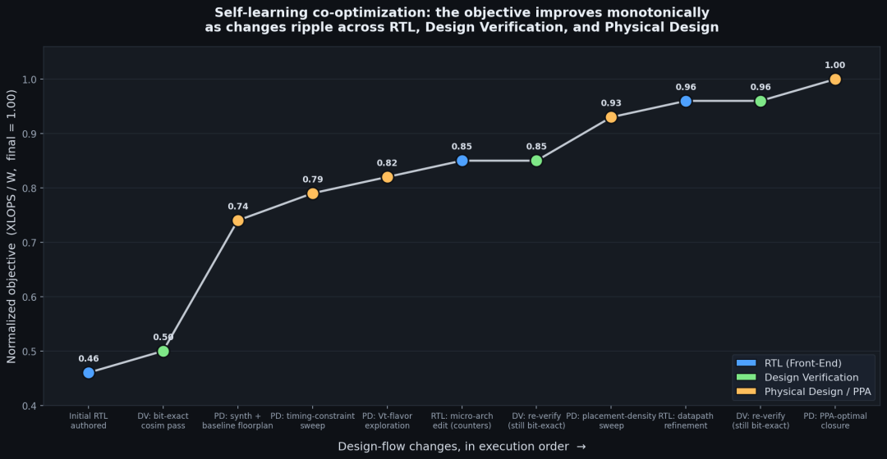

前端设计、功能验证和后端反复配合，提高同一个设计能效

⁠

在产品层面，Agentrys 允许客户围绕自己的工具、基础设施和设计数据构建 Agent。芯片公司的内部流程差异很大：同一项验证任务，可能涉及不同的脚本、代码组织方式和检查标准。可定制的平台让企业能够把这些内部经验纳入自动化流程，并通过执行记录持续积累可复用的工具使用方法和设计经验。

⁠

2026 年 8 月，公司宣布累计融资 $2,450 万，其中包括联发科领投的 $540 万 Pre-seed 轮，以及 Etna Labs 领投的 $1,910 万种子轮。

⁠

## Normal Computing

⁠

Normal Computing 在 2022 年成立时定位为热力学计算芯片公司，主张从热力学原理出发、共同设计算法与硬件，在 2025 年 6 月完成全球首个数字 CMOS 热力学计算芯片流片，面向扩散模型推理。

⁠

目前公司同时开发芯片设计软件与新型计算硬件，拥有软件产品 Normal EDA ，支持本地部署，并利用客户数据对模型进行后训练。2026 年 3 月，公司披露已与全球前十大半导体公司中的过半数建立合作。

⁠

公司由 CEO Faris Sbahi 等人联合创立，创始团队来自 Google Brain、Google X 和 Palantir；2026 年 3 月完成 Samsung Catalyst Fund 领投的 $5,000 万战略融资，累计融资超过 $8,500 万。

⁠

⁠

06.

## RL 环境公司：帮模型培养芯片设计能力

⁠

芯片设计的壁垒是数据，而真实的设计大多只存在各家芯片公司的内部，因此诞生了专门沉淀数据与环境的公司的机会。这类公司主要面向大模型公司的训练团队，提供芯片设计任务、可运行的 EDA 工具环境，以及判断结果好坏的评分机制。模型可以在环境中反复编写 RTL、运行验证，再根据结果修改设计。现在随着模型能力增强，许多代码题已经无法反映真实工程。因此也诞生了环境公司的机会，以可接受的成本，持续提供贴近真实工程、能够准确评分的训练任务。

⁠

随着 AI 芯片设计越来越受到模型公司的关注，RL 环境有望成为这一领域短期收入增长较快的方向之一，因为它们直接承接模型公司的研发预算，在模型公司也加大对芯片数据的采买的现在，这是短期内确定性最强也是增长最迅猛的一类公司。但与此同时，天花板会受到客户数量、交付成本和需求变化的共同约束。

⁠

## Standard Machines

⁠

Standard Machines 由曾在 Apple GPU 架构团队工作的 Jacob Peake 创立，成立于 2026 年，参加 YC Summer 2026 批次。它面向大模型公司的强化学习、后训练和数据团队，提供芯片设计训练环境与评测。其商业定位是为模型开发者提供训练基础设施。 客户可以将模型接入环境，让它反复执行设计任务，收集执行过程与奖励信号用于训练。

⁠

公司认为现有评测偏向短代码题，不能代表真实工程。公司将训练任务组织成一个可以反复运行的工程循环。每个任务先规定电路要完成什么计算、如何输入输出，以及必须满足的物理约束，再由 Agent 自行选择内部结构。

⁠

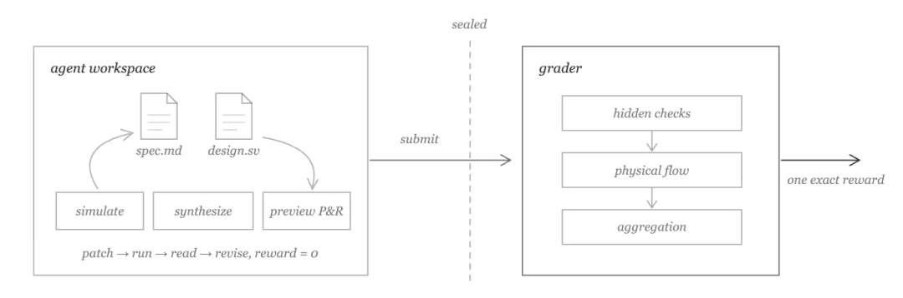

⁠

Agent 在 Sandbox 中工作，工作区包含规格说明和它自己的文件，并安装了真实的 EDA 工具。它可以将有限预算用于当前设计的布局布线预览，在回合中途看到真实的面积、时序和功耗数据，从而发现时序不达标，并在最终确定架构前进行修改。

⁠

为了检验模型是否学会了新任务，公司按任务来源划分训练集与测试集。评测同时固定模型、工具和尝试预算，并报告成功率、失败阶段及执行成本。目前开发环境使用的是固定的开源工具流程，主要作用是在相同条件下比较不同方案。客户可以接入自己的工艺库和经过认可的工具流程。

⁠

创始人兼 CEO 是 Jacob Peake，曾任 Apple GPU 架构师，是 Apple GPU 架构团队的首位实习生及最年轻入职者。公司成立于 2026 年，参加 YC Summer 2026 批次。已经获得 YC、以及来自 Anthropic、OpenAI、Google 等公司的个人投资者支持。

⁠

## Phinity Labs

⁠

Phinity Labs 是一家训练 AI 自主设计芯片的初创公司，目前通过为前沿模型实验室提供芯片设计训练基础设施开展业务，长期目标是让用户描述需求后，AI 自动完成从架构探索到流片的全过程。

⁠

Phinity 为模型实验室提供训练环境、评分系统和性能数据。自 2026 年中发布平台首版以来，他们已经与全球领先的前沿实验室建立合作，ARR 已经在短时间内到达八位数。

⁠

两位创始人 Sonya Jin 和 Aadi Nashikkar 在斯坦福学习计算机科学时相识。Sonya 曾为 NVIDIA 的芯片设计与代码推理模型构建合成数据管线，并在 AWS AI Lab 从事图机器学习研究；Aadi 曾任一家 YC 创业公司的联合创始人兼 CTO，后来创办的合成数据与资产平台被收购。公司于 2026 年 10 月宣布完成 $5.2M 种子轮融资，由 Uncork Capital 领投，Moxxie 和 Jeff Dean 等参与。

⁠

⁠

07.

## AI Native 芯片公司：芯片设计的能力平权

⁠

AI 有望降低定制芯片的设计门槛，让更多拥有独特计算需求的企业获得专用硬件。 过去，自研芯片需要组建专业团队，并承担从架构开发到验证、流片的投入。只有足够大的业务规模，才能摊薄这些固定成本。随着计算支出扩大，围绕特定工作负载优化硬件的经济价值也在增加：即使效率只改善一部分，长期运行所节省的成本也可能相当可观。

⁠

成熟芯片公司的优势，来自多年积累的可复用 IP、经过验证的代码和工程经验。AI 则有机会加快新进入者理解代码、生成设计和处理问题的速度，让规模较小的团队也能组织更复杂的设计流程。不过，成熟芯片公司和 EDA 厂商仍然积累了大量专利、可复用 IP 和工程经验，长期验证过的设计流程很难被快速替代。业内人士普遍认为至少在未来五年，不会发生对传统 EDA 的完整替代。

⁠

我们认为，AI 降低设计门槛后，有望打开定制芯片的增量市场，让过去无力组建完整设计团队的企业也能拥有专用硬件。但这个领域是否能诞生颠覆传统设计流程的新公司，仍然需要长时间的检验。长期来看，芯片产业价值可能从设计服务向工具迁移。 如果客户能够承担更多设计工作，博通这类定制芯片公司的部分设计价值可能被压缩，其角色可能更多转向供应链和产能协调，但他们的 IP 和产能组织能力仍然重要。

⁠

## Ricursive Intelligence

⁠

Ricursive Intelligence 是这一方向的代表之一，由 Anna Goldie 和 Azalia Mirhoseini 创立。两人曾在 Google 共同创建并领导 AlphaChip 项目，利用 RL 优化宏单元布局，并将相关方法用于实际芯片设计。

⁠

Ricursive 希望降低企业拥有定制芯片所需的设计门槛，这一愿景概括为从“fabless”走向“designless”：过去，企业可以将制造交给晶圆厂，但仍需组织自己的设计团队；未来，企业有机会将更完整的设计工作交给外部平台，由需求出发，得到可以进入制造环节的设计。

⁠

公司认为传统设计流程中的一些工具单次运行就要很久。如果 AI 每提出一个方案，都必须等待漫长的评估，那么即使模型能生成很多方案，也无法高效筛选。Ricursive 的思路是先大幅加速底层分析与优化工具，再让 AI 围绕这些工具进行反复搜索。

⁠

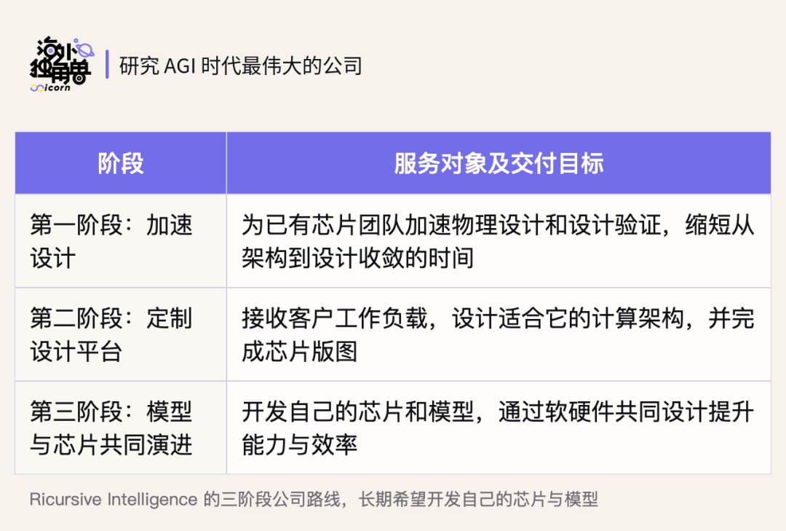

⁠

2025 年 12 月，公司公开亮相，宣布获得 Sequoia 领投的 $3,500 万种子轮融资，估值 $7.5 亿。2026 年 1 月，公司又完成 Lightspeed 领投的 $3 亿 A 轮融资，投后估值达到 $40 亿，参与方包括 DST Global、NVentures、Felicis 和 Sequoia，两轮累计融资 $3.35 亿。

⁠

## Architect Labs

⁠

Architect Labs 是一家利用 AI 加速定制 ASIC 开发的芯片设计公司。公司认为目前的芯片设计流程封闭且割裂，局部工具提效难以根本性缩短整芯片开发周期。因此希望重建统一流程，让有工作负载需求的企业也能获得定制设计，而不必先组建完整芯片公司。

⁠

Architect 同时在 post-train 面向芯片设计的专用模型，为自动化流程提供底层能力。在一项研究中，公司以 Kimi-K2.5 为基础，将模型在 CVDP 的 198 道单轮 Verilog 任务上的首次通过率从 48.4% 提高至 54.5%，与同一评测环境下的 Claude Opus 4.6 持平。

⁠

Architect Labs 由 Ebrahim Hussain 和 Aaditya Subedi 联合创立。按官网介绍，Hussain 曾在 Stanford 从事研究，并在 Apple 和 Tesla 的芯片团队工作。创始技术成员来自 Meta AI 芯片团队、Anthropic、xAI 和 Google DeepMind 等。公司于 2026 年 6 月宣布获得 Kindred Ventures 领投的 $2,400 万种子轮融资，TQ Ventures、Race Capital 和 Together Fund 等机构参与，个人投资者包括 Jeff Dean、Srinivas Narayanan、Lukasz Kaiser 和 Aravind Srinivas 等。

⁠

## Cognichip

⁠

Cognichip 以面向半导体设计的物理信息模型为核心，希望让模型学习设计逻辑与物理约束，再用于具体工程任务。目前公司以训练模型为主要目标。

⁠

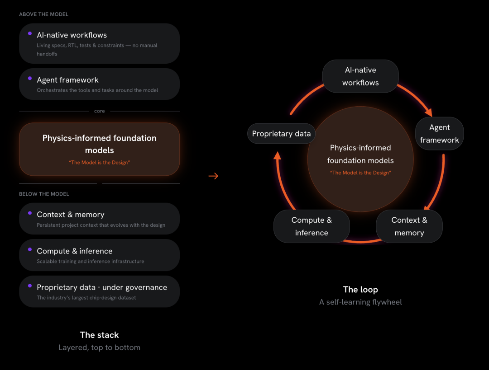

⁠

2026 年 9 月 14 日，Cognichip 发布 ACI Enterprise，将专用模型与 Agent 框架、上下文及记忆管理结合，并接入设计工作流。公司披露，ACI Enterprise 已在 40 多项客户合作项目中运行，并公布了 Renesas 和 SiTime 工程的反馈，应用包括分析和改进规格、规划新功能，以及创建和验证 IP。

⁠

创始人兼 CEO Faraj Aalaei 此前曾领导芯片公司 Aquantia 和 Centillium。2026 年 4 月 1 日，Cognichip 宣布完成 Seligman Ventures 领投的 $6,000 万 A 轮融资，SBI Investment 参与，Mayfield、Lux Capital 等原有投资方继续加注，累计融资达到 $9,300 万。英特尔 CEO 陈立武也以个人身份参与本轮投资，并与 Seligman Ventures 管理合伙人 Umesh Padval 一同加入公司董事会。

⁠

⁠⁠⁠

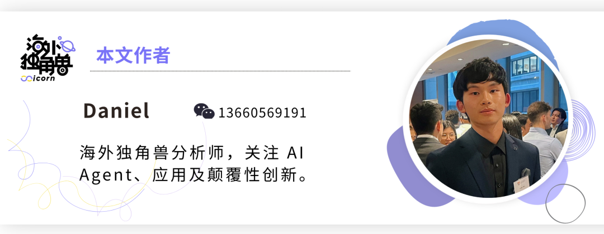

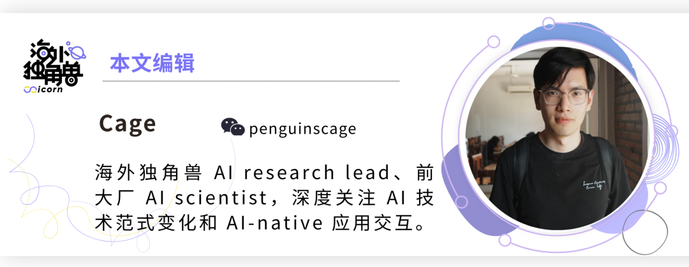

⁠⁠⁠

延伸阅读

⁠

深度讨论 Personal Agent：“最互联网”的 AI 命题

›

⁠

智能进步的复利：从 RSI 加速到持续学习

›

⁠

线虫、多巴胺与股份公司：进化给 RSI 的启发

›

⁠

为什么 CPU 重新变得重要？

›

⁠

和一线研究员的闭门讨论：蒸馏变难后，下一步的重点是什么？

›
